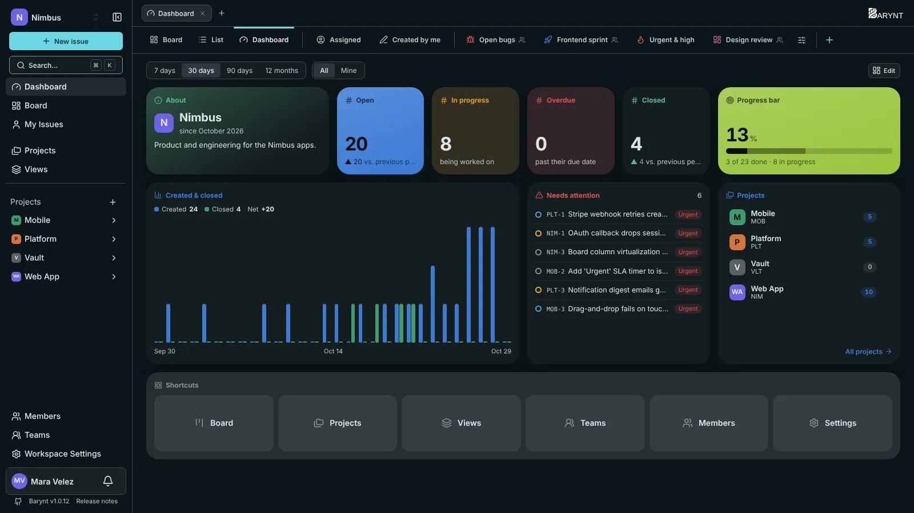
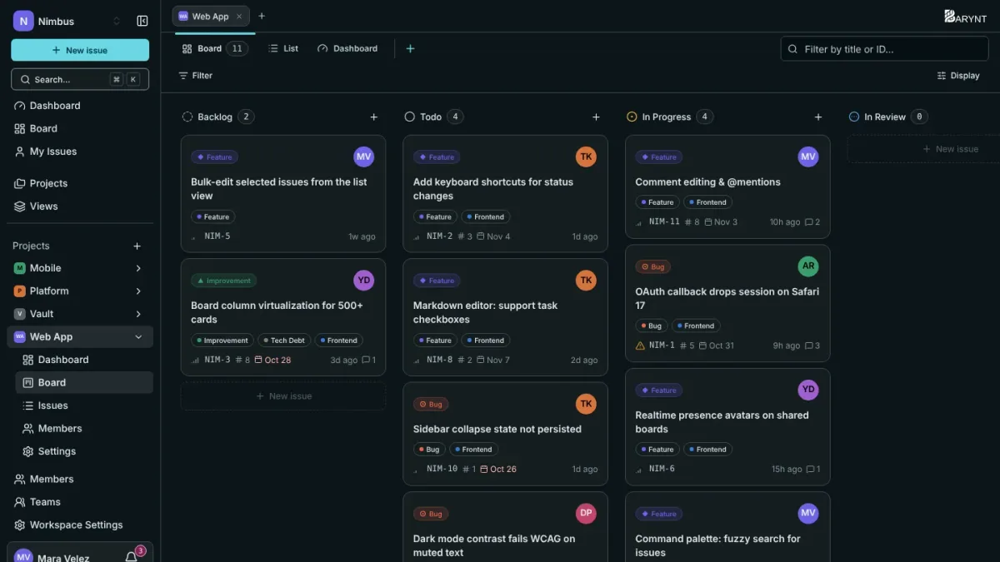
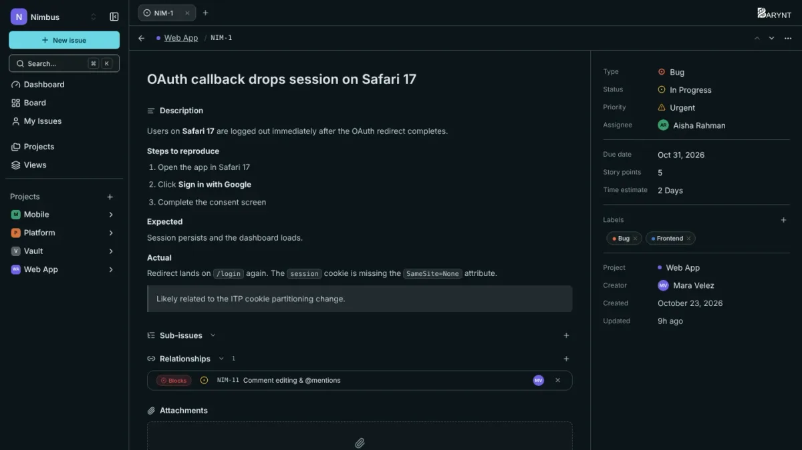
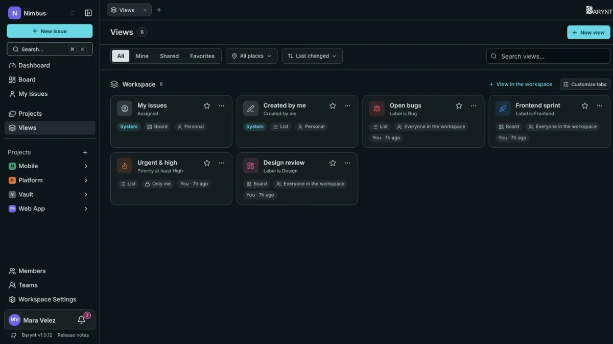
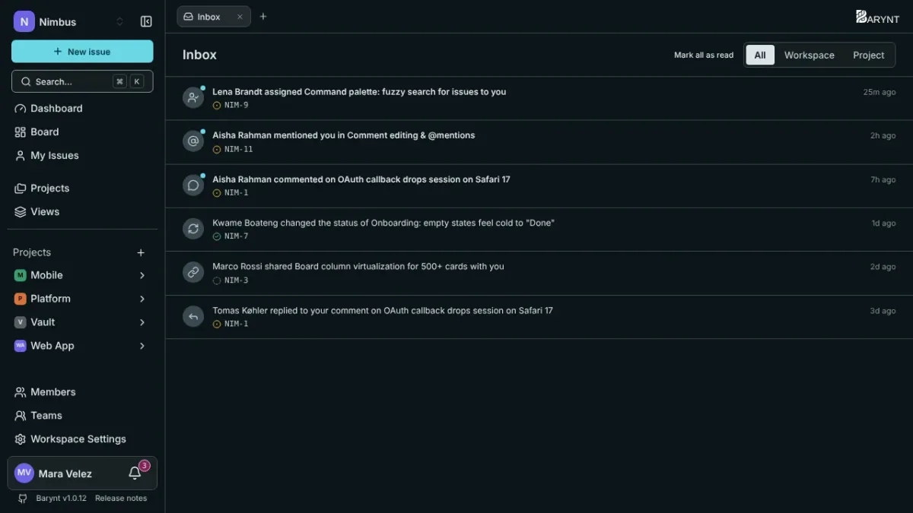
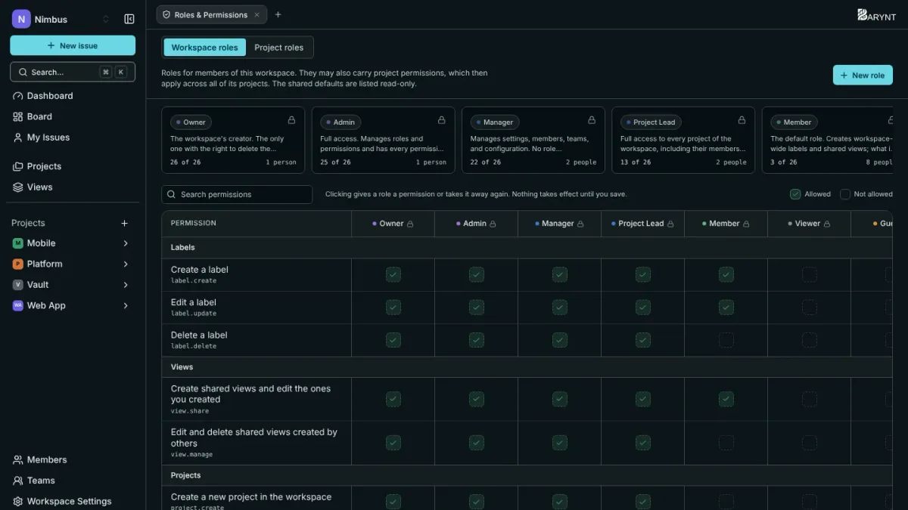
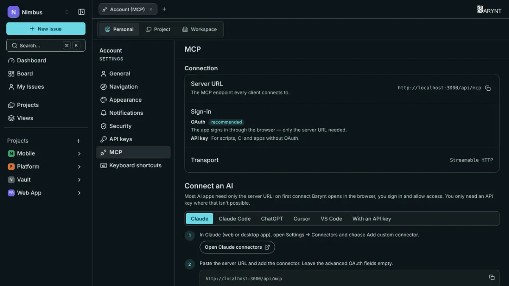

<p align="center">
  <a href="https://github.com/Jafoson/Barynt">
    <picture>
      <source media="(prefers-color-scheme: dark)" srcset="public/Logo/white/Logo_horizontal.svg">
      
    </picture>
  </a>
</p>

<h3 align="center">The issue tracker you host yourself.<br>Fast like Linear, flexible like Jira, yours like nothing else.</h3>

<p align="center">
  Boards, lists, dashboards and a keyboard-first workflow for your team, with roles, SSO and an API included.<br>
  One <code>curl</code> to install. MIT licensed. No seats, no tiers, no tracking.
</p>

<p align="center">
  <a href="https://github.com/Jafoson/Barynt/releases/latest"></a>
  <a href="https://github.com/Jafoson/Barynt/actions/workflows/tests.yml"></a>
  <a href="https://github.com/Jafoson/Barynt/actions/workflows/docker-build.yml"></a>
  <a href="https://github.com/Jafoson/Barynt/actions/workflows/security.yml"></a>
  <a href="LICENSE"></a>
  <a href="https://github.com/Jafoson/Barynt/stargazers"></a>
</p>

<p align="center">
  <a href="#-quick-start"><b>Quick start</b></a> ·
  <a href="#-what-you-get"><b>Features</b></a> ·
  <a href="docs/guide/en/getting-started/intro.md"><b>User guide</b></a> ·
  <a href="docs/dev/README.md"><b>Developer docs</b></a> ·
  <a href="#-contributing"><b>Contribute</b></a>
</p>

<p align="center">
  
</p>

---

## Why Barynt?

Most issue trackers make you pick: a slick tool that lives in someone else's cloud, or a self-hosted one that feels like 2009. Barynt is neither.

- **It is fast and it feels good.** Everything has a shortcut, `⌘K` finds anything, lists move with `j`/`k`, and it works just as well on a phone as on a desktop.
- **It is yours.** One Docker image and one Postgres. Your data, your server, your rules. SSO with GitHub, Google, GitLab, Microsoft, Apple or any OIDC provider is **free**, not an enterprise upsell.
- **It fits how teams really work.** Statuses, priorities, types and labels per workspace, saved views, sub-issues and relations, custom roles, private projects, public share links.
- **It talks to your tools, and to your AI.** A documented REST API, signed webhooks, and a built-in **MCP server**, so Claude, ChatGPT or Cursor can read and update your issues, signing in as you, with your permissions.

## ✨ What you get

<table>
  <tr>
    <td width="50%" valign="top">
      <h4>🗂 Boards, lists and views</h4>
      Kanban board, dense list, group by anything, filter with a visual builder, save the result as a <b>view</b> and share it with the team.
    </td>
    <td width="50%" valign="top">
      <h4>📊 Dashboards that answer questions</h4>
      Open, overdue, created vs. closed, workload and flow metrics, with widgets you arrange yourself, per project or per workspace.
    </td>
  </tr>
  <tr>
    <td valign="top">
      <h4>✍️ A real editor</h4>
      Rich text with a <code>/</code> menu, <code>@mentions</code>, <code>#issue</code> links, code blocks, images, reactions and threaded comments.
    </td>
    <td valign="top">
      <h4>🔐 Roles and permissions done properly</h4>
      Platform, workspace and project roles, custom roles, teams, private projects and invite links. Every check happens on the server.
    </td>
  </tr>
  <tr>
    <td valign="top">
      <h4>⌨️ Keyboard first</h4>
      Command palette, single-key actions for status, priority, assignee and labels, <code>g</code>-then-letter navigation. Remap what you like.
    </td>
    <td valign="top">
      <h4>🔔 Inbox and notifications</h4>
      An in-app inbox plus optional email, per event and per person. Nobody gets pinged about their own actions.
    </td>
  </tr>
  <tr>
    <td valign="top">
      <h4>🤖 MCP server for AI assistants</h4>
      Connect Claude, ChatGPT, Cursor or VS Code with just the server URL (OAuth 2.1, no key to paste). 37 tools, all permission-checked.
    </td>
    <td valign="top">
      <h4>🔌 API and webhooks</h4>
      A REST API with scoped keys, a documented filter language and rate limits, plus HMAC-signed webhooks for issues, comments and views.
    </td>
  </tr>
  <tr>
    <td valign="top">
      <h4>🧾 Audit log</h4>
      Who signed in, who changed whose role, who deleted what. Plus break-glass access for support, always with a reason on the record.
    </td>
    <td valign="top">
      <h4>🌍 English and German</h4>
      The whole app and the user guide, in both languages. Dark and light theme, and more.
    </td>
  </tr>
</table>

<details>
<summary><b>And a lot more</b></summary>

<br>

- Sub-issues, blocks / relates-to / duplicates, estimates, story points, due dates
- Drag-and-drop ranking that writes one row, not the whole column
- Public, read-only share links for single issues, with optional email
- Invitations by email or by link, to a workspace or straight into a project
- Passkeys (WebAuthn) by default, magic-link sign-in, and invite-only mode
- File attachments and avatars on any S3-compatible storage (RustFS bundled)
- Workspace domains: people with your company address join automatically
- Editable email templates, platform administration, account list with last-seen
- Tabs like a browser: open issues and pages side by side
- Health endpoints, a Helm chart, signed images and a signed installer

</details>

## See it

<table>
  <tr>
    <td width="50%"><br><sub><b>The board:</b> columns by status, cards with everything you need.</sub></td>
    <td width="50%"><br><sub><b>An issue:</b> the fields you need stay in reach while you scroll.</sub></td>
  </tr>
  <tr>
    <td><br><sub><b>Views:</b> save a filter once, share it with everyone.</sub></td>
    <td><br><sub><b>Inbox:</b> what happened, and what needs you.</sub></td>
  </tr>
  <tr>
    <td><br><sub><b>Roles:</b> see exactly who can do what.</sub></td>
    <td><br><sub><b>MCP:</b> hand your issue tracker to your AI assistant.</sub></td>
  </tr>
</table>

Press <kbd>⌘K</kbd> anywhere to jump to an issue, a page or an action.

## 🚀 Quick start

### Run it on your server (one command)

On any Linux server with Docker, point a domain at it and run:

```bash
curl -fsSL https://github.com/Jafoson/Barynt/releases/latest/download/install.sh | sh
```

The installer asks a few questions, sets up Barynt with HTTPS (Caddy, automatic Let's Encrypt) and waits until it is healthy. Afterwards the same script is your `barynt` command: `barynt upgrade`, `backup`, `restore`, `logs`, `doctor` and more. No questions, for automation: add `-s -- --domain issues.example.com --yes`. Want to read it first? Download it, `less install.sh`, then `sh install.sh`.

### Prefer something else?

| You want | Do this |
| --- | --- |
| **Docker Compose** by hand | Three files, no clone: see [Docker Compose](docs/guide/en/getting-started/compose.md) |
| **Kubernetes** | `helm install barynt oci://ghcr.io/jafoson/charts/barynt` (signed chart), see [Helm](docs/guide/en/getting-started/helm.md) |
| **Try it on your laptop** | [Local development](#-develop-locally), five minutes with Bun and Docker |

New to it? Start with the [first steps](docs/guide/en/getting-started/first-steps.md): create a workspace, a project and your first issue.

### Updating

Change the image tag (or run `barynt upgrade`). The app applies pending database migrations itself before it starts, so there is nothing else to run. All details in [Manage your installation](docs/guide/en/getting-started/manage.md).

## 🧰 Built with

| | |
| --- | --- |
| App | [Next.js 16](https://nextjs.org) (App Router), React 19, TypeScript |
| Data | PostgreSQL through [Prisma 7](https://www.prisma.io) |
| Sign-in | [Auth.js](https://authjs.dev): passkeys, OAuth/OIDC, magic links |
| Editor | [Tiptap](https://tiptap.dev) / ProseMirror |
| Styling | SCSS Modules, no Tailwind |
| Optional | Redis (API rate limit), any S3-compatible storage, SMTP |
| AI | [Model Context Protocol](https://modelcontextprotocol.io) server at `/api/mcp` |
| Tooling | [Bun](https://bun.sh), [Biome](https://biomejs.dev), Bun test runner |

One app, one database, no microservices. [How it fits together](docs/dev/architecture.md).

## 📚 Documentation

| | |
| --- | --- |
| **[User guide](docs/guide/en/getting-started/intro.md)** | For people who use and run Barynt: concepts, every feature, administration, SSO, email, storage, troubleshooting. English and German. |
| **[API reference](docs/guide/en/api-reference/workspaces.md)** | Every REST route with parameters and examples, the [filter language](docs/guide/en/api-reference/filters.md), [webhook events](docs/guide/en/api-reference/webhook-events.md) and [MCP tools](docs/guide/en/api-reference/mcp-tools.md). |
| **[Developer docs](docs/dev/README.md)** | For people who change Barynt: setup, architecture, data model, authentication, permissions, testing, release. |
| [`CLAUDE.md`](CLAUDE.md) | The project's rules in short form, also read by AI coding assistants. |

## 🛠 Develop locally

You need [Bun](https://bun.sh) and [Docker](https://www.docker.com).

```bash
bun install
cp example.env .env      # defaults match docker-compose.yml
bun run db:dev           # Postgres + Redis, migrations, demo data
bun run dev              # http://localhost:3000
```

The demo data is a workspace called **Nimbus** with a person for every role (`owner@nimbus.io`, `member1@nimbus.io`, …), so you can see what each of them may do. Barynt has no passwords: sign in with a passkey, or set up a mail catcher for magic links. The [getting started guide](docs/dev/getting-started.md) walks through it.

| Command | What it does |
| --- | --- |
| `bun run dev` | Dev server |
| `bun run lint` · `bun x tsc --noEmit` | Lint and typecheck |
| `bun run test` | The whole test suite (always this, not `bun test`; [why](docs/dev/testing.md)) |
| `bun run db:dev` / `db:reset` | Services + migrate + seed / start from scratch |
| `bun prisma migrate dev --name <what>` | New migration after a schema change |

## 🤝 Contributing

Issues and pull requests are very welcome, whether it is a typo, a bug or a feature. For anything bigger than a fix, open an issue first so we can talk about it.

1. Read the [contributing guide](docs/dev/contributing.md) (workflow, commit style, checklists)
2. `bun run lint`, `bun x tsc --noEmit` and `bun run test` should be green
3. A change to `prisma/schema.prisma` comes with its migration
4. A change users can see updates the [user guide](docs/guide/) in the same pull request

Found a bug? [Open an issue](https://github.com/Jafoson/Barynt/issues) with what you did, what you expected and the version (shown under your name in the sidebar).

## 📄 License

[MIT](LICENSE). Use it, change it, host it, sell it. If Barynt is useful to you, a ⭐ on GitHub makes our day.
