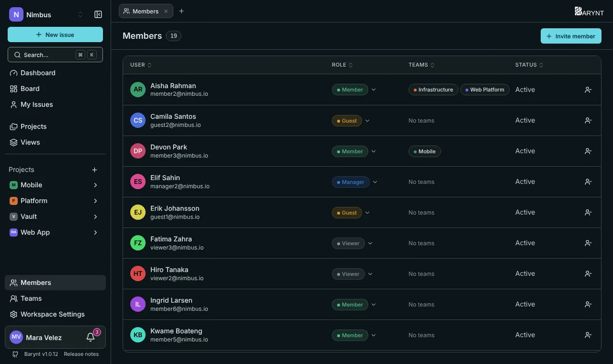
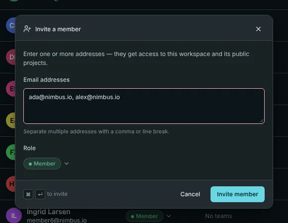
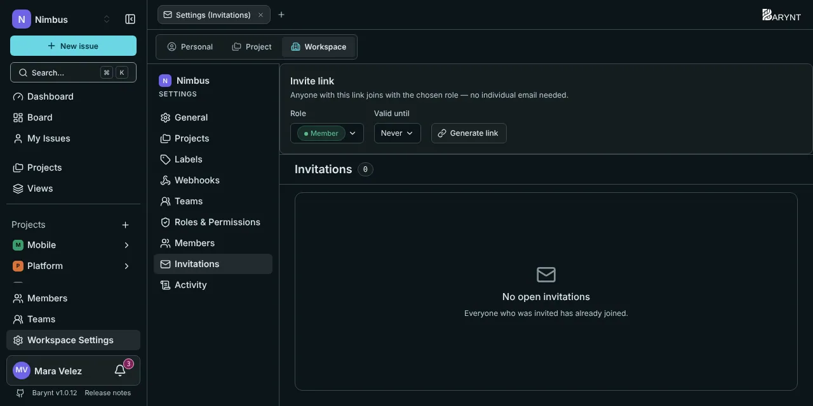

A **member** is a person with access to a workspace. This page covers the three ways of adding people, how to change or remove them, and how to bring in someone from outside for just one project.

## The members list

Open **Members** in the sidebar. You see everyone in the workspace with their **role**, their **teams** and their status (_Active_, or _Invited_ for people who have not accepted yet). You can change a person's role right in the list, and remove them with the button at the end of the row. What you can do depends on your own role, see [Roles and permissions](roles.md).

## Ways to add people

### 1. Invite by email

Click **Invite member**, enter one or more addresses (separated by commas or line breaks), choose a **role** and send.

What happens next depends on the address:

- If the person **already has an account** on this server, they are added straight away. They get a notification, and nothing more is needed.
- If the address is **new**, Barynt creates an invitation. The person gets an email with a link. One click on it sets up their access and they are in. The invitation is valid for **14 days**.

After sending, Barynt tells you for every address what happened: _Now added_, _Invitation sent by email_, or, when no mail server is set up, _Copy this link_ with a button to copy it yourself.

> [!WARNING]
> An invitation for a **new** person is accepted through a sign-in link that is sent by email. If your server has no [mail setup](email.md), those invitations cannot be accepted. Use an **invite link** (below) instead: it works without email.

New members are put into all **public projects** of the workspace automatically, with a starting project role that fits their workspace role.

### 2. An invite link for everyone

Under _Workspace settings → Invitations_, create an **invite link**: choose the role and how long it is valid (never, or a number of days) and click **Generate link**. Anyone who opens it can sign in or create an account and joins with that role. It suits a team chat or an all-hands message. **Revoke** stops it at any moment.

Only one link per workspace is active at a time: generating a new one replaces the old. Use a limited role (_Member_ or _Viewer_) for a link that many people see.

### 3. Automatically, by company domain

If everyone in your company has an address on the same domain, you can let the workspace **claim it**. Anyone who registers with such an address joins automatically as a Member. This is set up under _Workspace settings → General_, see [Workspace settings](workspace.md).

## Open invitations

_Workspace settings → Invitations_ also lists everyone who was invited but has not accepted yet: the address, who invited them, when and when it expires. For each one you can:

- **Resend:** creates a new link and a new 14 days.
- **Revoke:** the link stops working. If the account only existed for this invitation, it is removed as well.

## Changing and removing

- **Change a role:** pick another role in the _Role_ column. You can only assign roles up to your own rank.
- **Remove someone:** click the remove button on the row. Barynt shows how many projects the person is active in and asks you to confirm. They lose access to the workspace and all its projects and are told by email (if mail is set up). Their past work stays: issues, comments and history remain as they were.
- Accounts of people who have left the company can also be **deactivated** by a platform administrator, see [Platform administration](platform.md).

## Inviting someone to just one project

Sometimes you want a client or a freelancer to see **one** project and nothing else.

1. Open the project's **Members** page and click **Add member**.
2. Choose the tab **By email**, enter the address and pick the project role. For people from outside, choose **Guest**.
3. Send.

A **Guest** is added to the project only. They are **not** members of the workspace and see nothing else. Any other project role also adds the person to the workspace as a regular member, and to its public projects.

The same dialog's other tab, **From workspace**, adds people who are already members of the workspace to this project. It is the way to fill a **private** project. The project's _Invitations_ page also has an invite link, which gives a chosen project role.

See [Project settings](project-settings.md) for more on project membership.

## Teams

Instead of adding people one by one, you can put them into a [team](teams.md) and give the team a role on a project.
