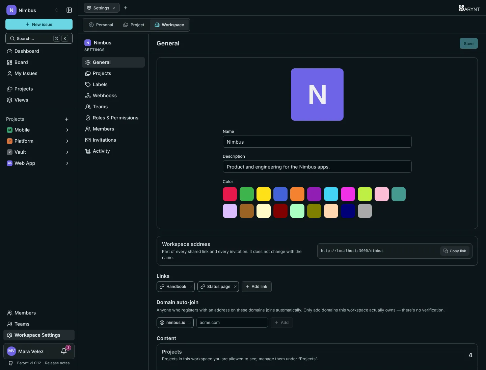

A workspace is the home of one team or company. Its settings live under **Workspace Settings** at the bottom of the sidebar (the _Workspace_ tab). What you see there depends on your role, see [Roles and permissions](roles.md). Changing the basics needs _Change name, color and address_, which owners, admins and managers have.

## General

- **Picture, name and color** show up in the sidebar, in the workspace switcher and wherever the workspace appears next to others. Without a picture, you get the first letter on the color you chose. The **description** is one or two sentences for the overview: what is this workspace for?
- **Workspace address** is the short name that is part of every link and every invitation, like `/nimbus/…`. It is made when you create the workspace and **does not change** when you rename it, so links keep working.
- **Links** are important addresses your team should find fast: the documentation, the repository, the chat. Click **Add link** and give each a label and a URL (starting with `http://` or `https://`). They show up in the dashboard's _Links_ widget.

## Join automatically by company domain

Under **Domain auto-join** you can enter the domain of your company, for example `nimbus.io`. Anyone who then creates an account with an address on that domain **joins this workspace automatically** as a Member, without an invitation. People who already have an account are not affected.

> [!WARNING]
> Barynt does not verify that the domain is yours. Only add domains that your company really owns, and remember that anyone who can receive mail on that domain can get in. For a more controlled setup, use [invitations](members.md) instead.

## What is in the workspace

At the bottom, three numbers give you the size of the workspace: **projects** you may see, **members** and **issues** across all projects.

## Projects, labels and more

The other entries of the workspace settings:

| Entry | What it is for |
| --- | --- |
| **Projects** | All projects of the workspace in two lists, public and private. A click opens one, the pencil edits its details, the bin deletes it. Workspace owners, admins and project leads see the private ones too. See [Projects](../using-barynt/projects.md). |
| **Labels** | The labels that apply in **every** project, with how many issues use each. You can hide a workspace label in single projects. Labels that belong to one project are listed below, for reference. |
| **Webhooks** | Tell other systems what happens, see [Webhooks](../integrations/webhooks.md). |
| **Teams** | See [Teams](teams.md). |
| **Roles & Permissions** | See [Roles and permissions](roles.md). |
| **Members** and **Invitations** | See [Members and invitations](members.md). |
| **Activity** | What happened in the workspace, see [Audit log](audit.md). |

### Workspace labels or project labels?

Use a **workspace label** for distinctions that mean the same thing everywhere, such as `Bug`, `Customer` or `Design`. Use a **project label** for words that only make sense in one project, such as `Sprint 14`. A workspace label is created once and available in every project. If one project does not want it, it can hide it there.

## Working with more than one workspace

Click the workspace name at the top of the sidebar to see all workspaces you belong to and to switch between them. **New workspace** creates another one, if the server allows it. Workspaces are completely separate from each other: members, projects, labels and roles are not shared.

## Deleting a workspace

At the very bottom is the **Danger zone**. Deleting a workspace deletes everything in it for good: its projects, issues, teams, labels and roles. Barynt tells you how many projects and issues will go and asks you to confirm. Only the **Owner** can do it. There is no undo, so make a [backup](../getting-started/manage.md) first if you are not sure.

> [!NOTE]
> A platform administrator can **suspend** a workspace instead. It then becomes inaccessible without losing any data, and can be switched back on. See [Platform administration](platform.md).
