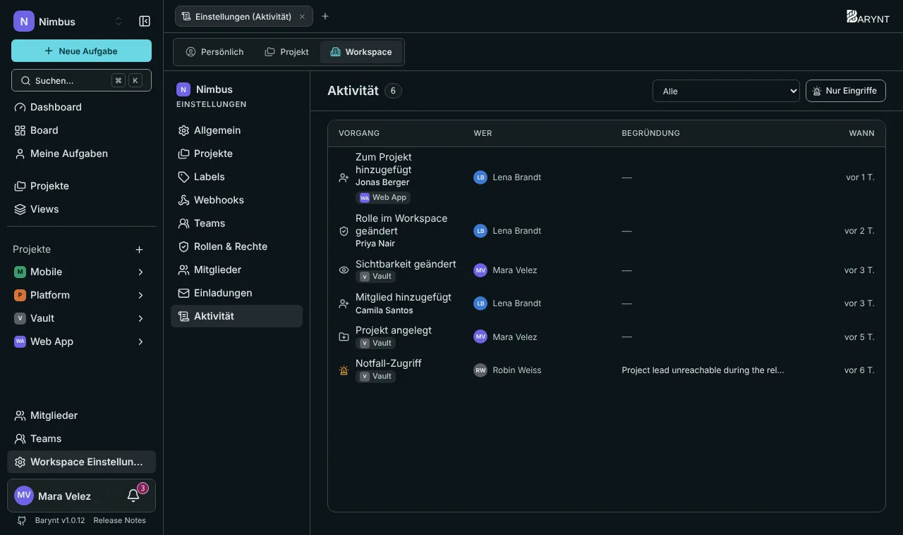

Wenn etwas schiefgeht oder jemand einfach fragt „Wer hat das geändert?“, hat das Audit-Log die Antwort. Es zeichnet auf, **wer** **was** **wann** getan hat und, wo es passt, **warum**. Einträge lassen sich innerhalb von Barynt nicht bearbeiten.

## Wo du es findest

Dasselbe Protokoll wird an vier Stellen gezeigt, jede mit eigener Berechtigung:

| Wo | Was es zeigt | Wer es sieht |
| --- | --- | --- |
| **Aufgabe → Tab Aktivität** | Die Änderungen an dieser einen Aufgabe. | Alle, die die Aufgabe sehen können. |
| **Projekteinstellungen → Aktivität** | Alles, was im Projekt passiert ist. | Project Admins. |
| **Workspace Einstellungen → Aktivität** | Alles im Workspace. | Owner, Admins und Manager. |
| **Admin → Protokoll** | Serverweite Ereignisse: Anmeldungen, Plattform-Rollen, Workspace-Sperren. | Plattform-Administration. |

Jede Liste hat einen **Ereignis**-Filter und den Schalter **Nur Eingriffe**, der den Alltagslärm ausblendet und nur die Einträge behält, die für die Sicherheit zählen.

## Was aufgezeichnet wird

Das Protokoll ist bewusst wählerisch. Es zeichnet **nicht** jeden Seitenaufruf auf, denn ein Protokoll, das niemand liest, schützt niemanden. Es hält fest, was **Rechte verschiebt oder Daten zerstört**, dazu das Alltagsleben von Aufgaben.

**Eingriffe** (die sicherheitsrelevanten Ereignisse):

- Angemeldet, Anmeldung fehlgeschlagen
- Rolle geändert (Plattform, Workspace, Projekt)
- Konto deaktiviert oder reaktiviert
- Notfallzugriff auf ein Projekt (mit Begründung)
- Projekt gelöscht, archiviert oder neu zugeordnet; Workspace gelöscht oder gesperrt
- Mail-Vorlagen und Systemeinstellungen geändert

**Alltagsereignisse** in Workspaces und Projekten:

- Projekte angelegt, Sichtbarkeit geändert
- Mitglieder hinzugefügt oder entfernt
- Aufgaben angelegt, gelöscht, zugewiesen, Zuweisung aufgehoben
- Titel, Beschreibung, Status, Priorität, Typ, Labels, Fälligkeitsdatum, Story Points oder Zeitschätzung geändert
- Unteraufgaben, Beziehungen und Anhänge hinzugefügt oder entfernt
- Kommentare hinzugefügt oder entfernt
- Öffentliche Links erstellt oder widerrufen
- Labels angelegt oder gelöscht, geteilte Views gelöscht

Bei Änderungen an Aufgaben sagt dir das Protokoll, **welcher Aspekt** sich geändert hat („Status geändert“), nicht den alten und neuen Text. So bleibt es lesbar und wird nicht zu einer zweiten Kopie deiner Inhalte.

## Einen Eintrag lesen

Jeder Eintrag zeigt das **Ereignis**, **wer** es war, **wann** und den **Grund**, falls einer angegeben wurde (bei Notfallzugriff ist er Pflicht). Der Name einer Person wird zu diesem Zeitpunkt mit dem Eintrag gespeichert. Wird jemand später umbenannt oder verlässt die Firma, bleiben die alten Einträge, wie sie geschrieben wurden.

## Gut zu wissen

- Das Protokoll beantwortet Fragen im Nachhinein. Für sofortige Benachrichtigung über Ereignisse nutze [Webhooks](../integrations/webhooks.md).
- Eine Plattform-Administration sieht serverweite Ereignisse, aber absichtlich keine Inhalte von Aufgaben. Siehe [Plattform-Verwaltung](platform.md).
