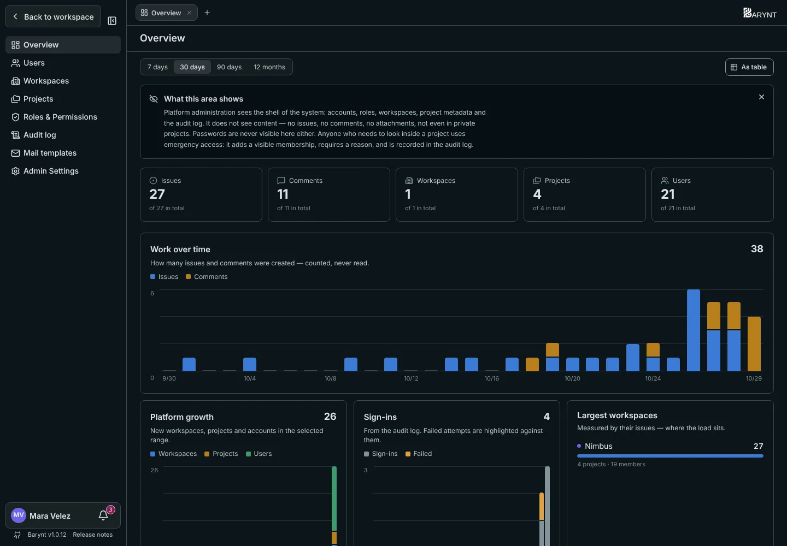

Ein Barynt-Server kann viele Workspaces beherbergen. Die **Plattform-Verwaltung** kümmert sich um den Server als Ganzes: Wer hat ein Konto, welche Workspaces gibt es, und ein paar Regeln, die für alle gelten. Sie ist für die Person oder das kleine Team gedacht, das den Server betreibt, und getrennt von den Workspace-Einstellungen, die Teamleitungen nutzen.

## Wer ist Plattform-Administration?

Wer sich als Erste oder Erster auf einem neuen Server anmeldet, wird automatisch **Platform Admin**. Er kann in der Benutzerliste weitere zu Plattform-Administratoren machen (oder zur eingeschränkteren _Platform Support_). Menschen mit einer Plattform-Rolle sehen im Menü unter ihrem Namen in der Seitenleiste den Eintrag **Admin**. Alle anderen sehen ihn nicht und können ihn nicht öffnen.

## Ein Prinzip: die Hülle, nicht der Inhalt

> [!NOTE]
> Die Plattform-Verwaltung sieht **Konten, Rollen, Workspaces, Projektdaten und das Audit-Log**. Sie sieht **keine** Aufgaben, Kommentare oder Anhänge, auch nicht in privaten Projekten. Passwörter gibt es in Barynt nicht, und nichts hier zeigt Anmeldegeheimnisse.

Das ist Absicht. Wer den Server am Laufen hält, soll nicht automatisch die vertraulichen Pläne der Firma lesen können. In ein Projekt zu schauen braucht einen Notfallzugriff (unten), der sichtbar ist und protokolliert wird.

## Übersicht

Die erste Seite zeigt den Zustand der Plattform: die Summen von **Aufgaben, Kommentaren, Workspaces, Projekten und Benutzern** und, für einen wählbaren Zeitraum, Diagramme zur **Arbeit über die Zeit** (gezählt, nie gelesen), zum **Wachstum der Plattform**, zu **Anmeldungen** mit hervorgehobenen Fehlversuchen und zu den **größten Workspaces**. Ein Block **Braucht Aufmerksamkeit** weist auf deaktivierte Konten, verwaiste Projekte (ohne Owner oder ohne Mitglieder) und die Zahl der Notfallzugriffe der letzten 30 Tage hin.

Gibt es eine neuere Barynt-Version, sagt es eine Karte über deinem Namen und verlinkt auf die Release Notes. Das ist das Einzige, was Barynt von sich aus nachschlägt, und `UPDATE_CHECK=false` schaltet es ab, siehe [Konfiguration](../getting-started/config.md).

## Benutzer

Jedes Konto auf dem Server, über alle Workspaces hinweg: Name, E-Mail, Plattform-Rolle, wie die Person sich anmeldet (_Passkey_ oder _Provider_), in wie vielen Workspaces sie ist und wann sie zuletzt gesehen wurde.

- **Die Plattform-Rolle ändern** geht mit dem Dropdown in der Zeile.
- **Deaktiviere** ein Konto, wenn jemand geht. Die Person kann sich nicht mehr anmelden und hat nirgends Berechtigungen. **Nichts wird gelöscht**: Aufgaben, Kommentare und Zuweisungen bleiben, wie sie waren. Du kannst das Konto jederzeit reaktivieren.

## Workspaces

Alle Workspaces mit Owner, Zahl der Mitglieder und Projekte, Aufgaben und letzter Aktivität.

- **Sperren** schließt einen Workspace ab: Seine Mitglieder verlieren den Zugriff, aber nichts wird gelöscht. Entsperre ihn, und alles ist zurück. Nutze es für eine Abrechnungspause oder während du etwas untersuchst.
- **Löschen** entfernt einen Workspace und alles darin endgültig. Ein Workspace muss vorher gesperrt sein, und du musst zur Bestätigung seinen Namen tippen. Es gibt kein Zurück, mach also vorher ein [Backup](../getting-started/manage.md).

## Projekte

Jedes Projekt auf dem Server, auch private: Owner, Mitglieder, Aufgaben, Erstellung. Du siehst die Metadaten, nie den Inhalt.

- **Neu zuordnen** gibt einem Projekt einen neuen Owner, nützlich, wenn der alte gegangen ist.
- **Archivieren** und **Wiederherstellen** nehmen ein Projekt außer Dienst, ohne es zu löschen.
- **Notfallzugriff** fügt dich einem Projekt hinzu, zu dem du nie eingeladen wurdest, etwa weil seine Leitung nicht erreichbar ist und etwas Dringendes geändert werden muss. Du musst einen **Grund** angeben (mindestens zehn Zeichen). Du erscheinst dann in der Mitgliederliste des Projekts, sichtbar für alle, die dort arbeiten, und der Grund, die Zeit und dein Name kommen dauerhaft ins Audit-Log. Um den Zugriff aufzugeben, entferne dich aus der Mitgliederliste.

## Rollen & Rechte

Die drei Plattform-Rollen, siehe [Rollen und Berechtigungen](roles.md).

## Protokoll

Serverweite Ereignisse: Anmeldungen und Fehlversuche, Änderungen von Plattform-Rollen, Kontodeaktivierungen, Notfallzugriffe, Sperrung und Löschung von Workspaces, Änderungen an Einstellungen und Mail-Vorlagen. Siehe [Audit-Log und Aktivität](audit.md).

## Mail-Vorlagen

Passe Betreff, Überschrift und Einleitung jeder E-Mail an, die Barynt verschickt, mit Live-Vorschau und Test-Knopf. Siehe [E-Mail](email.md).

## Admin Einstellungen

Zwei Regeln für den ganzen Server:

- **Anlegen von Workspaces erlauben.** Ist es ausgeschaltet, kann niemand einen neuen Workspace beginnen. Menschen ohne Workspace werden stattdessen dem **Standard-Workspace** hinzugefügt, den du in der zweiten Einstellung wählst. Das ist die richtige Einrichtung für eine Firma mit einem Workspace, in dem alle am selben Ort landen sollen.
- **Standard-Workspace.** Wo Konten ohne Workspace landen, sobald das Anlegen aus ist. Bis du einen wählst, bleibt das Anlegen faktisch eingeschaltet.
