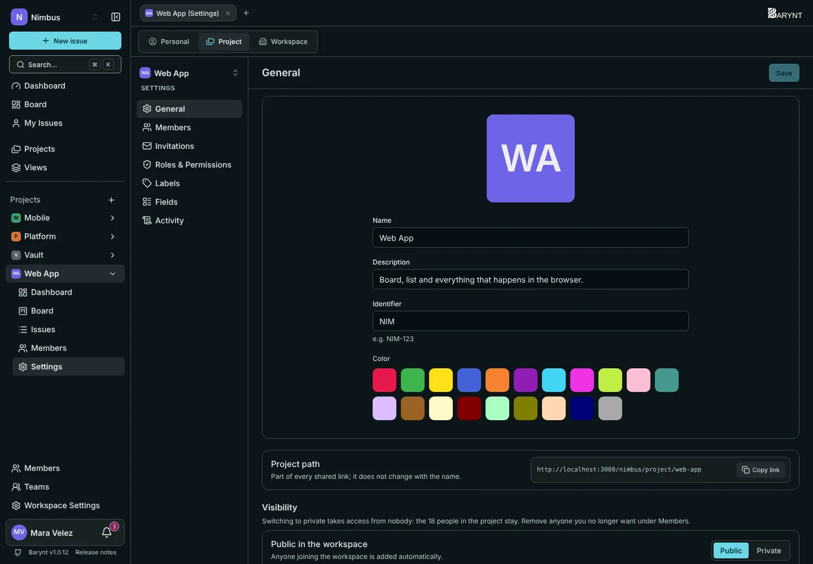
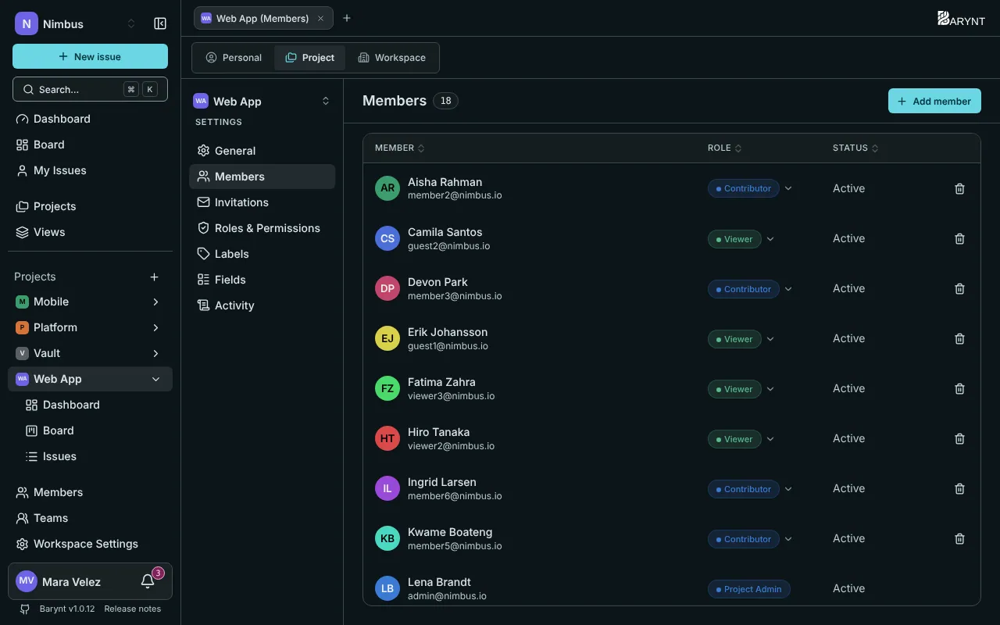

Öffne ein Projekt und klicke auf **Einstellungen** (oder auf den Tab _Projekt_ oben auf jeder Einstellungsseite). Das Menü links hat sieben Einträge. Die meisten brauchen die Rolle **Project Admin**, siehe [Rollen und Berechtigungen](roles.md).

## Allgemein

- **Bild, Name und Farbe** kennzeichnen das Projekt in der Seitenleiste, auf Tabs und auf dem Board. Die **Beschreibung** ist eine Zeile für die Übersicht.
- Der **Bezeichner** ist das Präfix jeder Aufgabennummer, wie `NIM` in `NIM-12`. Wähle ihn sorgfältig: Er ist Teil der Nummern, die Leute zitieren.
- Der **Projektpfad** ist der Teil der Adresse, der zum Projekt gehört, etwa `/project/web-app`. Er ändert sich nicht, wenn du das Projekt umbenennst, damit geteilte Links weiter funktionieren.
- **Sichtbarkeit:** **Öffentlich** (jedes Workspace-Mitglied wird automatisch hinzugefügt) oder **Privat** (nur von Hand hinzugefügte Menschen). Auf privat umzustellen nimmt niemandem, der schon drin ist, den Zugriff. Entferne Menschen, die du nicht mehr willst, unter _Mitglieder_.

Ganz unten löscht die **Gefahrenzone** das Projekt samt allen Aufgaben endgültig. Barynt sagt dir, wie viele Aufgaben das sind, und lässt dich bestätigen.

## Mitglieder

Alle, die im Projekt sind, mit ihrer **Rolle** und ihrem Status.

- **Mitglied hinzufügen** öffnet einen Dialog mit zwei Tabs: **Aus dem Workspace** (bestehende Mitglieder wählen, mit Suchfeld) und **Per E-Mail** (jemand Neues einladen, siehe [Mitglieder und Einladungen](members.md)).
- Die **Rolle** einer Person änderst du mit dem Dropdown in ihrer Zeile. Eine Rolle mit dem Hinweis _aus dem Workspace geerbt_ ist der Startwert aus der Workspace-Rolle. Eine mit _über Team_ kommt von einem [Team](teams.md). Lege hier eine Rolle fest, um sie für diese Person zu überschreiben.
- **Projektrolle entziehen** nimmt jemanden aus dem Projekt. Er bleibt im Workspace.

## Einladungen

Offene Einladungen in dieses Projekt und der **Einladungslink** des Projekts: Wähle eine Rolle (für Menschen von außen _Guest_) und wie lange er gilt, dann erzeuge den Link.

## Rollen & Rechte

Die Rollen, die **nur in diesem Projekt** existieren, neben den geteilten Standardrollen und den Projektrollen des Workspace. Nutze das, um eine Rolle für einen Sonderfall anzulegen. Wie Rollen funktionieren, steht unter [Rollen und Berechtigungen](roles.md).

## Labels

Labels gruppieren Aufgaben quer zu Status und Priorität. Es gibt zwei Arten, auf zwei Tabs:

- **Projekt-Labels** gehören zu diesem Projekt und gelten nur hier. Lege sie mit **Neues Label** an, wähle eine Farbe und sieh, wie viele Aufgaben jedes nutzen. Eines zu löschen entfernt es endgültig von allen Aufgaben des Projekts.
- **Workspace-Labels** kommen aus dem Workspace. Hier kannst du die **ausblenden**, die dieses Projekt nicht will, und später wieder einblenden.

## Felder

Nicht jedes Team will jedes Feld. Schalte sie für dieses Projekt ein und aus:

| Feld | Voreinstellung |
| --- | :---: |
| Priorität | an |
| Anhänge | an |
| Labels | an |
| Beziehungen | an |
| Fälligkeitsdatum | aus |
| Story Points | aus |
| Zeitschätzung | aus |

Ein ausgeschaltetes Feld verschwindet von der Aufgabenseite, aus der Liste, von den Board-Karten und aus dem Filter-Menü. Bereits eingegebene Daten bleiben erhalten, du kannst es also später wieder einschalten. Siehe [Aufgaben im Detail](../using-barynt/issues.md).

## Aktivität

Ein Protokoll dessen, was in diesem Projekt passiert ist: angelegte und gelöschte Aufgaben, Status- und Zuständigkeitsänderungen, hinzugefügte und entfernte Mitglieder, Rollen- und Sichtbarkeitsänderungen. Es braucht die Berechtigung _Das Audit-Log ansehen_ im Projekt. Siehe [Audit-Log](audit.md).
