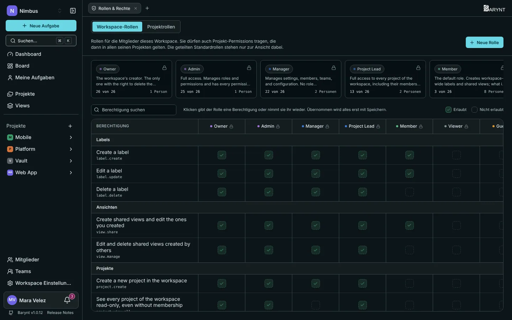
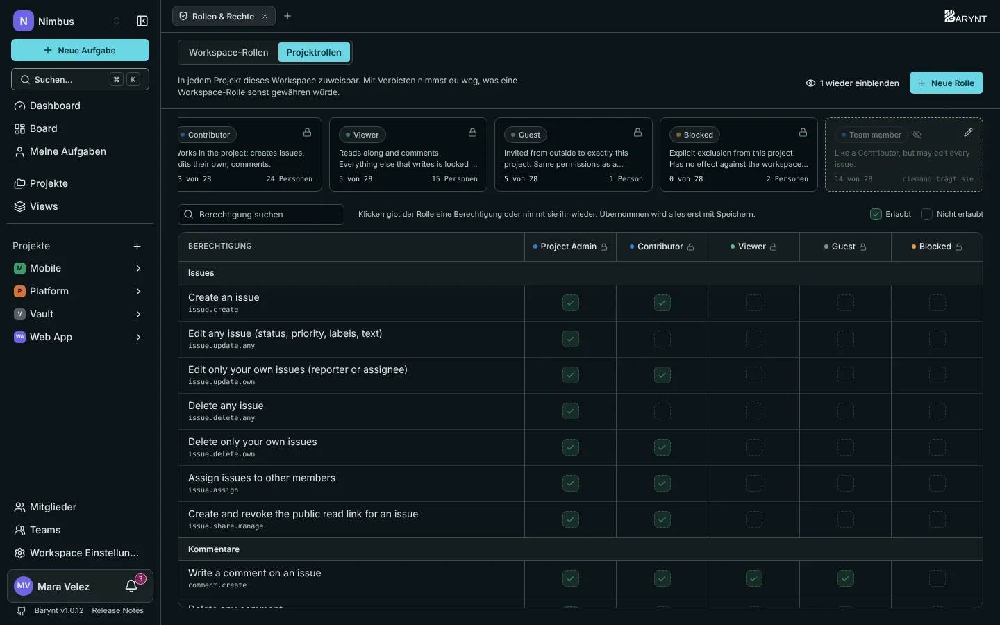

---

title: "Rollen und Berechtigungen"
description: "Wer was sehen und wer was ändern darf, auf drei Ebenen. Beginne mit den fertigen Rollen, baue eigene, wenn du sie brauchst."
sidebar:
order: 4
---

Barynt beantwortet „Wer darf das?“ mit **Rollen**. Eine Rolle ist ein benanntes Bündel von Berechtigungen, etwa _Member_ oder _Admin_. Du gibst Menschen Rollen, und die Rollen entscheiden den Rest. Diese Seite erklärt zuerst die Ideen und listet dann genau auf, was jede fertige Rolle kann.

## Die Idee in einem Bild

Stell dir ein Bürogebäude vor:

- Deine **Workspace-Rolle** ist der Schlüssel zum **Gebäude**. Sie sagt, ob du hineinkommst und was du in den gemeinsamen Bereichen darfst: Menschen einladen, Projekte anlegen, Einstellungen ändern.
- Deine **Projektrolle** ist der Schlüssel zu einem **Raum**. Sie sagt, was du in diesem einen Projekt darfst: Aufgaben anlegen, bearbeiten, löschen.
- Die **Plattform-Rolle** ist der Schlüssel zur **Haustechnik**, dem Server selbst. Nur wenige haben sie.

Auf jeder Ebene hast du höchstens eine Rolle. Innerhalb eines Projekts **entscheidet deine Projektrolle**, was du mit Aufgaben und Kommentaren tun kannst. Überall sonst entscheidet deine Workspace-Rolle.

> [!NOTE]
> Wenn jemand einem Projekt beitritt, wählt Barynt eine Start-Projektrolle anhand seiner Workspace-Rolle (ein _Member_ startet als _Contributor_, ein _Viewer_ als Projekt-_Viewer_). Danach ist die Projektrolle unabhängig: Sie in einem Projekt zu ändern, ändert nie die Workspace-Rolle, und umgekehrt.

## Workspace-Rollen

Sie bestimmen, was du im Workspace selbst darfst.

| Rolle            | In einfachen Worten                                                                                                                                                                   |
| ---------------- | ------------------------------------------------------------------------------------------------------------------------------------------------------------------------------------- |
| **Owner**        | Der Ersteller des Workspace. Kann alles, auch den Workspace löschen. Hat vollen Zugriff auf jedes Projekt.                                                                            |
| **Admin**        | Dasselbe, außer den Workspace zu löschen. Verwaltet Rollen und hat vollen Zugriff auf jedes Projekt.                                                                                  |
| **Manager**      | Führt den Workspace im Alltag: Einstellungen, Mitglieder, Teams, Webhooks und das Audit-Log. Kann keine Rollen verwalten und sieht Projekte nicht, in denen er nicht Mitglied ist.    |
| **Project Lead** | Kümmert sich um die Projekte: legt sie an, sieht und verwaltet alle, lädt Menschen ein und entfernt sie, pflegt Labels und geteilte Views. Kann keine Workspace-Einstellungen ändern. |
| **Member**       | Die übliche Rolle. Legt Labels und geteilte Views an. Was er in einem Projekt darf, hängt von seiner Projektrolle dort ab.                                                            |
| **Viewer**       | Lesezugriff. Tritt Projekten als Leser bei.                                                                                                                                           |
| **Guest**        | Jemand von außen, der nur sieht, wozu er ausdrücklich eingeladen wurde.                                                                                                               |

## Projektrollen

Sie bestimmen, was du innerhalb eines Projekts darfst.

| Rolle             | In einfachen Worten                                                                                                                                                                       |
| ----------------- | ----------------------------------------------------------------------------------------------------------------------------------------------------------------------------------------- |
| **Project Admin** | Alles im Projekt: Einstellungen, Mitglieder, Rollen, Labels, Views und jede Aufgabe und jeder Kommentar.                                                                                  |
| **Contributor**   | Die Arbeitsrolle. Legt Aufgaben an, bearbeitet und löscht **eigene** (die er erstellt hat oder die ihm zugewiesen sind), weist zu, teilt, kommentiert, legt Labels und geteilte Views an. |
| **Viewer**        | Liest mit und kommentiert. Alles, was schreibt, ist gesperrt.                                                                                                                             |
| **Guest**         | Dasselbe wie Viewer, für Menschen, die von außen direkt in dieses Projekt eingeladen wurden.                                                                                              |
| **Blocked**       | Aus dem Projekt ausgesperrt. Nutze sie, um Zugriff zu entziehen, ohne die Person zu entfernen.                                                                                            |

## Was genau kann jede Rolle?

### Im Workspace

| Berechtigung                                                     | Owner | Admin | Manager | Project Lead | Member |
| ---------------------------------------------------------------- | :---: | :---: | :-----: | :----------: | :----: |
| Name, Farbe und Adresse des Workspace ändern                     |   ✓   |   ✓   |    ✓    |              |        |
| Den Workspace löschen                                            |   ✓   |       |         |              |        |
| Webhooks verwalten                                               |   ✓   |   ✓   |    ✓    |              |        |
| Das Audit-Log ansehen                                            |   ✓   |   ✓   |    ✓    |              |        |
| Rollen definieren                                                |   ✓   |   ✓   |         |              |        |
| Mitglieder ansehen, einladen, entfernen und ihre Rollen ändern   |   ✓   |   ✓   |    ✓    |      ✓       |        |
| Projekte anlegen                                                 |   ✓   |   ✓   |    ✓    |      ✓       |        |
| Jedes Projekt sehen und verwalten, ohne Mitglied zu sein         |   ✓   |   ✓   |         |      ✓       |        |
| Die Dashboard-Zahlen des ganzen Workspace sehen                  |   ✓   |   ✓   |    ✓    |      ✓       |        |
| Das Standard-Dashboard-Layout festlegen                          |   ✓   |   ✓   |    ✓    |              |        |
| Teams anlegen, bearbeiten und löschen, ihre Mitglieder verwalten |   ✓   |   ✓   |    ✓    |              |        |
| Labels anlegen und bearbeiten                                    |   ✓   |   ✓   |    ✓    |      ✓       |   ✓    |
| Labels löschen                                                   |   ✓   |   ✓   |    ✓    |      ✓       |        |
| Geteilte Views anlegen                                           |   ✓   |   ✓   |    ✓    |      ✓       |   ✓    |
| Von anderen erstellte Views bearbeiten und löschen               |   ✓   |   ✓   |    ✓    |      ✓       |        |

### In einem Projekt

| Berechtigung                                          | Project Admin | Contributor | Viewer / Guest |
| ----------------------------------------------------- | :-----------: | :---------: | :------------: |
| Das Projekt sehen, Aufgaben lesen                     |       ✓       |      ✓      |       ✓        |
| Aufgaben anlegen                                      |       ✓       |      ✓      |                |
| **Eigene** Aufgaben bearbeiten und löschen            |       ✓       |      ✓      |                |
| **Jede** Aufgabe bearbeiten und löschen               |       ✓       |             |                |
| Aufgaben anderen zuweisen                             |       ✓       |      ✓      |                |
| Den öffentlichen Link einer Aufgabe erstellen         |       ✓       |      ✓      |                |
| Kommentare schreiben, reagieren                       |       ✓       |      ✓      |       ✓        |
| **Eigene** Kommentare bearbeiten und löschen          |       ✓       |      ✓      |       ✓        |
| **Jeden** Kommentar bearbeiten und löschen            |       ✓       |             |                |
| Labels anlegen und bearbeiten                         |       ✓       |      ✓      |                |
| Labels löschen                                        |       ✓       |             |                |
| Geteilte Views anlegen                                |       ✓       |      ✓      |                |
| Von anderen erstellte Views bearbeiten und löschen    |       ✓       |             |                |
| Die Dashboard-Zahlen des ganzen Projekts sehen        |       ✓       |             |                |
| Das Standard-Dashboard-Layout des Projekts festlegen  |       ✓       |             |                |
| Name, Farbe und Einstellungen des Projekts ändern     |       ✓       |             |                |
| Das Projekt löschen                                   |       ✓       |             |                |
| Mitglieder einladen und entfernen, ihre Rollen ändern |       ✓       |             |                |
| Projektrollen definieren                              |       ✓       |             |                |
| Die Aktivität des Projekts ansehen                    |       ✓       |             |                |

> [!TIP]
> „Eigene“ heißt: Du hast die Aufgabe erstellt, oder sie ist dir zugewiesen. Sollen deine Contributors **jede** Aufgabe bearbeiten können, lege dafür eine eigene Rolle an, wie unten beschrieben.

## Wer was sieht, kurz gesagt

- Ein **öffentliches Projekt** hat jedes Workspace-Mitglied als Mitglied.
- Ein **privates Projekt** hat nur die Menschen, die hinzugefügt wurden, dazu Workspace-Owner, -Admins und -Project-Leads, die jedes Projekt öffnen können.
- **Niemand sieht ein Projekt, in dem er nicht ist**, außer diesen Rollen. Suche, Boards, Dashboards und die API beachten das.
- Ein Workspace-**Guest** oder -**Viewer** sieht nur die Projekte, zu denen er gehört.

## Die Rolle von jemandem ändern

- **Workspace-Rolle:** Öffne **Mitglieder** in der Seitenleiste und wähle in der Spalte _Rolle_ eine neue.
- **Projektrolle:** Öffne die Seite _Mitglieder_ des Projekts oder _Projekteinstellungen → Mitglieder_ und wähle dort eine neue Rolle.

Du kannst Rollen nur **bis zu deinem eigenen Rang** vergeben und nur Menschen **unterhalb** von dir ändern. Ein Manager kann niemanden zum Admin machen. Deshalb sollte auch die Person, die den Workspace eingerichtet hat, Owner bleiben.

Menschen werden benachrichtigt, wenn sich ihre Rolle ändert, siehe [Posteingang und Benachrichtigungen](../using-barynt/my-work.md).

## Eigene Rollen bauen

Die fertigen Rollen decken die meisten Teams ab. Passen sie nicht, mach eigene. Typische Gründe: „Member, aber ohne Labels anlegen“, „Contributor, der jede Aufgabe bearbeiten darf“, „Dienstleister, der kommentieren, aber nur ein Projekt sehen darf“.

1. Öffne **Rollen & Rechte**: unter _Workspace Einstellungen_ für Workspace-Rollen und für Projektrollen, die du in jedem Projekt haben willst, oder in den _Projekteinstellungen_ für Rollen, die nur in diesem Projekt existieren.
2. Klicke auf **Neue Rolle**, gib ihr einen Namen und eine kurze Beschreibung.
3. Hake im Editor die Berechtigungen an, die die Rolle haben soll. Ein Klick auf ein Kästchen erlaubt oder entzieht eine Berechtigung, und ein Suchfeld filtert die lange Liste. Das Feld **Rang** legt fest, wo die Rolle in der Hierarchie steht.
4. Klicke auf **Speichern**. Bis dahin wirkt nichts, und Barynt warnt dich, wenn du mit ungespeicherten Änderungen gehst.

Ein paar Regeln halten das sicher:

- Die fertigen Rollen sind als **Shared** markiert und lassen sich nicht bearbeiten. Sie sind für alle gleich. Um eine zu ändern, kopiere sie in eine eigene Rolle.
- Du kannst nur Berechtigungen vergeben, die **du** hast. Kästchen, die du nicht anhaken kannst, sind ausgegraut.
- Der **Rang** bestimmt, wer die Rolle vergeben darf: Nur Menschen mit mindestens diesem Rang können sie zuweisen, und du kannst einer Rolle keinen höheren Rang geben als deinen eigenen.
- Eine Rolle lässt sich nur löschen, wenn niemand sie hat. Setze ihre Inhaber zuerst auf eine andere Rolle.

## Teams und Rollen

Einem [Team](teams.md) lässt sich eine Rolle in einem Projekt geben. Alle seine Mitglieder bekommen diese Rolle dort in einem Schritt. Du kannst weiterhin einer einzelnen Person eine eigene Rolle geben, die dann Vorrang vor der des Teams hat.

## Plattform-Rollen

Über den beiden Ebenen oben hat der Server selbst drei Rollen:

| Rolle                | Wofür sie da ist                                                                                  |
| -------------------- | ------------------------------------------------------------------------------------------------- |
| **Platform Admin**   | Kümmert sich um den Server: Konten, Workspaces, Einstellungen. **Kann niemandes Aufgaben lesen.** |
| **Platform Support** | Darf in jeden Workspace schauen, um bei einem Problem zu helfen. Kann keine Konten verwalten.     |
| **Platform Member**  | Eine normale Nutzerin. Alle beginnen hier.                                                        |

Die erste Person, die sich auf einem frischen Server registriert, wird Platform Admin. Siehe [Plattform-Verwaltung](platform.md).

## Typische Einrichtungen

| Du willst …                                                          | Mach das                                                                                                              |
| -------------------------------------------------------------------- | --------------------------------------------------------------------------------------------------------------------- |
| Ein Team, in dem alle alles bearbeiten                               | Lege eine eigene Projektrolle aus Contributor plus _Jede Aufgabe bearbeiten_ an und weise sie dem Team im Projekt zu. |
| Ein vertrauliches Projekt                                            | Mach es **privat** und füge nur die Menschen hinzu, die es brauchen.                                                  |
| Einen Kunden, der ein Projekt lesen und kommentieren darf            | Lade ihn als **Guest** in dieses Projekt ein, siehe [Mitglieder und Einladungen](members.md).                         |
| Eine Stakeholderin, die mitliest und kommentiert, aber nichts ändert | Gib ihr die Projektrolle **Viewer**.                                                                                  |
| Zugriff entziehen, ohne das Konto zu löschen                         | Setze die Projektrolle auf **Blocked** oder entferne die Person aus dem Projekt.                                      |
