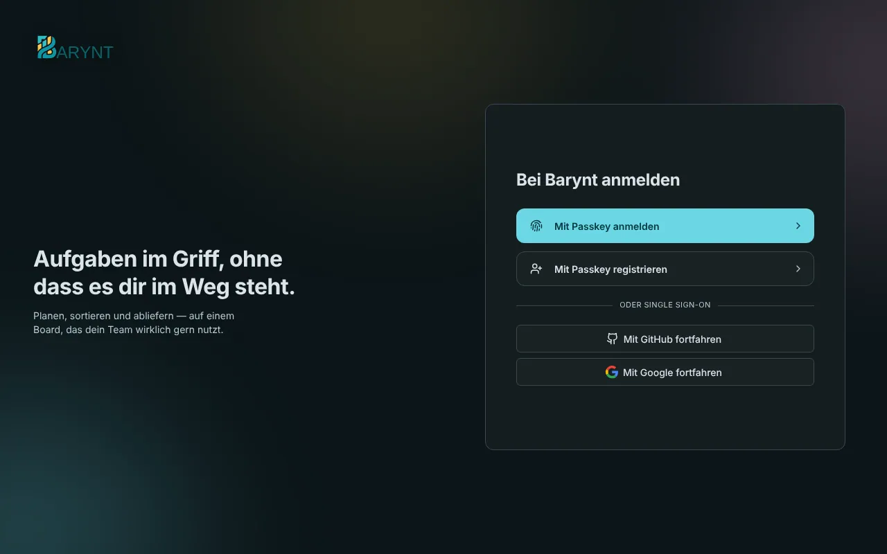

---

title: "Anmeldung und SSO"
description: "Passkeys von Haus aus, Firmen-Single-Sign-on mit jedem Identitätsanbieter und E-Mail-Links, alles ohne Aufpreis."
sidebar:
order: 6
---

Menschen sollen sich so anmelden, wie sie es schon überall sonst tun. Barynt unterstützt mehrere Wege nebeneinander, und **keiner davon ist ein kostenpflichtiges Extra**. Diese Seite ist für die Person, die den Server verwaltet: Sie erklärt die Möglichkeiten und wie du sie einschaltest.



## Die Möglichkeiten im Überblick

| Weg der Anmeldung         | Braucht Einrichtung?            | Gut für                                                                          |
| ------------------------- | ------------------------------- | -------------------------------------------------------------------------------- |
| **Passkey**               | Nein, funktioniert von Haus aus | Alle. Am sichersten und am einfachsten.                                          |
| **Firmen-Login (SSO)**    | Ja, ein paar Einstellungen      | Firmen mit Google, Microsoft, Okta, Keycloak und Ähnlichem.                      |
| **Magic Link per E-Mail** | Ja, [E-Mail](email.md)          | Menschen, die noch keinen Passkey eingerichtet haben, und zur Wiederherstellung. |

Welche Schaltflächen Menschen auf der Anmeldeseite sehen, richtet sich danach, was du eingeschaltet hast.

## Passkeys

Ein **Passkey** ist ein Login, der auf deinem Gerät lebt und mit Fingerabdruck, Gesicht oder der Geräte-PIN entsperrt wird. Es gibt kein Passwort, das man vergessen, stehlen oder wiederverwenden könnte. Er funktioniert von Haus aus. Menschen legen ihren auf der Anmeldeseite mit **Mit Passkey registrieren** an und fügen später weitere Geräte unter _Persönliche Einstellungen → Sicherheit_ hinzu.

Zwei Dinge sind gut zu wissen:

- Passkeys funktionieren nur auf einer sicheren Adresse: `https://…` oder `localhost`. Ein Server, der über schlichtes `http://` mit einer IP-Adresse erreicht wird, bietet sie nicht an.
- Ein Passkey gehört zu einer Domain. Ziehst du Barynt auf eine andere Domain um, registrieren Menschen neue Passkeys.

## Firmen-Login (SSO)

Barynt spricht mit **jedem Anbieter, den Auth.js unterstützt**, das sind etwa hundert: Google, Microsoft Entra ID (Azure AD), GitHub, GitLab, Apple, Okta, Auth0, Keycloak, authentik, ZITADEL, Cognito, Discord, Slack und viele mehr. Und mit jedem Anbieter, der **OpenID Connect (OIDC)** spricht.

Einen einzuschalten braucht nie eine Code-Änderung. Du registrierst Barynt als Anwendung bei deinem Anbieter und gibst Barynt dann die **Client-ID** und das **Client-Secret** als Einstellungen.

### Schritt 1: Barynt beim Anbieter registrieren

Lege dort eine neue „Anwendung“ oder einen neuen „Client“ an. Der Anbieter fragt nach einer **Rückruf-Adresse** (auch Redirect-URI genannt). Sie lautet immer:

```
https://deine-barynt-domain/api/auth/callback/<anbieter>
```

Zum Beispiel `https://issues.example.com/api/auth/callback/google`. Der Name des Anbieters steht in Kleinbuchstaben: `github`, `google`, `gitlab`, `microsoft-entra-id`, `keycloak` und so weiter.

### Schritt 2: Barynt die Zugangsdaten geben

Die Einstellungen sind nach dem Anbieter benannt, in Großbuchstaben, mit `_` statt `-`:

```bash
AUTH_GOOGLE_ID=…
AUTH_GOOGLE_SECRET=…
```

Setze sie mit `barynt config` (siehe [Konfiguration](../getting-started/config.md)), zum Beispiel:

```bash
barynt config AUTH_GOOGLE_ID=123.apps.googleusercontent.com AUTH_GOOGLE_SECRET=…
```

Barynt startet neu, und die Schaltfläche erscheint. Selbst betriebene oder firmeneigene Anbieter (Keycloak, Okta, Auth0, authentik, ZITADEL und andere) brauchen zusätzlich ihre Adresse, den **Issuer**:

```bash
AUTH_KEYCLOAK_ID=barynt
AUTH_KEYCLOAK_SECRET=…
AUTH_KEYCLOAK_ISSUER=https://keycloak.example.com/realms/acme
```

### Microsoft: nur die eigene Organisation

Standardmäßig kann sich jedes Microsoft-Konto anmelden. Um es auf deine Organisation zu beschränken, füge die Adresse des Verzeichnisses (Tenant) als Issuer hinzu:

```bash
AUTH_MICROSOFT_ENTRA_ID_ID=…
AUTH_MICROSOFT_ENTRA_ID_SECRET=…
AUTH_MICROSOFT_ENTRA_ID_ISSUER=https://login.microsoftonline.com/<tenant-id>/v2.0
```

### Ein generischer OIDC-Login mit eigener Schaltfläche

Für einen Identitätsanbieter ohne eigenen Eintrag, oder wenn du eine Schaltfläche willst, die „Mit Acme SSO anmelden“ sagt:

```bash
AUTH_OIDC_ISSUER=https://idp.example.com
AUTH_OIDC_CLIENT_ID=…
AUTH_OIDC_CLIENT_SECRET=…
AUTH_OIDC_NAME=Acme SSO
```

### Apple

Braucht eine kostenpflichtige Apple-Developer-Mitgliedschaft, funktioniert nur über HTTPS, und das Secret ist ein signiertes Token statt einer festen Zeichenfolge. Folge den Schritten in `example.env`.

## Wer darf ein Konto anlegen?

Von Haus aus kann jeder, der die Anmeldeseite erreicht, ein Konto anlegen, und Konten ohne Workspace können einen eigenen beginnen. Du kannst das enger fassen:

| Du willst …                                                                           | Einstellung                                                                                                                                                                                                                                                                                  |
| ------------------------------------------------------------------------------------- | -------------------------------------------------------------------------------------------------------------------------------------------------------------------------------------------------------------------------------------------------------------------------------------------- |
| **Nur auf Einladung:** niemand kann sich selbst registrieren                          | `AUTH_REGISTRATION_ENABLED=false`. Menschen mit offener **E-Mail-Einladung** kommen weiterhin hinein, weil ihr Konto schon existiert. Ein Einladungs-_Link_ hilft nur Menschen, die schon ein Konto haben. Auf einem ganz neuen, leeren Server kann sich das erste Konto immer registrieren. |
| Passkeys nur für bestehende Konten                                                    | `AUTH_PASSKEY_REGISTRATION_ENABLED=false`                                                                                                                                                                                                                                                    |
| Gar keine Passkeys                                                                    | `AUTH_PASSKEY_LOGIN_ENABLED=false`, aber stelle vorher sicher, dass ein anderer Weg funktioniert                                                                                                                                                                                             |
| Neue Konten sollen in einem bestehenden Workspace landen, nicht ihren eigenen anlegen | Schalte in den [Admin Einstellungen](platform.md) der Plattform das Anlegen von Workspaces aus und wähle einen Standard-Workspace.                                                                                                                                                           |

Eine Firmen-Domain kann außerdem von einem Workspace **beansprucht** werden, sodass alle mit passender Adresse beitreten, siehe [Workspace-Einstellungen](workspace.md).

## Den Identitätsanbieter wechseln

Wechselst du von einem Anbieter zu einem anderen (etwa authentik zu Keycloak), kommen alle mit einer neuen internen ID an, und Barynt kann nicht sicher sein, dass es dieselben Menschen sind. Die Anmeldung scheitert dann mit „Another account already exists with the same email address“. Der Weg hindurch:

1. Setze `AUTH_OIDC_ALLOW_EMAIL_LINKING=true`. Eine unbekannte Anmeldung wird dann mit dem bestehenden Konto mit **derselben E-Mail-Adresse** verknüpft.
2. Lass alle sich einmal anmelden. Sie sind danach dauerhaft verknüpft.
3. Schalte es wieder aus.

> [!WARNING]
> Schalte das nur ein, wenn dein Identitätsanbieter **E-Mail-Adressen zuverlässig prüft** (Administratoren pflegen sie, keine Selbstregistrierung). Sonst könnte jeder, der dort eine Adresse beanspruchen kann, das Barynt-Konto mit dieser Adresse übernehmen.

## Verbundene Konten

Menschen, die sich über einen Firmen-Login anmelden, sehen ihre verbundenen Konten unter _Persönliche Einstellungen → Verbundene Konten_. Haben sie zusätzlich einen Passkey, können sie sie trennen. Der letzte verbleibende Weg hinein lässt sich nicht entfernen.
