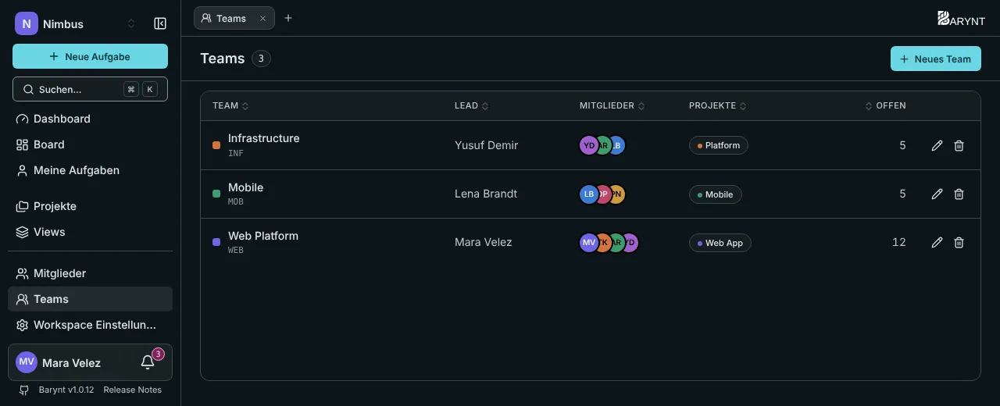
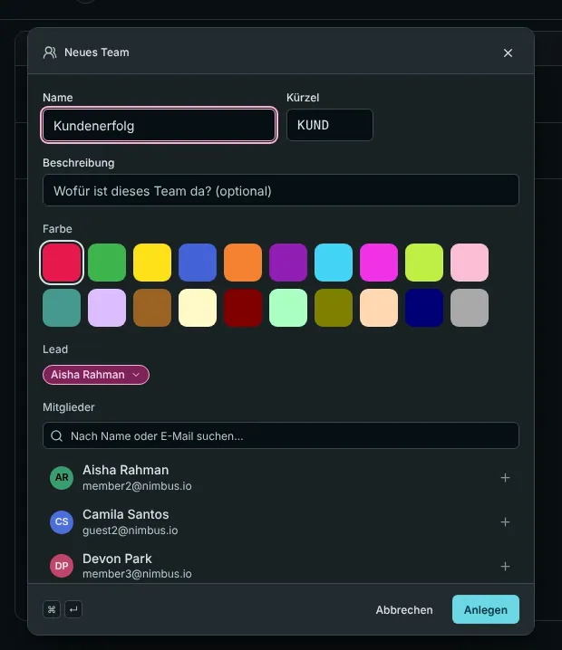

Ein **Team** ist eine benannte Gruppe von Workspace-Mitgliedern, zum Beispiel „Mobile-Team“ oder „Kundensupport“. Es erledigt zwei Aufgaben: Es zeigt auf einen Blick, **wer woran arbeitet**, und es lässt dich **einer ganzen Gruppe auf einmal Zugriff geben**.

## Die Teamliste

Öffne **Teams** in der Seitenleiste. Für jedes Team siehst du Farbe, Name und Bezeichner, seine **Leitung**, seine Mitglieder, die verknüpften Projekte und wie viele Aufgaben in diesen Projekten **offen** sind. Der Stift bearbeitet ein Team, der Papierkorb löscht es.

## Ein Team anlegen

Klicke auf **Neues Team** und fülle aus:

- **Name**, einen kurzen **Bezeichner** und eine **Farbe**.
- Eine **Beschreibung**: Wofür ist dieses Team da? (optional)
- Eine **Leitung**: die Person, die sich um das Team kümmert.
- **Mitglieder**: wähle sie aus dem Workspace.
- **Projekte**: verknüpfe das Team mit den Projekten, an denen es arbeitet, und wähle die **Rolle in diesem Projekt**, die die Mitglieder des Teams dort bekommen.

## Was das Verknüpfen eines Teams mit einem Projekt bewirkt

Wird ein Team mit einer Rolle mit einem Projekt verknüpft, **bekommt jedes Mitglied des Teams diese Rolle in diesem Projekt**. Das spart viel Klickerei:

- **Eine neue Kollegin kommt ins Team?** Sie ist sofort im Projekt.
- **Jemand verlässt das Team?** Er verliert den Zugriff, der nur vom Team kam.
- **Du brauchst für eine Person eine andere Rolle?** Lege sie einzeln auf der Seite _Mitglieder_ des Projekts fest. Eine individuelle Rolle gewinnt immer gegen die des Teams. Die Mitgliederliste markiert Rollen, die von einem Team kommen: „Über Team ‚Mobile‘“.

Das funktioniert auch bei **privaten** Projekten: Stecke die Menschen in ein Team, verknüpfe das Team, und du hast den Zugriff für die ganze Gruppe eingerichtet.

## Wer was darf

- Alle Teams sehen, sie anlegen, ändern und löschen sowie ihre Mitglieder und verknüpften Projekte verwalten sind getrennte Berechtigungen, die Workspace-Owner, -Admins und -Manager haben, siehe [Rollen und Berechtigungen](roles.md).
- Workspace-Mitglieder sehen die Teams, zu denen sie gehören.

## Ein Team löschen

Ein Team zu löschen entfernt nur die **Gruppierung**. Konten, Projekte und Aufgaben bleiben, wie sie sind. Menschen, deren Zugriff auf ein Projekt **nur** vom Team kam, verlieren ihn, und Barynt sagt dir vor der Bestätigung, wie viele betroffen sind.

## Wann sich Teams lohnen

Ein Team lohnt sich, sobald der Workspace größer ist als eine Handvoll Menschen oder sobald du private Projekte hast. In einem Team aus sechs Leuten, das an einem öffentlichen Projekt arbeitet, brauchst du vermutlich keines.
