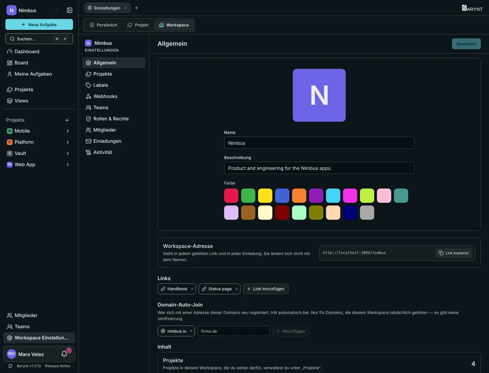

---

title: "Workspace-Einstellungen"
description: "Name, Aussehen und Adresse deines Workspace, geteilte Links, Beitritt über die Firmen-Domain, Labels und was du vor dem Löschen wissen solltest."
sidebar:
order: 1
---

Ein Workspace ist das Zuhause eines Teams oder einer Firma. Seine Einstellungen findest du unter **Workspace Einstellungen** unten in der Seitenleiste (der Tab _Workspace_). Was du dort siehst, hängt von deiner Rolle ab, siehe [Rollen und Berechtigungen](roles.md). Die Grundlagen zu ändern braucht _Name, Farbe und Adresse ändern_, was Owner, Admins und Manager haben.

## Allgemein

- **Bild, Name und Farbe** erscheinen in der Seitenleiste, im Workspace-Wechsler und überall, wo der Workspace neben anderen steht. Ohne Bild bekommst du den ersten Buchstaben auf der gewählten Farbe. Die **Beschreibung** besteht aus ein bis zwei Sätzen für die Übersicht: Wofür ist dieser Workspace da?
- Die **Workspace-Adresse** ist der kurze Name, der Teil jedes Links und jeder Einladung ist, etwa `/nimbus/…`. Sie wird beim Anlegen des Workspace gebildet und **ändert sich nicht**, wenn du ihn umbenennst, damit Links weiter funktionieren.
- **Links** sind wichtige Adressen, die dein Team schnell finden soll: die Dokumentation, das Repository, der Chat. Klicke auf **Link hinzufügen** und gib jedem eine Beschriftung und eine URL (die mit `http://` oder `https://` beginnt). Sie erscheinen im Dashboard-Widget _Links_.

## Automatisch über die Firmen-Domain beitreten

Unter **Domain-Auto-Join** kannst du die Domain deiner Firma eintragen, zum Beispiel `nimbus.io`. Wer dann ein Konto mit einer Adresse auf dieser Domain anlegt, **tritt diesem Workspace automatisch bei**, als Member und ohne Einladung. Menschen, die schon ein Konto haben, sind nicht betroffen.

> [!WARNING]
> Barynt prüft nicht, ob die Domain dir gehört. Trage nur Domains ein, die deiner Firma wirklich gehören, und bedenke, dass jeder, der Post auf dieser Domain empfangen kann, hineinkommt. Für eine kontrolliertere Lösung nutze lieber [Einladungen](members.md).

## Was im Workspace steckt

Unten geben dir drei Zahlen die Größe des Workspace: **Projekte**, die du sehen darfst, **Mitglieder** und **Aufgaben** über alle Projekte.

## Projekte, Labels und mehr

Die übrigen Einträge der Workspace-Einstellungen:

| Eintrag                            | Wofür er da ist                                                                                                                                                                                                                                                              |
| ---------------------------------- | ---------------------------------------------------------------------------------------------------------------------------------------------------------------------------------------------------------------------------------------------------------------------------- |
| **Projekte**                       | Alle Projekte des Workspace in zwei Listen, öffentlich und privat. Ein Klick öffnet eines, der Stift bearbeitet seine Details, der Papierkorb löscht es. Workspace-Owner, -Admins und -Project-Leads sehen auch die privaten. Siehe [Projekte](../using-barynt/projects.md). |
| **Labels**                         | Die Labels, die in **jedem** Projekt gelten, mit der Zahl der Aufgaben, die sie nutzen. Ein Workspace-Label kannst du in einzelnen Projekten ausblenden. Labels, die zu einem Projekt gehören, stehen zur Orientierung darunter.                                             |
| **Webhooks**                       | Anderen Systemen sagen, was passiert, siehe [Webhooks](../integrations/webhooks.md).                                                                                                                                                                                         |
| **Teams**                          | Siehe [Teams](teams.md).                                                                                                                                                                                                                                                     |
| **Rollen & Rechte**                | Siehe [Rollen und Berechtigungen](roles.md).                                                                                                                                                                                                                                 |
| **Mitglieder** und **Einladungen** | Siehe [Mitglieder und Einladungen](members.md).                                                                                                                                                                                                                              |
| **Aktivität**                      | Was im Workspace passiert ist, siehe [Audit-Log](audit.md).                                                                                                                                                                                                                  |

### Workspace-Labels oder Projekt-Labels?

Nimm ein **Workspace-Label** für Unterscheidungen, die überall dasselbe bedeuten, etwa `Bug`, `Customer` oder `Design`. Nimm ein **Projekt-Label** für Wörter, die nur in einem Projekt Sinn ergeben, etwa `Sprint 14`. Ein Workspace-Label legst du einmal an, und es steht in jedem Projekt zur Verfügung. Will ein Projekt es nicht, kann es dort ausgeblendet werden.

## Mit mehr als einem Workspace arbeiten

Klicke oben in der Seitenleiste auf den Namen des Workspace, um alle Workspaces zu sehen, zu denen du gehörst, und zwischen ihnen zu wechseln. **Neuer Workspace** legt einen weiteren an, wenn der Server es erlaubt. Workspaces sind völlig getrennt voneinander: Mitglieder, Projekte, Labels und Rollen werden nicht geteilt.

## Einen Workspace löschen

Ganz unten steht die **Gefahrenzone**. Einen Workspace zu löschen löscht alles darin endgültig: Projekte, Aufgaben, Teams, Labels und Rollen. Barynt sagt dir, wie viele Projekte und Aufgaben verschwinden, und lässt dich bestätigen. Nur der **Owner** darf das. Es gibt kein Rückgängig, mach also ein [Backup](../getting-started/manage.md), wenn du unsicher bist.

> [!NOTE]
> Eine Plattform-Administration kann einen Workspace stattdessen **sperren**. Er ist dann nicht mehr zugänglich, ohne dass Daten verloren gehen, und lässt sich wieder einschalten. Siehe [Plattform-Verwaltung](platform.md).
