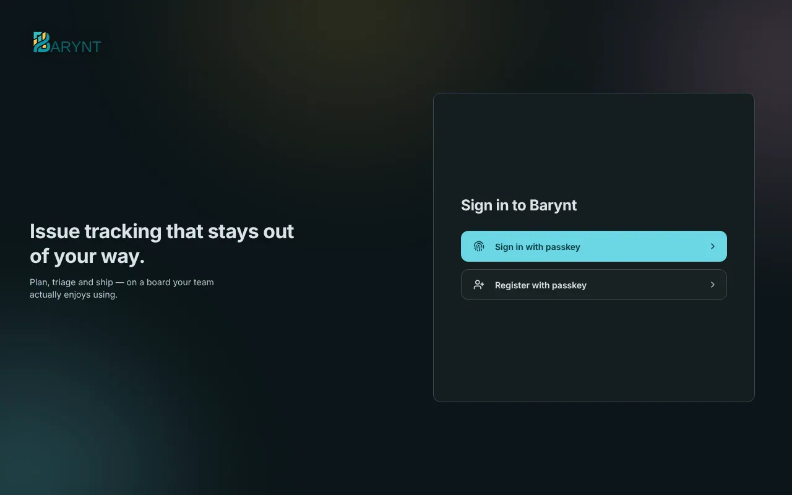
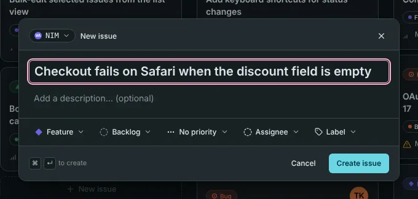
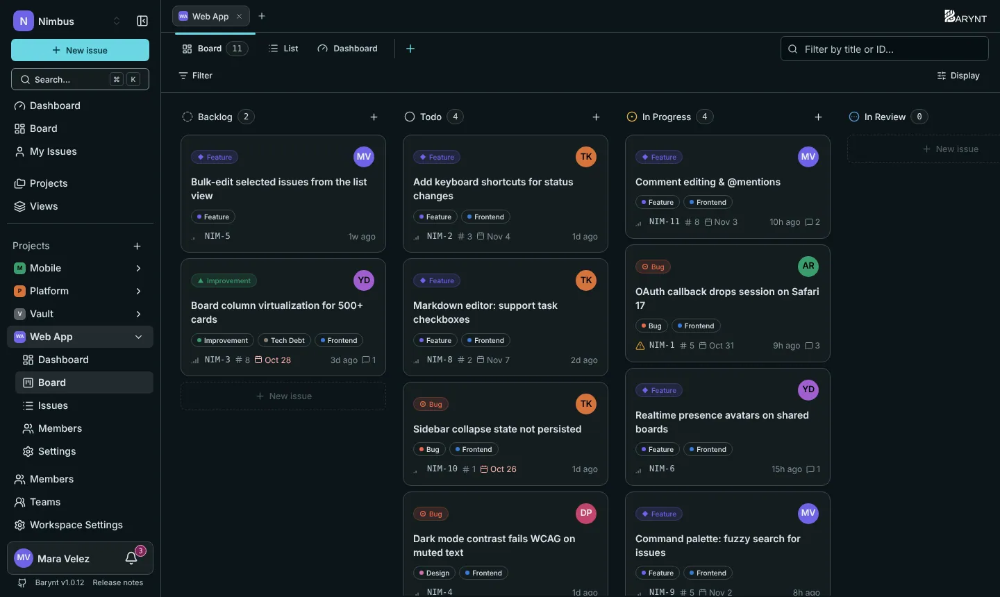

Dieser Rundgang führt dich von der Anmeldung zu einer ersten Aufgabe und einem ersten Teammitglied. Wenn jemand deinen Workspace schon eingerichtet hat, spring direkt zu [Schritt 4](#4-schreibe-deine-erste-aufgabe).

## 1. Anmelden

Öffne die Adresse, die dir deine Administration gegeben hat. Welche Schaltflächen du siehst, hängt davon ab, wie der Server eingerichtet ist:

- **Mit Passkey anmelden.** Ein Passkey ersetzt das Passwort. Du bestätigst mit Fingerabdruck, Gesicht oder der PIN deines Geräts, und es wird nichts Geheimes übers Netz geschickt. Neu hier? Wähle einmal **Mit Passkey registrieren**.
- **Mit dem Firmen-Login fortfahren.** Hat deine Firma Single Sign-on (Google, Microsoft, Okta, Keycloak und andere), nutze diese Schaltfläche, wie überall sonst auch.
- **Ein Magic Link per E-Mail.** Du gibst deine Adresse ein, und Barynt schickt dir einen Link oder einen kurzen Code.

> [!NOTE]
> Das allererste Konto auf einem neuen Server wird zur **Plattform-Administration**, also zur Person, die sich um den Server selbst kümmert. Alle danach sind normale Nutzerinnen und Nutzer.

Nach der ersten Anmeldung bittet dich Barynt, deinen Namen und einen kurzen Benutzernamen zu bestätigen. Mit diesem Benutzernamen erwähnen dich andere (`@mara`).

## 2. Einem Workspace beitreten oder einen erstellen

Ein **Workspace** ist das Zuhause deines Teams: seine Projekte, Aufgaben und Menschen. Es gibt drei Wege hinein:

- Jemand **lädt dich ein**, per E-Mail oder mit einem Link.
- Deine E-Mail-Domain ist von einem Workspace **beansprucht** (zum Beispiel alle mit `@nimbus.io`), und du trittst automatisch bei.
- Du **erstellst einen eigenen**: Gib ihm einen Namen und eine Farbe. Die kurze Adresse (der _Slug_) wird aus dem Namen gebildet und ist Teil jedes Links.

Hat deine Administration das Erstellen von Workspaces abgeschaltet, siehst du diesen Schritt nicht: Du landest gleich im Standard-Workspace.

## 3. Ein Projekt anlegen

Ein **Projekt** bündelt zusammengehörige Arbeit, zum Beispiel „Web App“ oder „Mobile“. Drücke irgendwo `N` oder klicke in der Seitenleiste auf das **+** neben _Projekte_.

- **Name und Beschreibung** erscheinen in der Seitenleiste und auf der Projektübersicht.
- Der **Bezeichner** ist ein kurzes Aufgaben-Kürzel aus zwei bis vier Buchstaben. Er wird Teil jeder Aufgabennummer: Mit `WEB` heißen deine Aufgaben `WEB-1`, `WEB-2` und so weiter.
- Die **Sichtbarkeit** bestimmt, wer dabei ist. _Öffentliche_ Projekte nehmen jedes Workspace-Mitglied automatisch auf. _Private_ Projekte enthalten nur die Menschen, die du selbst hinzufügst. Nimm „privat“ für alles Vertrauliche.

## 4. Schreibe deine erste Aufgabe

Drücke `C` (oder klicke oben in der Seitenleiste auf **Neue Aufgabe**). Gib ihr einen Titel und ergänze so viel oder so wenig, wie du möchtest: eine Beschreibung, einen Typ, einen Status, eine Priorität, jemanden, der es erledigt, Labels. Mit `⌘↵` (`Strg+Enter` unter Windows und Linux) legst du sie an.

Die Aufgabe liegt jetzt in deinem Projekt, auf dem **Board** und in der **Liste**. Ihre Nummer (zum Beispiel `WEB-1`) nutzt du, um sie im Chat, in Commits und in anderen Aufgaben zu nennen.

## 5. Bring sie voran

Öffne das **Board** des Projekts. Jede Spalte ist ein Status. Ziehe eine Karte von _Offen_ nach _In Bearbeitung_, und der Status ändert sich sofort für alle. Mit einem Klick auf die Karte öffnest du die Details: Schreibe einen Kommentar, weise sie jemandem zu, setze ein Fälligkeitsdatum, hänge eine Datei an.

## 6. Lade dein Team ein

Öffne **Mitglieder** in der Seitenleiste und klicke auf **Mitglied einladen**. Gib eine oder mehrere E-Mail-Adressen ein, wähle eine Rolle (_Member_ ist die übliche) und sende ab.

> [!TIP]
> Auf deinem Server ist keine E-Mail eingerichtet? Dann zeigt dir Barynt einen **Einladungslink** zum Kopieren und Selbstversenden. Unter _Workspace Einstellungen → Einladungen_ kannst du außerdem einen **Link für alle** erzeugen, praktisch für den Team-Chat.

Mehr dazu unter [Mitglieder und Einladungen](../administration/members.md).

## 7. Mach Barynt zu deinem

Klicke unten in der Seitenleiste auf deinen Namen, um deine persönlichen Einstellungen zu öffnen. Drei Dinge lohnen eine Minute:

- **Darstellung:** dunkel oder hell, Deutsch oder Englisch.
- **Benachrichtigungen:** was in deinem Posteingang landet und was zusätzlich per E-Mail kommt. Siehe [Konto und persönliche Einstellungen](../using-barynt/account.md).
- **Shortcuts:** Mit `?` siehst du alle Tastenkombinationen. Nach einem Tag willst du nicht mehr zurück.

## Wie es weitergeht

- [Die Bausteine](concepts.md): die Begriffe von Barynt auf einer Seite.
- [Aufgaben im Detail](../using-barynt/issues.md): alles, was du mit einer Aufgabe tun kannst.
- [Rollen und Berechtigungen](../administration/roles.md): wer was sehen und tun darf.
