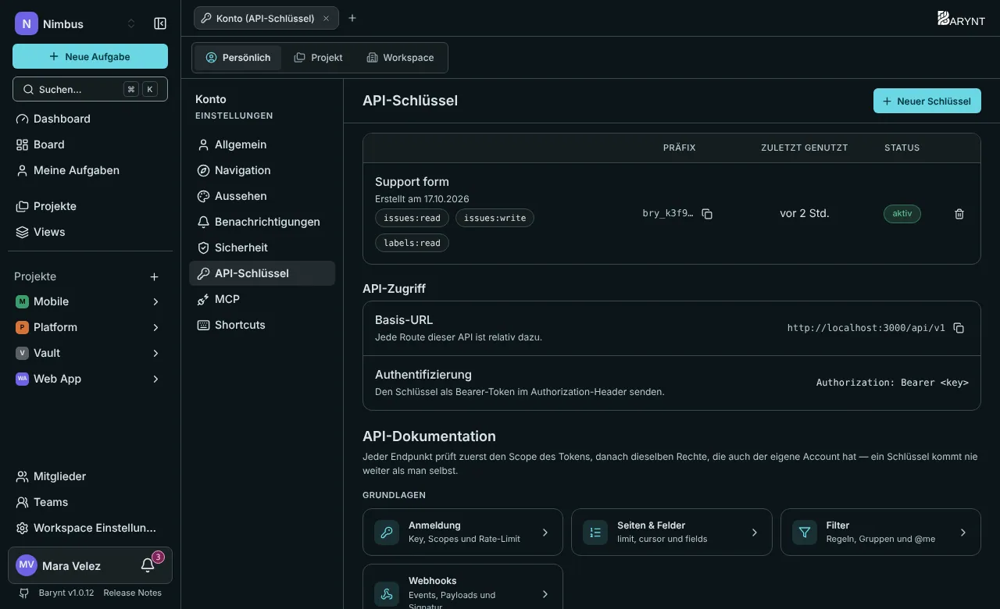
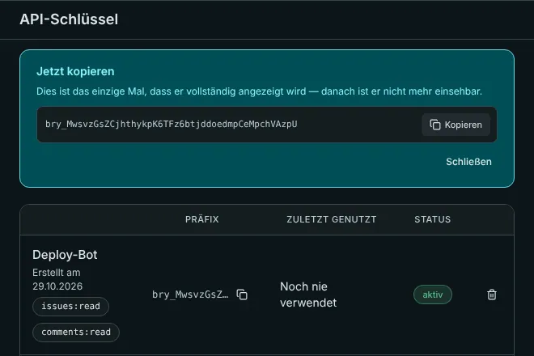

Die **REST-API** lässt andere Software lesen und ändern, was in Barynt steckt: eine Aufgabe anlegen, wenn ein Kunde ein Formular abschickt, Zahlen in einen Bericht ziehen, eine Tabelle synchron halten. Es sind dieselben Daten und dieselben Regeln wie in der App. Bist du kein Entwickler, sagt dir diese Seite, was du bei ihnen anfragen sollst und wie du Zugang sicher weitergibst.



## Wofür sie gut ist

- **Aufgaben automatisch anlegen**, aus einem Support-Formular, einem Monitoring-Alarm oder einem Chat-Befehl.
- **Berichte und Dashboards** außerhalb von Barynt: offene Aufgaben exportieren, pro Woche geschlossene zählen.
- **Abgleich** mit anderen Systemen: CRM, Tabellen, ein Firmenportal.
- **Skripte und CI:** eine Aufgabe kommentieren, wenn ein Deployment fertig ist.

Für KI-Assistenten nimm stattdessen [MCP](mcp.md): Es braucht keinen Schlüssel. Um benachrichtigt zu werden, wenn etwas passiert, nimm [Webhooks](webhooks.md).

## API-Schlüssel

Ein **API-Schlüssel** ist ein persönliches Zugriffstoken. Er handelt als **du**, kann also nie mehr, als du kannst, und du kannst ihn mit **Scopes** weiter einschränken.

1. Öffne deine persönlichen Einstellungen → **API-Schlüssel** und klicke auf **Neuer Schlüssel**.
2. Gib ihm einen **Namen**, der sagt, wofür er da ist („Support-Formular“), wähle ein **Ablaufdatum** (nie oder eine Anzahl Tage) und hake die nötigen **Scopes** an.
3. Klicke auf **Schlüssel erstellen**. Barynt zeigt den Schlüssel **ein einziges Mal**. Kopiere ihn jetzt, denn er lässt sich nicht erneut anzeigen.
4. Gib ihn über einen sicheren Weg an die weiter, die ihn brauchen, nie in einem Chat oder einer E-Mail.



Die Liste zeigt für jeden Schlüssel sein Präfix, wann er erstellt und wann er **zuletzt benutzt** wurde und ob er aktiv ist. **Widerrufe** einen Schlüssel jederzeit: Jedes Werkzeug, das ihn nutzt, verliert sofort den Zugriff, und das lässt sich nicht rückgängig machen.

> [!WARNING]
> Behandle einen Schlüssel wie ein Passwort. Lege **einen Schlüssel pro Werkzeug** an, gib ihm die **wenigsten Scopes**, mit denen es funktioniert, und setze ein **Ablaufdatum**, wo du kannst. Ist ein Schlüssel durchgesickert, widerrufe ihn.

### Scopes

Ein Scope ist ein Paar aus „was“ und „lesen oder schreiben“. Ein Aufruf braucht den richtigen Scope **und** die Berechtigung, die du in der App hast.

| Scope | Erlaubt |
| --- | --- |
| `issues:read` / `issues:write` | Aufgaben, Beziehungen und Anhänge lesen. Aufgaben anlegen, ändern und verschieben, Beziehungen und Anhänge hinzufügen oder entfernen. |
| `comments:read` / `comments:write` | Kommentare lesen und schreiben. |
| `labels:read` / `labels:write` | Labels lesen, anlegen, ändern und löschen. |
| `projects:read` / `projects:write` | Projekte lesen. Sie anlegen, ändern und löschen. |
| `workspaces:read` / `workspaces:write` | Die Workspaces, Status, Prioritäten und Typen lesen. Workspaces anlegen, ändern und löschen. |
| `members:read` | Die Mitglieder von Workspaces und Projekten lesen. Es gibt keinen Schreib-Scope: Menschen hinzuzufügen geschieht in der App. |
| `views:read` / `views:write` | Gespeicherte Views lesen und verwalten. Die Aufgaben einer View brauchen zusätzlich `issues:read`. |

## Eine Anfrage senden

Jede Adresse beginnt mit deinem Server, `/api/v1`. Sende den Schlüssel als **Bearer-Token**:

```bash
curl https://issues.example.com/api/v1/workspaces \
  -H "Authorization: Bearer $BARYNT_API_KEY"
```

Antworten sind JSON, immer `{ "data": … }`. Um in einem Projekt eine Aufgabe anzulegen:

```bash
curl -X POST https://issues.example.com/api/v1/projects/$PROJECT_ID/issues \
  -H "Authorization: Bearer $BARYNT_API_KEY" \
  -H "Content-Type: application/json" \
  -d '{ "title": "Fix broken checkout", "priority": 2, "type": "bug" }'
```

Die Aufgabe wird mit **dir** als Ersteller angelegt und als über die API erstellt markiert.

### Listen, Seiten und Felder

- Listen kommen **neueste zuerst** und in **Seiten**. Nutze `limit` (1 bis 100, Standard 25) und gib den `nextCursor` der letzten Antwort als `cursor` zurück, um die nächste Seite zu bekommen.
- Füge `fields=id,title,status` hinzu, um nur die Felder zu bekommen, die du brauchst.
- Aufgabenlisten lassen sich mit `status`, `assignee`, einer Textsuche `q` oder einem vollständigen **Filter** als JSON filtern, mit denselben Regeln wie die Filter in der App, einschließlich `@me`.

### Fehler

Die Form ist immer dieselbe: `{ "error": { "code": "…", "message": "…" } }`.

| Status | Bedeutung |
| --- | --- |
| **401** | Der Schlüssel fehlt, ist falsch, widerrufen oder abgelaufen. |
| **403** | Dem Schlüssel fehlt der Scope, den dieser Aufruf braucht, oder du darfst die Sache sehen, aber nicht ändern. |
| **404** | Sie existiert nicht, oder du darfst sie nicht sehen. Barynt sagt nicht, was zutrifft, mit Absicht. |
| **422** | Der Anfragetext fehlt oder ist falsch, oder der Filter ist ungültig. |
| **429** | Zu viele Anfragen. |

### Grenzen

Jeder Schlüssel darf **120 Anfragen pro Minute** stellen. Ist das Budget aufgebraucht, lautet die Antwort 429 mit einem Header `Retry-After`, der sagt, wie viele Sekunden zu warten sind. Jede Antwort trägt außerdem die Header `X-RateLimit-Limit` und `X-RateLimit-Remaining`. Die Zähler liegen in Redis, siehe [Konfiguration](../getting-started/config.md).

## Was du tun kannst

| Bereich | Aufrufe |
| --- | --- |
| **Workspaces** | auflisten, anlegen, ändern, löschen; Status, Prioritäten und Aufgabentypen auflisten |
| **Projekte** | auflisten, anlegen, ändern, löschen; Mitglieder auflisten |
| **Aufgaben** | auflisten und lesen, anlegen, ändern (auch Status, Zuständigkeit, Labels, Daten, Schätzungen, übergeordnete Aufgabe); Beziehungen |
| **Kommentare** | auflisten, anlegen, ändern, löschen |
| **Anhänge** | auflisten, lesen, eine Datei oder einen Link hinzufügen, löschen |
| **Labels** | auflisten, anlegen, ändern, löschen |
| **Mitglieder** | die Mitglieder eines Workspace oder Projekts auflisten |
| **Views** | auflisten, lesen, anlegen, ändern, löschen; die Aufgaben einer View auflisten |

Die **vollständige Referenz** mit jedem Feld und Live-Beispielen ist in die App eingebaut, direkt unter deinen Schlüsseln auf der Seite **API-Schlüssel**: Tabs pro Bereich, Anfrage- und Antwortbeispiele und die Filtersprache. Sie passt immer zu der Version, die du betreibst.

## Gut zu wissen

- **Ein Schlüssel ist ein Mensch.** Seine Aktionen erscheinen in der Aktivität der Aufgaben als diese Person. Für eine Integration lege ein eigenes Konto an (zum Beispiel „Support-Bot“) und stelle den Schlüssel dort aus.
- Nichts, was die API tut, umgeht Berechtigungen. Der Schlüssel eines Viewers kann nicht schreiben, auch nicht mit Schreib-Scope.
