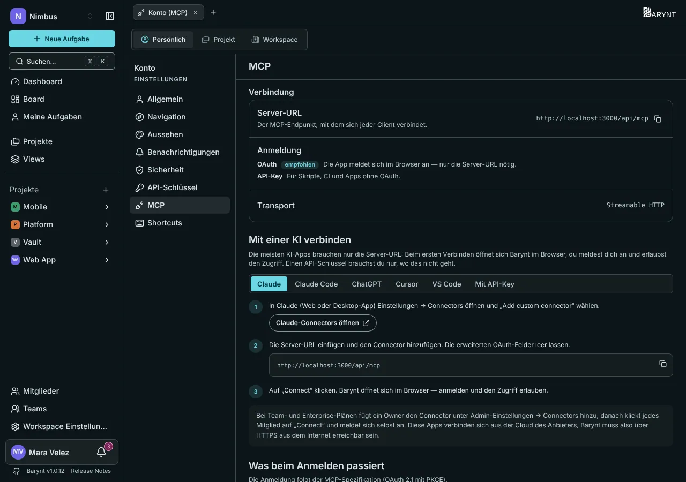

Barynt hat einen eingebauten **MCP-Server**. MCP, das _Model Context Protocol_, ist der Standardweg, wie KI-Assistenten andere Werkzeuge nutzen. Sobald er verbunden ist, sprichst du in normaler Sprache mit deinem Issue-Tracker, direkt im Assistenten, den du ohnehin nutzt.



## Wofür er gut ist

Du fragst, der Assistent erledigt es in Barynt:

- „**Was ist in Bearbeitung** im Projekt Web App, und wer arbeitet daran?“
- „**Lege Aufgaben an** für die Aktionspunkte aus diesem Besprechungsprotokoll, zugewiesen wie besprochen.“
- „**Fasse** alle offenen Bugs mit dem Label `Customer` für mein Montags-Update **zusammen**.“
- „**Verschiebe** alle Aufgaben, die ich diese Woche fertig hatte, nach _Erledigt_, und kommentiere NIM-12, dass es Freitag rauskommt.“
- „**Finde Duplikate** dieser Fehlermeldung und verknüpfe sie.“

Alles, was der Assistent tut, ist in Barynt **sichtbar**: Aufgaben, die darüber angelegt wurden, tragen „Erstellt über MCP“, und jede Änderung erscheint in der Aktivität der Aufgabe.

## Wer handelt hier?

Der Assistent handelt **als du**. Er meldet sich über deinen Browser an und bekommt genau die Berechtigungen, die **du** hast: nicht mehr, nicht weniger. Wenn du ein Projekt nicht löschen kannst, kann es der Assistent auch nicht. Das ist das Sicherheitsnetz hinter allem anderen auf dieser Seite.

## Verbinden

Öffne deine persönlichen Einstellungen, Bereich **MCP**. Er zeigt deine Server-Adresse und eine Schritt-für-Schritt-Anleitung für jede App, mit Kopier-Knöpfen. Die Adresse sieht so aus: `https://issues.example.com/api/mcp`.

> [!WARNING]
> Apps wie Claude und ChatGPT verbinden sich aus der **Cloud** des Anbieters, nicht von deinem Rechner. Barynt muss deshalb **aus dem Internet über HTTPS** erreichbar sein. Ein Server, der nur im Firmennetz existiert, oder eine `localhost`-Adresse funktioniert für sie nicht. Werkzeuge, die auf deinem eigenen Rechner laufen (Claude Code, Cursor, VS Code), haben diese Grenze nicht.

### Claude (Web und Desktop)

1. Öffne **Einstellungen → Connectors** und wähle **Add custom connector**.
2. Füge deine Server-Adresse ein und lege den Connector an. Lass die erweiterten Felder leer.
3. Klicke auf **Connect**. Barynt öffnet sich im Browser: Melde dich an und klicke auf **Allow**.

In Team- und Enterprise-Tarifen legt ein Owner den Connector einmal unter _Admin settings → Connectors_ an. Jedes Mitglied klickt dann auf **Connect** und meldet sich als es selbst an.

### Claude Code

```bash
claude mcp add --transport http --scope user barynt https://issues.example.com/api/mcp
```

Melde dich dann an: Ein Browserfenster öffnet sich, oder führe in einer Sitzung `/mcp` aus und wähle _Authenticate_. `claude mcp logout barynt` meldet wieder ab.

### ChatGPT

Öffne **Einstellungen → Apps & Connectors → Erweiterte Einstellungen** und schalte den _Entwicklermodus_ ein. Lege einen neuen Connector an, füge die Server-Adresse ein und wähle **OAuth**. Melde dich im sich öffnenden Fenster bei Barynt an.

### Cursor und VS Code

Die MCP-Einstellungsseite hat die Schaltflächen **Zu Cursor hinzufügen** und **Zu VS Code hinzufügen**, die die Einrichtung für dich erledigen. Melde dich dann an, wenn die App fragt. Starte danach einen **neuen Chat**.

### Mit einem API-Schlüssel (Skripte und Sonderfälle)

Nur dort, wo eine Anmeldung im Browser nicht möglich ist, etwa bei Skripten oder CI. Lege unter **API-Schlüssel** einen Schlüssel mit nur den nötigen Scopes an, siehe [REST-API](api.md), und sende ihn als Header:

```bash
claude mcp add --transport http barynt https://issues.example.com/api/mcp \
  --header "Authorization: Bearer $BARYNT_API_KEY"
```

Halte den Schlüssel in einer Umgebungsvariablen, nicht in einer Datei, die du teilst.

## Was der Assistent kann

37 Tools, eines für alles, was du in der App tun kannst. Jedes prüft zuerst deine Berechtigungen. Jedes Tool mit Scope und Argumenten steht in der **[MCP-Tools-Referenz](../api-reference/mcp-tools.md)**.

| Bereich | Tools |
| --- | --- |
| **Workspaces** | auflisten, anlegen, ändern, löschen |
| **Projekte** | auflisten, anlegen, ändern, löschen |
| **Mitglieder** | die Mitglieder eines Workspace oder Projekts auflisten |
| **Issues** | auflisten (mit Filtern, Textsuche und gespeicherten Views), eines lesen, anlegen, ändern (Titel, Beschreibung, Status, Priorität, Typ, Zuständige, Labels, Termine, Schätzungen, übergeordnetes Issue) |
| **Beziehungen** | hinzufügen und entfernen (blockiert, hängt zusammen mit, Duplikat von) |
| **Kommentare** | auflisten, anlegen, ändern, löschen |
| **Anhänge** | auflisten, lesen (Bilder und Textdateien direkt), Dateien und Links hinzufügen, löschen |
| **Labels** | auflisten, anlegen, ändern, löschen |
| **Views** | auflisten, lesen, anlegen, ändern, löschen |
| **Optionen** | Status, Prioritäten und Issue-Typen auflisten |

### Was du sagen kannst

Du rufst keine Tools selbst auf: Du beschreibst, was du willst, und der Assistent wählt die Tools. Ein paar Sätze, die gut funktionieren:

- „Was ist im Projekt Website-Relaunch offen, und wer arbeitet woran?“
- „Leg aus diesen Besprechungsnotizen drei Issues an, gib ihnen das Label `Kunde` und weise das erste Priya zu.“
- „Setz alles, was in _In Überprüfung_ steht und älter als zwei Wochen ist, zurück auf _In Bearbeitung_ und schreib einen Kommentar, warum.“
- „Sieh dir den Screenshot an WEB-42 an und sag mir, was nicht stimmt.“ (der Assistent kann Bilder bis 5 MB und Textdateien bis 512 KB ansehen)
- „Finde Issues, die wie Duplikate von WEB-42 aussehen, und verknüpfe sie.“

Für manches braucht der Assistent **IDs** (ein Projekt, ein Status). Er schlägt sie selbst mit den Listen-Tools nach, nenne die Dinge also so, wie du es einem Kollegen gegenüber tun würdest.

## Hinter den Kulissen

Für Neugierige und für alle, die einen Client von Hand einrichten.

- **Adresse:** `https://dein-server/api/mcp`, der Transport ist _Streamable HTTP_, zustandslos: Jede Anfrage steht für sich, es gibt keine Sitzungen, die am Leben bleiben müssen.
- **Anmeldung:** ein Bearer-Token im `Authorization`-Header. Entweder ein **API-Schlüssel** (`bry_…`) oder ein **OAuth-Zugriffstoken** (`bryat_…`), das eine App bekommen hat, nachdem du es erlaubt hast. Beides führt zu denselben Tools, mit denselben Scopes und demselben Budget von **120 Anfragen pro Minute** und Schlüssel.
- **Kein Token:** Der Server antwortet mit `401` und einem `WWW-Authenticate`-Header, der auf `/.well-known/oauth-protected-resource` zeigt. So erfährt eine App, wo sie sich anmelden muss.
- **Tool-Ergebnisse** sind JSON als Text. Ein Fehler ist ein als Fehler markiertes Ergebnis mit dem Text `code: message`, etwa `insufficient_scope: This API key is missing the "issues:write" scope.` Die Codes sind dieselben wie in der [REST-API](api.md): `unauthorized`, `insufficient_scope`, `forbidden`, `not_found`, `invalid_input`, `rate_limited`, `workspace_creation_disabled` und bei Anhängen die genauen Codes. Was du nicht sehen darfst, ist immer `not_found`.
- **Hinweise:** Hat ein Issue Kommentare, sagt das Lesen dem Assistenten auch, sie mit `list_comments` zu holen, damit er die Diskussion nicht verpasst.
- **Listen** kommen seitenweise wie in der REST-API: `limit` (1 bis 100) und `cursor`, beantwortet mit einem `nextCursor`. Filter sind einfache JSON-Objekte, siehe [Filter](../api-reference/filters.md).

### Die OAuth-Anmeldung im Detail

| Schritt | Was passiert |
| --- | --- |
| Entdecken | `GET /.well-known/oauth-protected-resource` und `/.well-known/oauth-authorization-server` sagen der App, wo alles liegt. |
| Registrieren | Die App registriert sich selbst (Dynamic Client Registration, `POST /api/oauth/register`), als öffentlicher Client ohne Geheimnis. |
| Zustimmung | Die App öffnet die Anmelde- und Zustimmungsseite von Barynt, mit **PKCE** (`S256`, Pflicht). Sie fragt nach Scopes; ohne Angabe darf sie alle erbitten. Du siehst, was sie verlangt, und klickst auf **Erlauben**. |
| Token | Die App tauscht den einmaligen Code (zehn Minuten gültig) gegen ein **Zugriffstoken** (**eine Stunde** gültig) und ein **Refresh-Token** (**30 Tage** gültig). |
| Erneuern | Die App erneuert das Zugriffstoken selbst. Ein Refresh-Token gilt nur einmal und wird bei jeder Nutzung durch ein neues ersetzt; wird ein altes erneut benutzt, wird die ganze Freigabe widerrufen. |

Ein Token kann nie mehr, als deine Rollen erlauben, und nur im Rahmen der gewährten Scopes.

### Direkt mit dem Server sprechen

Die meisten brauchen das nie, denn eine App erledigt es für sie. Es ist das Standard-MCP-JSON-RPC über HTTP; sende beide `Accept`-Typen mit:

```bash
curl -X POST "$BARYNT_URL/api/mcp" \
  -H "Authorization: Bearer $BARYNT_API_KEY" \
  -H "Content-Type: application/json" \
  -H "Accept: application/json, text/event-stream" \
  -d '{ "jsonrpc": "2.0", "id": 1, "method": "tools/call",
        "params": { "name": "list_workspaces", "arguments": {} } }'
```

Ersetze `tools/call` und `params` durch `tools/list`, um alle Tools und ihre Eingabe-Schemas zu sehen.

## Die Kontrolle behalten

- Der Assistent kann nur, was **du** darfst, und erst, nachdem du es beim ersten Mal auf der Zustimmungsseite **erlaubt** hast.
- Um ihn abzuklemmen, entferne den Connector im Assistenten. Bei Schlüsseln **widerrufe** den Schlüssel unter _API-Schlüssel_, dann ist er sofort ausgesperrt.
- Was passiert ist, siehst du im Tab **Aktivität** jedes Issues, und das [Audit-Log](../administration/audit.md) hält die größeren Änderungen fest.
- Assistenten können Fehler machen. Bei wichtiger Arbeit lass sie zeigen, was sie ändern wollen, oder beschränke die Scopes des Schlüssels auf Lesen.

## Wenn es nicht klappt

| Was du siehst | Wahrscheinliche Ursache |
| --- | --- |
| Die App kann sich gar nicht verbinden | Barynt ist nicht per HTTPS aus dem Internet erreichbar (Claude und ChatGPT verbinden sich aus ihrer Cloud), oder die Adresse stimmt nicht. Sie muss auf `/api/mcp` enden. |
| Die Anmeldung öffnet sich nicht oder schlägt fehl | Der Browser hat das Fenster blockiert, oder du hast eine andere Adresse eingegeben als die auf der MCP-Einstellungsseite. Nimm die Adresse, die dort steht. |
| `insufficient_scope` | Dem Schlüssel oder Token wurden weniger Scopes gegeben, als der Aufruf braucht. Lege einen neuen Schlüssel mit dem Scope an oder verbinde die App neu. |
| `not_found` | Die ID stimmt nicht, oder du kannst das Element nicht sehen. Barynt antwortet in beiden Fällen gleich. Lass den Assistenten das Element erneut nachschlagen. |
| `rate_limited` | Mehr als 120 Anfragen pro Minute. Der Assistent wartet und macht weiter, oder bitte ihn, in kleineren Schritten zu arbeiten. |
| Neue Tools oder Felder fehlen | Starte einen **neuen Chat**: Apps lesen die Tool-Liste, wenn ein Chat beginnt. |

## Wie die Anmeldung funktioniert (für Neugierige)

Barynt folgt dem MCP-Standard: OAuth 2.1 mit PKCE. Der Assistent ruft die Server-Adresse ohne Token auf, erfährt, wo er sich anmelden muss, registriert sich selbst und schickt dich auf die Zustimmungsseite von Barynt. Nachdem du erlaubt hast, bekommt er ein Token, das sich von selbst erneuert. Es wird nie ein Schlüssel herumkopiert. Darum brauchst du nur die Server-Adresse.
