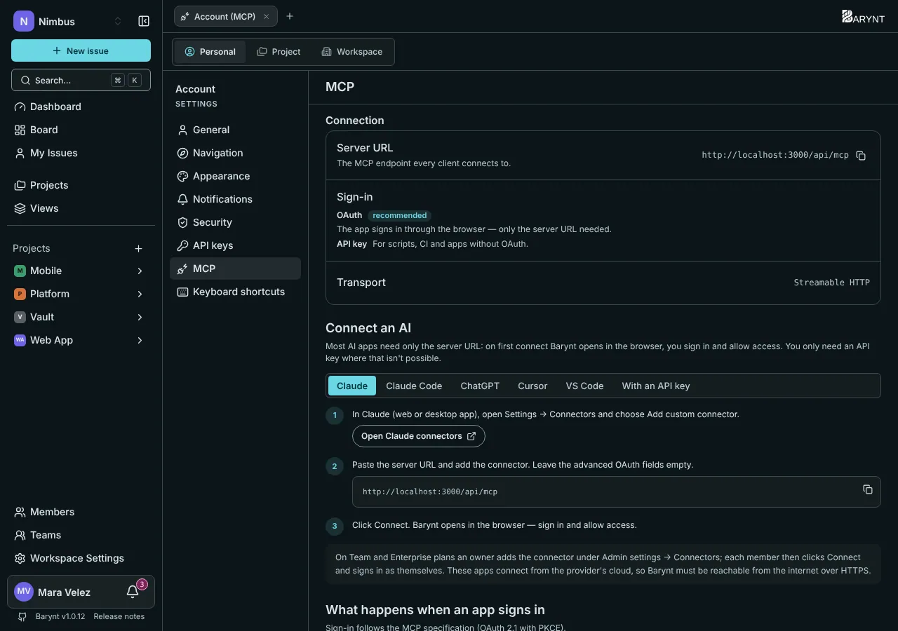

Barynt hat einen eingebauten **MCP-Server**. MCP, das _Model Context Protocol_, ist der Standardweg, wie KI-Assistenten andere Werkzeuge nutzen. Sobald er verbunden ist, sprichst du in normaler Sprache mit deinem Issue-Tracker, direkt im Assistenten, den du ohnehin nutzt.



## Wofür er gut ist

Du fragst, der Assistent erledigt es in Barynt:

- „**Was ist in Bearbeitung** im Projekt Web App, und wer arbeitet daran?“
- „**Lege Aufgaben an** für die Aktionspunkte aus diesem Besprechungsprotokoll, zugewiesen wie besprochen.“
- „**Fasse** alle offenen Bugs mit dem Label `Customer` für mein Montags-Update **zusammen**.“
- „**Verschiebe** alle Aufgaben, die ich diese Woche fertig hatte, nach _Erledigt_, und kommentiere NIM-12, dass es Freitag rauskommt.“
- „**Finde Duplikate** dieser Fehlermeldung und verknüpfe sie.“

Alles, was der Assistent tut, ist in Barynt **sichtbar**: Aufgaben, die darüber angelegt wurden, tragen „Erstellt über MCP“, und jede Änderung erscheint in der Aktivität der Aufgabe.

## Wer handelt hier?

Der Assistent handelt **als du**. Er meldet sich über deinen Browser an und bekommt genau die Berechtigungen, die **du** hast: nicht mehr, nicht weniger. Wenn du ein Projekt nicht löschen kannst, kann es der Assistent auch nicht. Das ist das Sicherheitsnetz hinter allem anderen auf dieser Seite.

## Verbinden

Öffne deine persönlichen Einstellungen, Bereich **MCP**. Er zeigt deine Server-Adresse und eine Schritt-für-Schritt-Anleitung für jede App, mit Kopier-Knöpfen. Die Adresse sieht so aus: `https://issues.example.com/api/mcp`.

> [!WARNING]
> Apps wie Claude und ChatGPT verbinden sich aus der **Cloud** des Anbieters, nicht von deinem Rechner. Barynt muss deshalb **aus dem Internet über HTTPS** erreichbar sein. Ein Server, der nur im Firmennetz existiert, oder eine `localhost`-Adresse funktioniert für sie nicht. Werkzeuge, die auf deinem eigenen Rechner laufen (Claude Code, Cursor, VS Code), haben diese Grenze nicht.

### Claude (Web und Desktop)

1. Öffne **Einstellungen → Connectors** und wähle **Add custom connector**.
2. Füge deine Server-Adresse ein und lege den Connector an. Lass die erweiterten Felder leer.
3. Klicke auf **Connect**. Barynt öffnet sich im Browser: Melde dich an und klicke auf **Allow**.

In Team- und Enterprise-Tarifen legt ein Owner den Connector einmal unter _Admin settings → Connectors_ an. Jedes Mitglied klickt dann auf **Connect** und meldet sich als es selbst an.

### Claude Code

```bash
claude mcp add --transport http --scope user barynt https://issues.example.com/api/mcp
```

Melde dich dann an: Ein Browserfenster öffnet sich, oder führe in einer Sitzung `/mcp` aus und wähle _Authenticate_. `claude mcp logout barynt` meldet wieder ab.

### ChatGPT

Öffne **Einstellungen → Apps & Connectors → Erweiterte Einstellungen** und schalte den _Entwicklermodus_ ein. Lege einen neuen Connector an, füge die Server-Adresse ein und wähle **OAuth**. Melde dich im sich öffnenden Fenster bei Barynt an.

### Cursor und VS Code

Die MCP-Einstellungsseite hat die Schaltflächen **Zu Cursor hinzufügen** und **Zu VS Code hinzufügen**, die die Einrichtung für dich erledigen. Melde dich dann an, wenn die App fragt. Starte danach einen **neuen Chat**.

### Mit einem API-Schlüssel (Skripte und Sonderfälle)

Nur dort, wo eine Anmeldung im Browser nicht möglich ist, etwa bei Skripten oder CI. Lege unter **API-Schlüssel** einen Schlüssel mit nur den nötigen Scopes an, siehe [REST-API](api.md), und sende ihn als Header:

```bash
claude mcp add --transport http barynt https://issues.example.com/api/mcp \
  --header "Authorization: Bearer $BARYNT_API_KEY"
```

Halte den Schlüssel in einer Umgebungsvariablen, nicht in einer Datei, die du teilst.

## Was der Assistent kann

37 Werkzeuge, eines für jede Sache, die du in der App tun kannst. Jedes prüft zuerst deine Berechtigungen.

| Bereich | Werkzeuge |
| --- | --- |
| **Workspaces** | auflisten, anlegen, ändern, löschen |
| **Projekte** | auflisten, anlegen, ändern, löschen |
| **Mitglieder** | die Mitglieder eines Workspace oder Projekts auflisten |
| **Aufgaben** | auflisten (mit Filtern, Textsuche und gespeicherten Views), eine lesen, anlegen, ändern (Titel, Beschreibung, Status, Priorität, Typ, Zuständigkeit, Labels, Daten, Schätzungen, übergeordnete Aufgabe) |
| **Beziehungen** | hinzufügen und entfernen (blockiert, verknüpft, Duplikat von) |
| **Kommentare** | auflisten, anlegen, ändern, löschen |
| **Anhänge** | auflisten, lesen (Bilder und Textdateien direkt), Dateien und Links hinzufügen, löschen |
| **Labels** | auflisten, anlegen, ändern, löschen |
| **Views** | auflisten, lesen, anlegen, ändern, löschen |
| **Optionen** | Status, Prioritäten und Aufgabentypen auflisten |

## Die Kontrolle behalten

- Der Assistent kann nur tun, was **du** darfst, und erst, nachdem du beim ersten Mal auf der Zustimmungsseite **erlaubt** hast.
- Um ihn abzuschneiden, entferne den Connector im Assistenten. Bei Schlüsseln **widerrufe** den Schlüssel unter _API-Schlüssel_, und er ist sofort abgeschnitten.
- Was passiert ist, siehst du im Tab **Aktivität** jeder Aufgabe, und das [Audit-Log](../administration/audit.md) hält die größeren Änderungen fest.
- Assistenten machen Fehler. Bei wichtiger Arbeit bitte sie, zu zeigen, was sie ändern wollen, oder beschränke die Scopes des Schlüssels auf Lesen.

## Wie die Anmeldung funktioniert (für Neugierige)

Barynt folgt dem MCP-Standard: OAuth 2.1 mit PKCE. Der Assistent ruft die Server-Adresse ohne Token auf, erfährt, wo er sich anmelden soll, registriert sich selbst und schickt dich auf Barynts Zustimmungsseite. Nachdem du erlaubt hast, bekommt er ein Token, das sich von selbst erneuert. Es wird nie ein Schlüssel herumkopiert. Deshalb brauchst du nur die Server-Adresse.
