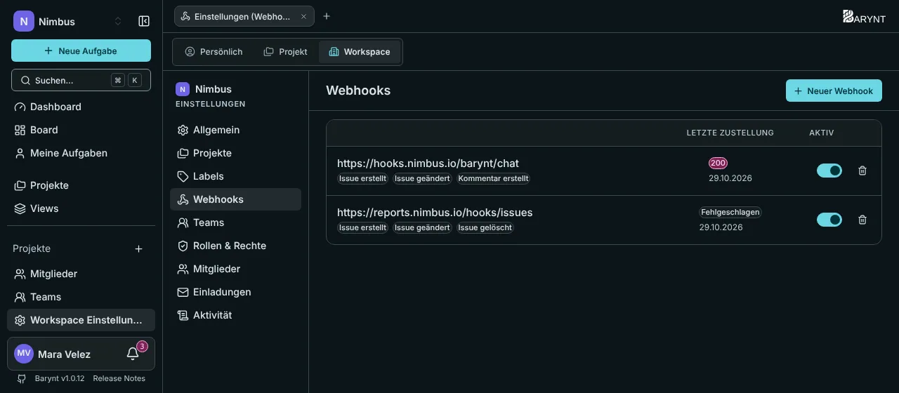
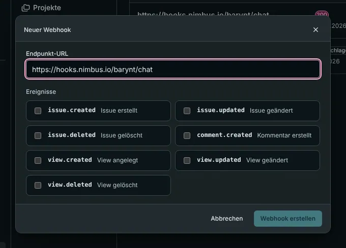

Bei einem **Webhook** ruft Barynt **dich** an. Immer wenn im Workspace etwas passiert, das dich interessiert, schickt es eine Nachricht an eine Adresse, die du wählst. So postest du neue Bugs in einen Chat-Kanal, startest einen Build, wenn eine Aufgabe auf _In Überprüfung_ wechselt, oder hältst ein anderes System aktuell, ohne immer wieder nachzusehen.



## Beispiele, was Teams damit machen

- **Chat-Benachrichtigungen:** eine Nachricht im Team-Kanal für jeden neuen _dringenden_ Bug.
- **Automatisierung:** Wird eine Aufgabe mit dem Label `Customer` angelegt, öffne ein Ticket im Support-System.
- **Berichte:** jede Änderung in ein Data Warehouse kopieren.
- Eine Tabelle, eine Statusseite oder ein Kundenportal **abgleichen**.

Manches davon braucht einen Entwickler oder ein Werkzeug wie Zapier, Make oder n8n, das einen Webhook empfangen kann. Die Einstellungsseite selbst braucht keinen Code.

## Einen einrichten

Öffne **Workspace Einstellungen → Webhooks** (du brauchst die Berechtigung, Webhooks zu verwalten, die Owner, Admins und Manager haben) und klicke auf **Neuer Webhook**.



1. **Endpunkt-URL:** die Adresse, die die Nachrichten empfangen soll, zum Beispiel `https://example.com/webhooks/barynt`.
2. **Ereignisse:** wähle, wovon du hören willst.
3. Klicke auf **Webhook erstellen**. Barynt zeigt das **Secret** einmal: Kopiere es jetzt. Der Empfänger braucht es, um zu prüfen, dass eine Nachricht wirklich von deinem Barynt kam.

Die Liste zeigt jeden Webhook mit seiner **letzten Zustellung** (dem HTTP-Status oder dem Fehler) und einem Schalter, um ihn **ein- oder auszuschalten**. Ein Webhook, der noch nie ausgelöst wurde, sagt das. Einen zu löschen stoppt ihn sofort.

## Ereignisse

| Ereignis | Wann |
| --- | --- |
| `issue.created` | Eine Aufgabe wird angelegt, in der App, über die API oder von einem KI-Assistenten. |
| `issue.updated` | Eine Aufgabe ändert sich. Die Nachricht enthält die **ganze aktuelle Aufgabe**, nicht nur den Unterschied. |
| `issue.deleted` | Eine Aufgabe wird gelöscht. |
| `comment.created` | Ein Kommentar wird geschrieben. |
| `view.created`, `view.updated`, `view.deleted` | Eine **geteilte** View ändert sich. Private Views lösen nie etwas aus. |

Webhooks gehören zu einem Workspace und melden nur Ereignisse dieses Workspace.

## Wie eine Nachricht aussieht

Barynt sendet einen HTTP-`POST` mit einem JSON-Körper:

```json
{
  "event": "issue.created",
  "timestamp": 1772870400000,
  "data": {
    "id": "i_4k2n1x",
    "ref": "WEB-42",
    "title": "Fix broken checkout flow",
    "status": "backlog",
    "priority": 2,
    "type": "feature",
    "labels": [{ "id": "l_9f2a1b", "name": "frontend" }],
    "assignee": null,
    "reporter": { "id": "u_1a2b3c", "name": "Alex Kim" },
    "project": { "id": "proj_9f8e7d", "name": "Website Relaunch" }
  }
}
```

`data` hat dieselbe Form für Aufgabe (oder Kommentar oder View) wie in der [REST-API](api.md).

## Prüfen, dass eine Nachricht echt ist

Jeder, der die empfangende Adresse kennt, könnte ihr gefälschte Nachrichten schicken. Deshalb ist jede Zustellung **signiert**. Zwei Header gehören dazu:

- `X-Barynt-Timestamp`: wann die Nachricht gesendet wurde.
- `X-Barynt-Signature`: eine Signatur der Nachricht, erzeugt mit deinem Secret.

Der Empfänger berechnet dieselbe Signatur und vergleicht. Das Rezept, für die Entwicklerin:

```js
import { createHmac, timingSafeEqual } from "node:crypto";

function isGenuine(secret, timestamp, rawBody, signature) {
  const expected = createHmac("sha256", secret)
    .update(`${timestamp}.${rawBody}`) // Zeitstempel, ein Punkt, der rohe Body
    .digest("hex");
  return timingSafeEqual(Buffer.from(expected), Buffer.from(signature));
}
```

Weise außerdem Nachrichten zurück, deren Zeitstempel älter als ein paar Minuten ist. Das verhindert, dass jemand eine alte Nachricht erneut abspielt.

## Gut zu wissen

- **Nur ein Versuch.** Barynt sendet jede Nachricht einmal, wartet zehn Sekunden auf eine Antwort und wiederholt nicht. Ist dein Empfänger nicht erreichbar, verpasst er diese Nachricht. Der Status der letzten Zustellung steht in der Liste, du siehst es also. Empfänger sollten schnell antworten und langsame Arbeit danach erledigen.
- **Keine Reihenfolge-Garantie.** Zwei schnelle Änderungen können in beliebiger Reihenfolge ankommen. Nutze die Zeit `updated` in den Daten, um zu erkennen, welche neuer ist.
- Eine Nachricht trägt den Inhalt der Aufgabe, etwa Titel und Beschreibung. Geh sorgfältig mit der empfangenden Adresse um und nutze **HTTPS**.

Scheint ein Webhook nicht anzukommen, siehe [Fehlerbehebung](../administration/troubleshooting.md).
