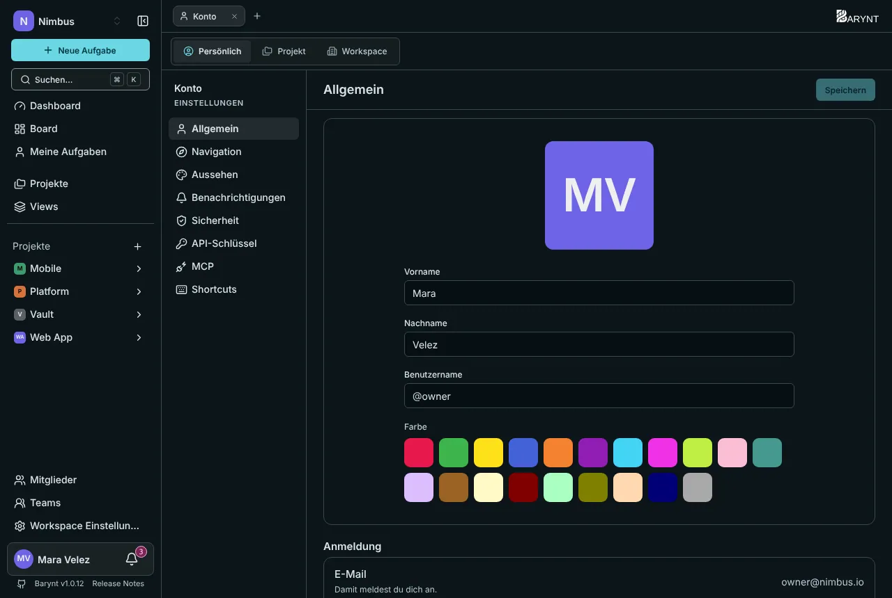
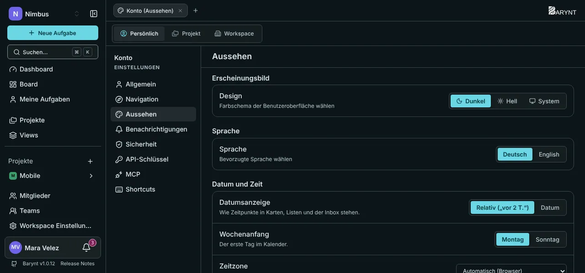
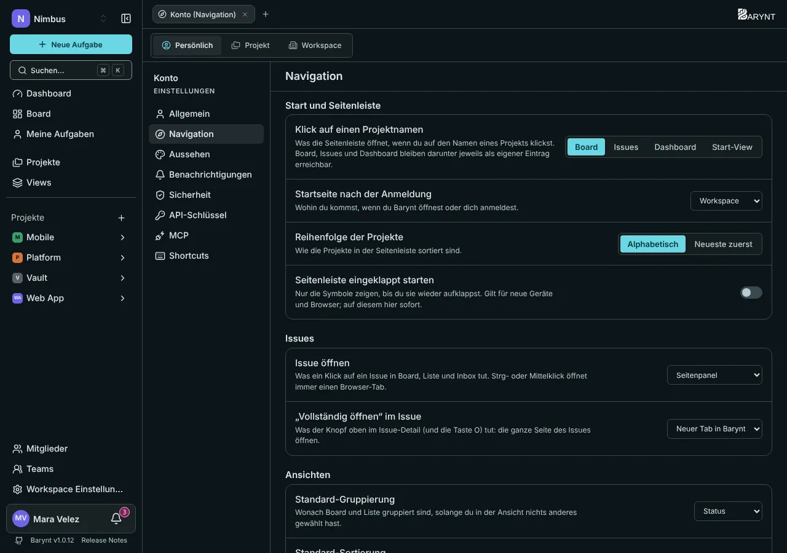
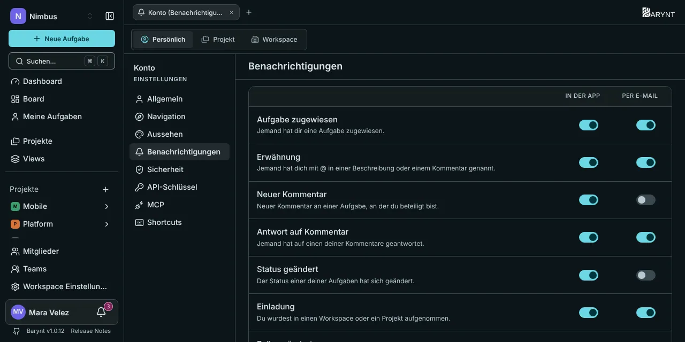
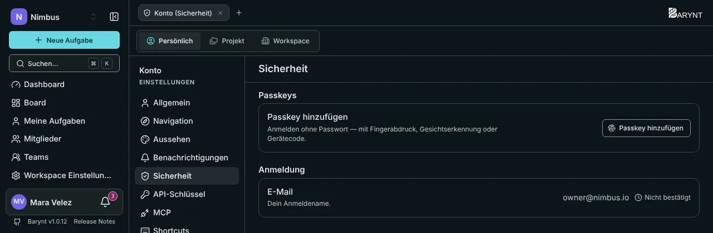

Alles auf dieser Seite gilt **nur für dich**. Es wird in deinem Konto gespeichert und folgt dir deshalb auf jedes Gerät und in jeden Browser.

Zum Öffnen klicke unten in der Seitenleiste auf **deinen Namen** und wähle **Einstellungen**. Der Tab _Persönlich_ oben ist dieser Bereich. Die anderen beiden Tabs, _Projekt_ und _Workspace_, gehören zu den [Projekt-](../administration/project-settings.md) und [Workspace-Einstellungen](../administration/workspace.md).

## Allgemein

- **Bild, Vorname, Nachname** sind das, wie Kolleginnen und Kollegen dich sehen. Ist kein Bild gesetzt, bekommst du deine Initialen auf einer Farbe deiner Wahl.
- Der **Benutzername** ist dein kurzes Kürzel für `@Erwähnungen` und für Filteradressen wie `?assignee=@mara`. Er ist einmalig und darf Kleinbuchstaben, Ziffern und Bindestriche enthalten.
- **Anmeldung** zeigt die E-Mail-Adresse, mit der du dich anmeldest.

## Aussehen

- **Design:** dunkel, hell oder _System_, das deinem Rechner folgt.
- **Sprache:** Deutsch oder Englisch. Sie gilt für die ganze Oberfläche.
- **Datumsanzeige:** relativ („vor 2 Tagen“) oder das tatsächliche Datum, auf Karten, in Listen und im Posteingang.
- **Wochenanfang:** Montag oder Sonntag, für Kalender.
- **Zeitzone:** automatisch aus deinem Browser oder eine, die du wählst.

## Navigation

Wohin Klicks führen, wo du startest und wie sich Aufgaben öffnen.

| Einstellung | Was sie bestimmt |
| --- | --- |
| **Klick auf einen Projektnamen** | Ob die Seitenleiste das _Board_, die Liste (_Issues_), das _Dashboard_ oder deine eigene _Start-View_ öffnet. |
| **Startseite nach der Anmeldung** | Wo du landest: der _Workspace_ (die Übersicht), _Meine Issues_, die _Inbox_, das _Dashboard_ oder eine View deiner Wahl. |
| **Reihenfolge der Projekte** | Alphabetisch oder neueste zuerst. |
| **Seitenleiste eingeklappt starten** | Nur Symbole, bis du sie ausklappst. |
| **Issue öffnen** | Was ein Klick auf eine Aufgabe tut: ein _Seitenpanel_, eine _eigene Seite_, einen _neuen Tab in Barynt_ oder einen _neuen Browser-Tab_ öffnen. |
| **„Vollständig öffnen“ im Issue** | Was die Schaltfläche oben in einer Aufgabe (und die Taste `O`) tut. |
| **Standard-Gruppierung, Standard-Sortierung** | Was Boards und Listen nutzen, bis du in einer View etwas anderes wählst. |
| **Unteraufgaben im Board zeigen** | Die Voreinstellung für Views, bei denen du noch nichts entschieden hast. |

Hältst du beim Klicken `Strg` (oder `⌘`) gedrückt oder nutzt die mittlere Maustaste, öffnet sich immer ein Browser-Tab.

## Benachrichtigungen

Wähle für jedes Ereignis, ob du es **in der App**, **per E-Mail**, beides oder keines von beiden willst. Die Einzelheiten stehen unter [Meine Aufgaben, Posteingang und Benachrichtigungen](my-work.md).

## Sicherheit

- **Passkeys** lassen dich mit Fingerabdruck, Gesicht oder einer Geräte-PIN anmelden, ganz ohne Passwort. Klicke auf jedem Gerät, das du nutzt, auf **Passkey hinzufügen**. Ein Passkey, der über deinen Passwortmanager oder dein Cloud-Konto synchronisiert wird (iCloud-Schlüsselbund, Google Passwortmanager, 1Password), ist als _synchronisiert_ markiert.
- Die **E-Mail** ist dein Anmeldename. Eine bestätigte Adresse schaltet außerdem Anmelde-Links, Einladungen und E-Mail-Benachrichtigungen frei und ist dein **Weg zurück hinein**, falls du je deinen Passkey verlierst. Füge eine hinzu.
- **Verbundene Konten** (wenn deine Administration Firmen-Logins aktiviert hat) listet die Anbieter, mit denen du dich anmelden kannst. Hast du einen Passkey, kannst du sie jederzeit trennen. Ohne einen lässt sich das letzte verbundene Konto nicht entfernen, weil du dich damit aussperren würdest.

> [!TIP]
> Barynt erinnert dich einmal daran, einen Passkey einzurichten. Das dauert zehn Sekunden und ist zugleich der sicherste Weg hinein.

## API-Schlüssel und MCP

Zwei Bereiche dienen dazu, andere Werkzeuge zu verbinden. Sie stehen im Kapitel Integrationen: [REST-API](../integrations/api.md) für persönliche API-Schlüssel und [MCP-Server](../integrations/mcp.md), um einen KI-Assistenten zu verbinden.

## Tastenkombinationen

Du siehst und änderst sie im Bereich _Shortcuts_ und schaltest dort **Vor dem Löschen nachfragen** ein oder aus. Siehe [Suche und Tastenkombinationen](shortcuts.md).
