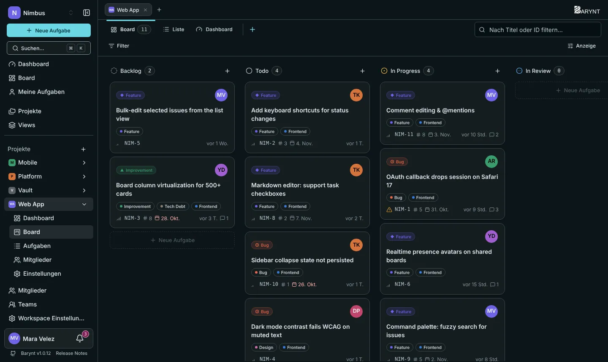
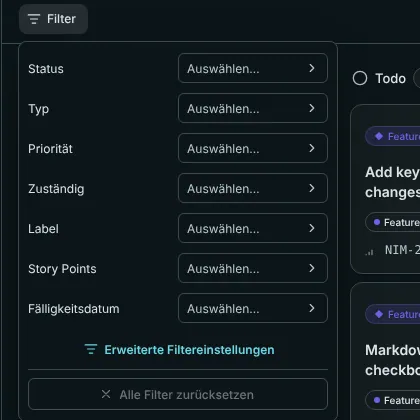

Barynt hat zwei Grundlayouts für Aufgaben. Sie zeigen dieselben Daten, nimm also, was gerade passt: das **Board**, um Arbeit voranzubringen, die **Liste**, um viele Aufgaben zu überblicken, zu sortieren und abzuarbeiten.

## Das Board

Jede **Spalte** ist ein Status: _Rückstand_, _Offen_, _In Bearbeitung_, _In Überprüfung_ und _Erledigt_. Jede Aufgabe ist eine Karte. Die Karte zeigt: ihr Projekt (auf dem Workspace-Board), Typ, Titel, Labels, Nummer, Priorität, das Bild der zuständigen Person, wann sie zuletzt geändert wurde und wie viele Kommentare sie hat.

- **Ziehe eine Karte** in eine andere Spalte, und ihr Status ändert sich sofort für alle.
- **Ziehe eine Karte nach oben oder unten** innerhalb einer Spalte, um sie zu ordnen. Die Reihenfolge, die du festlegst, sehen alle (die voreingestellte _manuelle_ Sortierung).
- **Klicke eine Karte an**, um sie zu öffnen, oder bewege dich mit den Pfeiltasten und drücke `Enter`.
- Das **+** am Kopf einer Spalte legt eine Aufgabe in diesem Status an.
- **Abgebrochene** Aufgaben erscheinen nicht als Spalte, lassen sich aber über _Angezeigte Gruppen_ zurückholen (siehe unten).

Keine Maus zur Hand? Öffne die Karte und ändere den Status mit `S`, oder drücke `⌘K` und nutze die Befehle.

> [!NOTE]
> Ändert eine Kollegin etwas, während dein Board offen ist, erscheint ein kleiner Hinweis „Es gibt Änderungen.“ mit einer Schaltfläche **Aktualisieren**. Eigene Änderungen lösen ihn nie aus.

## Die Liste

Die Liste zeigt dieselben Aufgaben als Zeilen: Nummer, Titel, Status, Priorität, Zuständige, Labels und das Datum. Die Zeilen sind gruppiert (standardmäßig nach Status), und jede Gruppe lässt sich einklappen. Klicke eine Zeile an, um die Aufgabe zu öffnen.

Mit `J` und `K` gehst du nach unten und oben, mit `Enter` öffnest du, wie in vielen Mailprogrammen.

## Anzeige: wähle, was du siehst

Die Schaltfläche **Anzeige** rechts öffnet ein kleines Menü. Deine Einstellungen werden für dich gemerkt, pro Projekt.

| Einstellung | Was sie bewirkt |
| --- | --- |
| **Board / Liste** | Wechselt das Layout. |
| **Spalten / Gruppierung** | Nach _Status_ (voreingestellt), _Priorität_, _Typ_, _Zuständig_ oder _Story Points_ gruppieren. Auf dem Workspace-Board auch nach _Projekt_. |
| **Bahnen** (Swimlanes) | Eine zweite Gruppierung als horizontale Reihen, etwa Spalten nach Status und eine Reihe pro Person. |
| **Sortierung** | _Standard_ (deine manuelle Ordnung) oder sortiert nach Priorität, Typ, Status, Story Points, Fälligkeit, Zeitschätzung, letzter Änderung, Erstellung, Titel oder Zuständigkeit, auf- oder absteigend. |
| **Angezeigte Gruppen** | Spalten ausblenden, die du nicht brauchst, etwa Rückstand, und die übrigen umsortieren. |
| **Leere Gruppen automatisch ausblenden** | Klappt Spalten ohne Aufgaben zu. |
| **Unteraufgaben anzeigen** | Zeigt Unteraufgaben neben ihren übergeordneten. Standardmäßig aus. |
| **Angezeigte Felder** | Welche Details Karten zeigen: Priorität, Labels, Story Points, Fälligkeitsdatum. |
| **Zurücksetzen** | Zurück zu den Voreinstellungen. |

Willst du eine dieser Einstellungen morgen wieder haben oder mit deinem Team teilen, speichere sie als [View](views.md).

## Filtern: nur zeigen, was zählt

Klicke über dem Board auf **Filter**. Die Schnellfilter sind _Status_, _Typ_, _Priorität_, _Zuständig_ und _Label_. Wähle in jedem einen oder mehrere Werte. **Alle Filter zurücksetzen** beginnt von vorn.

Für alles Genauere öffne die **erweiterten Filtereinstellungen**. Dort baust du Bedingungen selbst:

- Zu den Feldern gehören Status, Typ, Priorität, Zuständigkeit, Ersteller, Labels, Fälligkeitsdatum, Story Points und ob es eine Unteraufgabe ist.
- Zu den Vergleichen gehören _ist_, _ist nicht_, _ist leer_, _mindestens_, _höchstens_, _vor_, _nach_ und _innerhalb_.
- Spezielle Werte sparen Tipparbeit: **Ich** steht für die Person, die gerade schaut, und Daten können relativ sein, etwa _überfällig_, _heute_, _nächste 7 Tage_ oder _letzte 30 Tage_.
- Bedingungen lassen sich mit **UND** oder **ODER** verknüpfen und in Kästen gruppieren.

Um eine Aufgabe nach Name oder Nummer zu finden, nutze das Feld **Nach Titel oder ID filtern…** neben den Tabs. Für eine Suche über alles drücke `⌘K`, siehe [Suche und Tastenkombinationen](shortcuts.md).

## Workspace-weites Board und Liste

**Board** und **Aufgaben** im oberen Teil der Seitenleiste leisten dasselbe über alle deine Projekte. Die Karten tragen dann den Projektnamen, und du kannst nach Projekt gruppieren.
