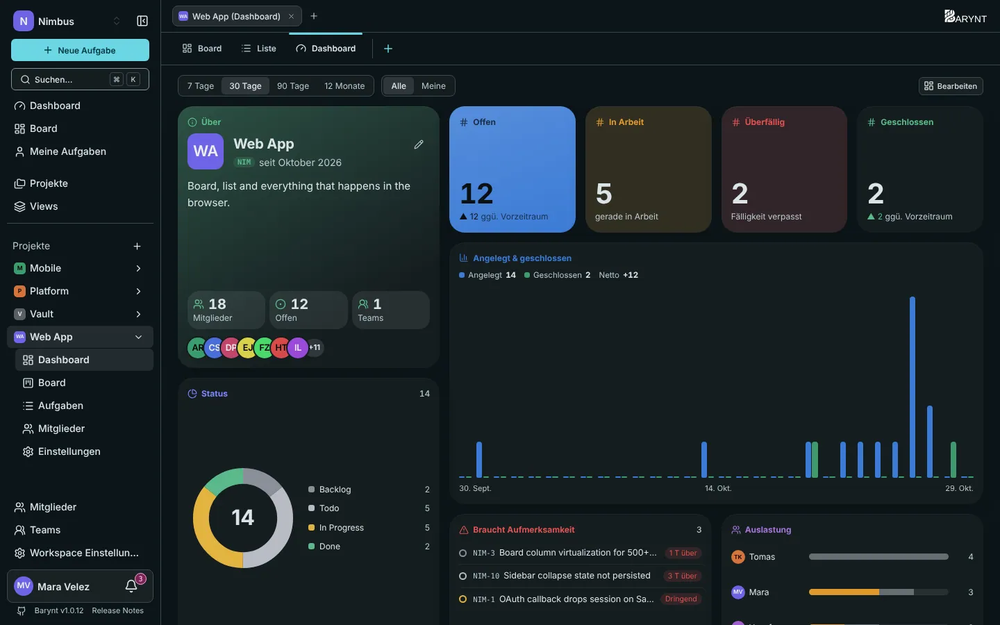
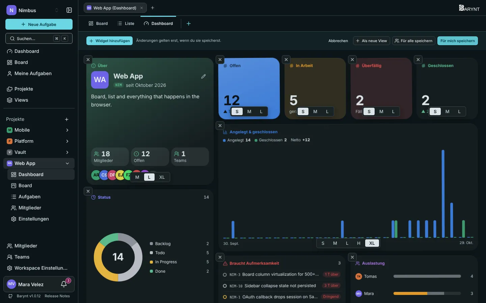
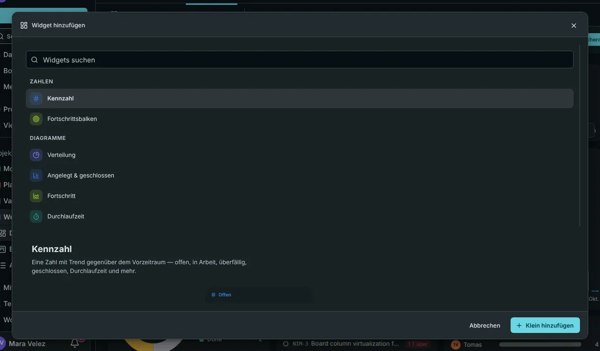

Ein **Dashboard** macht aus den Aufgaben eines Projekts oder des ganzen Workspace ein Bild. Es besteht aus **Widgets**: kleinen Kacheln mit einer Zahl, einem Diagramm oder einer Liste. Du entscheidest, welche du willst und wo sie sitzen.

## Wo du es findest

- **Workspace-Dashboard:** _Dashboard_ oben in der Seitenleiste. Es umfasst alle Projekte, die du sehen kannst.
- **Projekt-Dashboard:** der Tab _Dashboard_ (oder Seitenleisten-Eintrag) in einem Projekt.

## Ein Dashboard lesen

Zwei Schalter oben steuern alles auf der Seite:

- **Zeitraum:** 7 Tage, 30 Tage, 90 Tage oder 12 Monate. Die Trendpfeile vergleichen immer mit dem Zeitraum davor.
- **Umfang:** **Alle** zeigt das ganze Projekt oder den ganzen Workspace, **Meine** nur deine eigenen Aufgaben. _Alle_ zu sehen braucht eine Berechtigung (_Dashboard-Zahlen des ganzen Projekts sehen_). Ohne sie (der übliche Fall für Teammitglieder) siehst du deine eigenen Zahlen, und die Seite sagt es dir.

### Was die Standard-Widgets dir sagen

| Widget | Die Frage, die es beantwortet |
| --- | --- |
| **Über** | Was ist dieses Projekt, wer ist dabei, wie viele Aufgaben sind offen? |
| **Offen, In Bearbeitung, Überfällig, Geschlossen** | Die vier Zahlen, die eine Leitung zuerst prüft, jeweils mit dem Trend gegenüber dem Zeitraum davor. |
| **Status** | Wie verteilt sich die Arbeit auf Rückstand, Offen, In Bearbeitung, Erledigt? |
| **Angelegt und geschlossen** | Was hereinkam und was erledigt wurde, pro Tag, Woche oder Monat. Wo die blauen Balken die grünen überragen, wächst der Rückstau. |
| **Braucht Aufmerksamkeit** | Was gefährdet ist: überfällig, dringend und nicht zugewiesen, dringend, oder in Bearbeitung, aber seit zwei Wochen unberührt. |
| **Auslastung** | Wer wie viel offen hat, aufgeteilt in in Bearbeitung und noch nicht begonnen. |
| **Fortschrittsbalken** | Wie viel einer gewählten Menge erledigt ist, zum Beispiel alles mit dem Label `Release 2.4`. |
| **Projekte** | Jedes Projekt mit seinen offenen Aufgaben, einen Klick entfernt (Workspace-Dashboard). |

## Weitere Widgets

Klicke auf **Bearbeiten**, dann auf **Widget hinzufügen**, um die Galerie zu öffnen. Du kannst sie durchsuchen, und jeder Eintrag zeigt eine Live-Vorschau mit deinen eigenen Zahlen.

| Gruppe | Widgets |
| --- | --- |
| **Zahlen** | Kennzahl (offen, in Bearbeitung, überfällig, geschlossen, Durchlaufzeit und mehr), Fortschrittsbalken |
| **Diagramme** | Verteilung (Ring oder Balken nach Status, Priorität, Typ, Zuständigkeit, Label oder Projekt), Angelegt & geschlossen, Fortschritt (Burn-up), Durchlaufzeit, Cumulative Flow, Zeit je Status, Auslastung, Matrix (zwei Eigenschaften gegeneinander, als Heatmap), Alter offener Aufgaben |
| **Listen** | Braucht Aufmerksamkeit, Aufgabenliste (beliebiger Filter), Aktivität |
| **Überblick** | Über, Mitglieder, Teams, Labels, Projekte, Links, Schnellzugriff |
| **Frei** | Notiz (Ziele, Text, Links), Einbettung (eine Website oder ein Bild), Eigenes Widget |

Die meisten Widgets können einen **eigenen Filter** zusätzlich zu dem des Dashboards haben, sodass eine Kachel „nur Bugs“ zeigt, während eine andere alles zeigt.

## Mach es zu deinem

Klicke oben rechts auf **Bearbeiten**. Jetzt kannst du:

- Ein Widget an eine neue Stelle **ziehen**.
- Seine **Größe** mit den kleinen Schaltflächen darunter ändern: **S**, **M**, **L**, **T** (hoch), **XL** oder **W** (volle Breite).
- Es mit dem **×** in der Ecke **entfernen**.
- Mit _Widget hinzufügen_ weitere **hinzufügen**.

Wenn du fertig bist, wählst du, wie gespeichert wird:

| Schaltfläche | Was sie bewirkt |
| --- | --- |
| **Für mich speichern** | Deine eigene Anordnung. Alle anderen behalten die Vorgabe. |
| **Für alle speichern** | Macht dies zur Vorgabe für alle, die nichts selbst geändert haben. Braucht die Berechtigung _Standard-Dashboard-Layout festlegen_, die Workspace-Owner, Admins, Manager und Project Admins haben. |
| **Als neue View** | Behält dieses Dashboard samt Filter als eigene [View](views.md), zum Beispiel „Dashboard des Mobile-Teams“. |
| **Abbrechen** | Geht zurück zum zuletzt gespeicherten Stand. |

## Eigene Widgets

Findest du nicht, was du brauchst? Baue ein **eigenes Widget** aus Bausteinen: Zahlen, Fortschrittsbalken, Verteilungen, Zeitreihen, Matrizen und Aufgabenlisten, jeweils mit eigenem Filter. Beginne mit einer Vorlage (_Sprint-Status_ ist beliebt), gib ihm einen Namen und hake **Im Workspace teilen** an, wenn alle es in ihrer Galerie finden sollen. Ein geteiltes Widget kannst nur du ändern. Bereits platzierte Widgets bleiben, wenn das eigene gelöscht wird.

## Gut zu wissen

- Die **Durchlaufzeit** ist die Zeit vom Anlegen einer Aufgabe bis zu ihrem Abschluss, gezeigt als Median, P75 und P95. Es zählen nur geschlossene Aufgaben.
- Eine _geschlossene_ Aufgabe ist eine, deren Status _Erledigt_ oder _Abgebrochen_ wurde. Sie wieder zu öffnen nimmt sie aus den Geschlossen-Zahlen heraus.
- Alles auf einem Dashboard beachtet Berechtigungen: Du siehst immer nur Aufgaben aus Projekten, die du sehen kannst.
