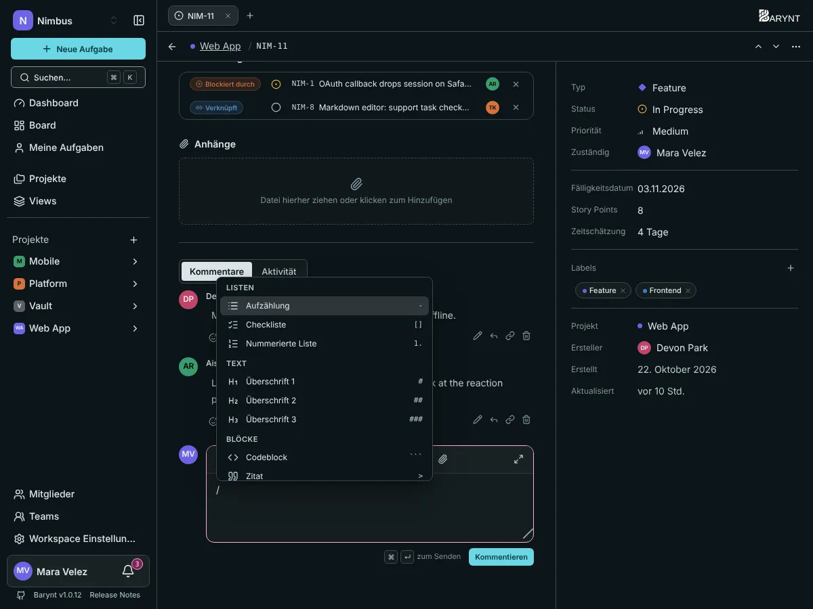

---

title: "Schreiben und Formatieren"
description: "Beschreibungen und Kommentare in Barynt sind formatierter Text. Mit / fügst du alles Mögliche ein, mit @ erwähnst du Menschen, mit # verlinkst du Aufgaben."
sidebar:
order: 2
---

Aufgabenbeschreibungen und Kommentare nutzen denselben Editor. Er ist mit Absicht einfach: Du kannst reinen Text schreiben und gar nicht darüber nachdenken, und die Formatierung ist da, wenn du sie brauchst.

## Tippe `/` für alles

Tippe an beliebiger Stelle im Text **`/`**, um das Befehlsmenü zu öffnen, und tippe weiter, um einzugrenzen („/tabelle“, „/code“). Nutze die Pfeiltasten und `Enter` oder klicke.

| Gruppe       | Was du einfügen kannst                                                                      |
| ------------ | ------------------------------------------------------------------------------------------- |
| **Text**     | Überschrift 1, 2 oder 3                                                                     |
| **Listen**   | Aufzählung, nummerierte Liste, Checkliste mit Kästchen                                      |
| **Blöcke**   | Codeblock, Zitat, Info-Feld, Warn-Feld, Tabelle, Trennlinie                                 |
| **Einfügen** | Link, Bild, Video oder Datei, einen Menschen erwähnen, eine andere Aufgabe verlinken, Datum |

Auch Kurzformen funktionieren beim Tippen: `#` mit Leerzeichen beginnt eine Überschrift, `-` mit Leerzeichen eine Aufzählung, `1.` eine nummerierte Liste, `[ ]` eine Checkliste.

## Text formatieren

Die Werkzeugleiste über dem Text bietet fett, kursiv, durchgestrichen, Code im Text, Überschriften, Listen, eine Checkliste, ein Zitat, Links und Anhänge. Auch die üblichen Tastenkombinationen funktionieren: fett (`⌘B`), kursiv (`⌘I`) und `⌘K` / `Strg+K` für einen Link.

## Menschen mit `@` erwähnen

Tippe `@` und die ersten Buchstaben eines Namens. Wähle die Person aus der Liste, und sie ist erwähnt, was ihr eine Benachrichtigung schickt (siehe [Posteingang und Benachrichtigungen](my-work.md)). Du kannst in der Beschreibung und in Kommentaren erwähnen.

## Aufgaben mit `#` verlinken

Tippe `#` und ein paar Buchstaben eines Titels oder eine Nummer wie `#NIM-12`. Der Verweis wird zu einem Link, der Nummer und Titel der Aufgabe zeigt, damit alle direkt dorthin springen können. So sagst du mitten im Satz einfach „das hängt hiermit zusammen“.

## Bilder, Videos und Dateien

Wähle _Bild, Video oder Datei_ im `/`-Menü oder nutze die Büroklammer in der Werkzeugleiste. Du kannst eine Datei hochladen oder eine von einer Adresse einfügen. Uploads brauchen eingerichteten [Objektspeicher](../administration/storage.md). Die Grenze liegt bei 100 MB pro Datei.

## Checklisten

Eine Checkliste ist der schnellste Weg, kleine Schritte innerhalb einer Aufgabe zu verfolgen. Hake die Kästchen ab, während du vorankommst. Verdient ein Schritt eigene Zuständigkeit, einen eigenen Status und eine eigene Diskussion, mache lieber eine [Unteraufgabe](relations.md) daraus.

## Info- und Warn-Felder

Felder setzen einen Absatz in einem farbigen Kasten ab. Nimm ein _Info-Feld_ für Hintergrund und ein _Warn-Feld_ für etwas, das niemand übersehen darf, etwa „nicht freitags deployen“.

## Kommentare

Das Kommentarfeld liegt unter der Beschreibung. `⌘↵` / `Strg+Enter` sendet. Dasselbe Feld erledigt auch **Antworten**: Klicke unter einem Kommentar auf _Antworten_, und der Thread bleibt zusammen. Reagiere mit einem Emoji unter jedem Kommentar, oft reicht das schon als Antwort.

Eigene Kommentare lassen sich bearbeiten (es erscheint „(bearbeitet)“) und löschen. Ob du Kommentare anderer bearbeiten oder löschen darfst, hängt von deiner Rolle ab, siehe [Rollen und Berechtigungen](../administration/roles.md).

## Vollbild und lange Texte

Schreibst du eine lange Beschreibung? Nutze die Vollbild-Schaltfläche in der Werkzeugleiste für die ganze Höhe des Bildschirms. Auf dem Handy oder Tablet öffnet sich der Editor an Ort und Stelle und lässt die Aufgabe über der Tastatur sichtbar.

> [!TIP]
> Brichst du einen Kommentar ab, bleibt sein Text als Entwurf erhalten, und du kannst später daran weiterarbeiten.
