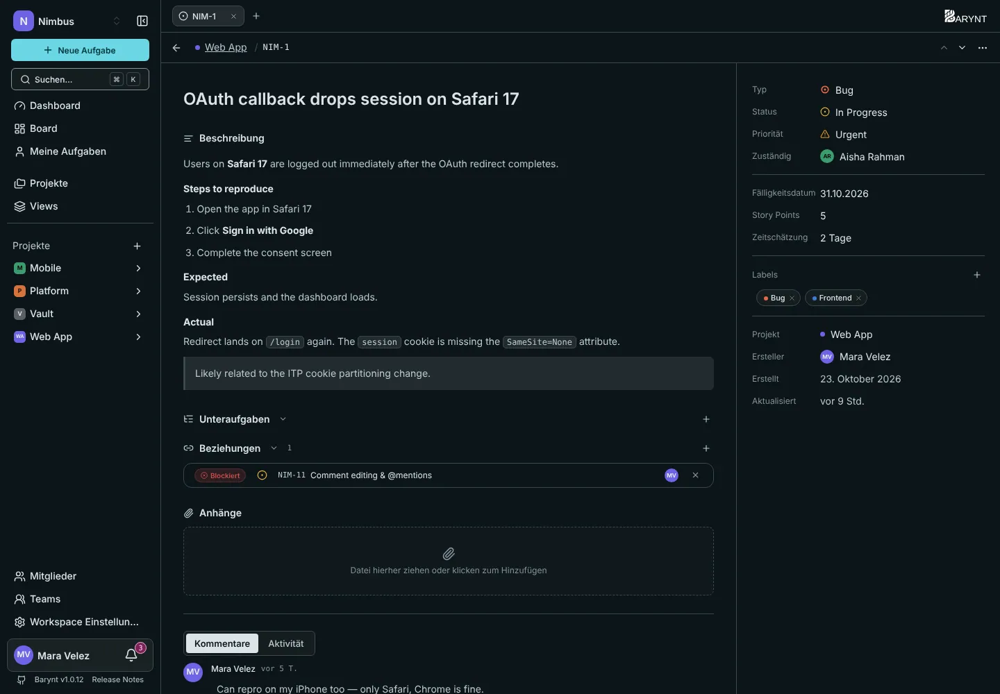
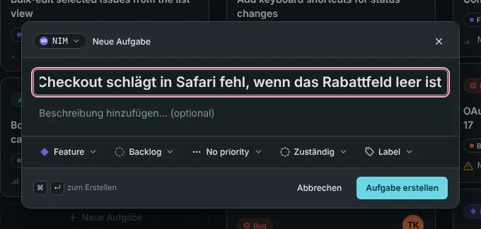

Eine **Aufgabe** (englisch _Issue_) ist ein Stück Arbeit: eine To-do, ein Fehler, eine Idee. Alles andere in Barynt, vom Board bis zum Dashboard, ist nur eine Art, Aufgaben anzusehen. Diese Seite handelt von der Aufgabe selbst.

## Eine Aufgabe anlegen

Es gibt mehrere Wege, die alle zum selben kleinen Dialog führen:

- Drücke **`C`** irgendwo in der App (solange du nicht in einem Feld tippst).
- Klicke oben in der Seitenleiste auf **Neue Aufgabe**.
- Klicke auf das **+** am Kopf einer Spalte im Board, das wählt gleich den Status dieser Spalte vor.
- Drücke `⌘K` / `Strg+K` und wähle _Neue Aufgabe erstellen_.

Nur der **Titel** ist Pflicht. Alles andere kannst du jetzt oder später ausfüllen. `⌘↵` / `Strg+Enter` legt die Aufgabe an.

> [!TIP]
> Aufgaben kommen auch von außen: über die [REST-API](../integrations/api.md) oder von einem KI-Assistenten über [MCP](../integrations/mcp.md). Die Aufgabe zeigt dann, woher sie kam („Erstellt über MCP“).

## Die Aufgabenseite

Klicke irgendwo auf eine Aufgabe (Board, Liste, Posteingang, Suche), und sie öffnet sich. Standardmäßig öffnet sie sich in einem **Seitenpanel** neben deiner Liste, damit du deinen Platz nicht verlierst. Mit `E` wechselst du zwischen Seitenpanel und Dialog, mit `O` öffnest du sie als ganze Seite. Was ein Klick bewirkt, stellst du unter _Persönliche Einstellungen → Navigation_ ein, siehe [Konto und persönliche Einstellungen](account.md).

Die Seite hat zwei Teile:

- **Links** steht die Geschichte: Titel, Beschreibung, Unteraufgaben, Beziehungen, Anhänge und darunter die Tabs **Kommentare** und **Aktivität**.
- **Rechts** stehen die Eigenschaften.

### Eigenschaften

| Eigenschaft | Wofür sie da ist |
| --- | --- |
| **Typ** | Die Art der Arbeit: Feature, Bug, Improvement, Task oder Chore. |
| **Status** | Wo sie steht: Rückstand, Offen, In Bearbeitung, In Überprüfung, Erledigt oder Abgebrochen. |
| **Priorität** | Wie dringend: Keine Priorität, Niedrig, Mittel, Hoch oder Dringend. |
| **Zuständig** | Die eine verantwortliche Person. |
| **Labels** | Beliebig viele Schlagwörter, aus dem Projekt oder dem Workspace. |
| **Projekt, Ersteller, Daten** | Wo sie liegt, wer sie geschrieben hat, wann sie erstellt und zuletzt geändert wurde. |

Klicke auf eine Eigenschaft, um sie zu ändern, oder fahre über die Aufgabe und nutze die Einzeltasten: `S` Status, `P` Priorität, `A` Zuständig, `I` mir zuweisen, `L` Labels.

### Planungsfelder

Drei optionale Felder helfen beim Planen. Sie sind standardmäßig aus und lassen sich pro Projekt unter _Projekteinstellungen → Felder_ einschalten, siehe [Projekteinstellungen](../administration/project-settings.md).

- Das **Fälligkeitsdatum** ist ein Kalendertag. Es speist die Zahl der _überfälligen_ Aufgaben im Dashboard und die Fälligkeitsfilter.
- **Story Points** sind eine ganze Zahl, meist 1, 2, 3, 5, 8 oder 13, für Teams, die in Punkten schätzen.
- Die **Zeitschätzung** ist eine Dauer. Du kannst sie in Stunden, Tagen, Wochen, Monaten oder Jahren eingeben, und Barynt merkt sich die Einheit, die du benutzt hast.

Du kannst eines, beide oder keines nutzen. Zwischen ihnen wird nicht umgerechnet.

## Eine Aufgabe voranbringen

Ändere den Status in den Eigenschaften, mit `S` oder indem du die Karte im [Board](boards.md) ziehst. Wird eine Aufgabe **Erledigt** oder **Abgebrochen**, merkt sich Barynt den Zeitpunkt. Daran misst das Dashboard, wie viel dein Team schafft und wie lange Dinge dauern. Kommt sie zurück in Arbeit, wird dieser Zeitpunkt wieder gelöscht.

## Darüber sprechen

Unter der Beschreibung steht die Diskussion. Schreibe einen Kommentar, erwähne mit `@` eine Kollegin oder einen Kollegen oder verweise mit `#` auf eine andere Aufgabe. Antworten und Emoji-Reaktionen halten lange Threads lesbar. Zuständige und Ersteller erfahren von neuen Kommentaren, wen du erwähnst, bekommt eine Benachrichtigung, ebenso die Autorin eines Kommentars, auf den du antwortest. Siehe [Posteingang und Benachrichtigungen](my-work.md).

Der Tab **Aktivität** ist die andere Hälfte der Geschichte. Er listet jede Änderung an dieser Aufgabe: wer den Status, die zuständige Person oder die Labels geändert hat, und wann. Nichts davon lässt sich bearbeiten, du kannst dich also darauf verlassen.

Mehr zum guten Schreiben unter [Schreiben und Formatieren](editor.md).

## Aufteilen und verknüpfen

- **Unteraufgaben** zerlegen eine große Aufgabe in kleinere Schritte, jeder mit eigener Zuständigkeit und eigenem Status.
- **Beziehungen** sagen, wie Aufgaben voneinander abhängen: _blockiert_, _wird blockiert von_, _verknüpft_, _ist Duplikat von_.
- **Anhänge** enthalten Dateien und Links.

Alle drei behandelt [Unteraufgaben, Beziehungen und Anhänge](relations.md).

## Teilen und löschen

Das **…**-Menü oben an der Aufgabe bietet:

- **Teilen**, das einen schreibgeschützten öffentlichen Link für Menschen ohne Konto erstellt, siehe [Eine Aufgabe teilen](sharing.md).
- **Aufgabe löschen**, das sie endgültig entfernt. Unteraufgaben werden nicht mitgelöscht: Sie rücken eine Ebene nach oben.

Die Aufgabennummer kopierst du mit `⌘.` / `Strg+.`, einen Link darauf mit `⌘⇧,` / `Strg+Umschalt+,`.

## Wer was darf

Was du ändern kannst, hängt von deiner Rolle im Projekt ab:

- Ein **Contributor** (die übliche Rolle) kann Aufgaben anlegen, **eigene** bearbeiten und löschen (von ihm erstellt oder ihm zugewiesen), Aufgaben zuweisen und alles kommentieren, was er sieht.
- Ein **Project Admin** kann jede Aufgabe bearbeiten und löschen.
- Ein **Viewer** kann lesen und kommentieren.

Die Einzelheiten stehen unter [Rollen und Berechtigungen](../administration/roles.md).
