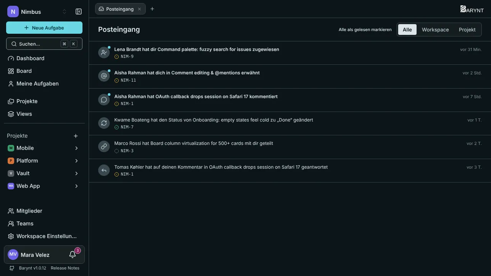

Teams ersticken im Lärm, wenn alles alle anpingt. Barynt hält zwei Dinge auseinander: **Meine Aufgaben** ist die Liste deiner Arbeit, und der **Posteingang** ist die kurze Liste dessen, was jetzt deine Aufmerksamkeit braucht.

## Meine Aufgaben

Klicke in der Seitenleiste auf **Meine Aufgaben**. Du siehst alles, was dir zugewiesen ist, über **alle Projekte** hinweg, standardmäßig als Board. Es ist eine der zwei System-Views, die jeder Workspace hat (siehe [Views](views.md)), du kannst sie also wie jedes andere Board oder jede Liste filtern, gruppieren und sortieren. Mit der Tastatur: `G`, dann `I`.

Ein guter Ort, um den Tag zu beginnen: Was gehört mir, was ist in Bearbeitung, was wartet auf Überprüfung.

## Der Posteingang

Der **Posteingang** sammelt Benachrichtigungen über Dinge, die dich betreffen. Die **Glocke** neben deinem Namen unten in der Seitenleiste öffnet ihn und zeigt, wie viele Benachrichtigungen ungelesen sind.

Benachrichtigungen kommen, wenn:

| Ereignis | Du erfährst es, wenn … |
| --- | --- |
| **Aufgabe zugewiesen** | Dir jemand eine Aufgabe zuweist. |
| **Erwähnung** | Dich jemand mit `@` in einer Beschreibung oder einem Kommentar nennt. |
| **Neuer Kommentar** | Jemand eine Aufgabe kommentiert, die du erstellt hast oder die dir zugewiesen ist. |
| **Antwort auf Kommentar** | Jemand auf einen deiner Kommentare antwortet. |
| **Status geändert** | Sich der Status einer Aufgabe ändert, die du erstellt hast oder die dir zugewiesen ist. |
| **Einladung** | Du zu einem Workspace oder Projekt hinzugefügt wirst. |
| **Rolle geändert** | Sich deine Rolle in einem Workspace oder Projekt ändert. |
| **Aufgabe geteilt** | Jemand eine Aufgabe direkt mit dir teilt. |

Niemand wird über die eigenen Aktionen benachrichtigt. Wirst du in einem Kommentar erwähnt, bekommst du die Erwähnung, nicht zusätzlich noch einen „neuen Kommentar“.

### Den Posteingang abarbeiten

- **Nach Ort filtern** mit den Tabs _Alle_, _Workspace_ und _Projekt_.
- **Klicke eine Benachrichtigung an**, um die Aufgabe zu öffnen. Sie wird als gelesen markiert.
- **Alle als gelesen markieren** leert die Liste in einem Zug.
- Mach den Posteingang zu deiner **Startseite** unter _Persönliche Einstellungen → Navigation_, wenn du darin lebst, siehe [Konto und persönliche Einstellungen](account.md).

## Benachrichtigungen per E-Mail

Jedes Ereignis kann **in der App**, **per E-Mail**, beides oder keines von beiden kommen. Das bestimmst du unter _Persönliche Einstellungen → Benachrichtigungen_:

| Ereignis | In der App | Per E-Mail |
| --- | :---: | :---: |
| Aufgabe zugewiesen, Erwähnung, Antwort, Einladung, Rolle geändert, Aufgabe geteilt | an | an |
| Neuer Kommentar, Status geändert | an | **aus** |

Kommentare und Statusänderungen sind standardmäßig aus, weil sie häufig sein können. Schalte sie ein, wenn du E-Mail dem Posteingang vorziehst.

> [!NOTE]
> E-Mail funktioniert nur, wenn deine Administration einen Mailserver eingerichtet hat, siehe [E-Mail](../administration/email.md). Ohne bleibt alles im Posteingang.

## Weniger Lärm

- Schalte E-Mail für Kommentare und Statusänderungen aus (die Voreinstellung).
- Nutze `@Erwähnungen` gezielt: Sie erreichen die Person immer.
- Halte deine Aufgaben richtig zugewiesen. Die Zuweisung verbindet Benachrichtigungen mit der richtigen Person.
