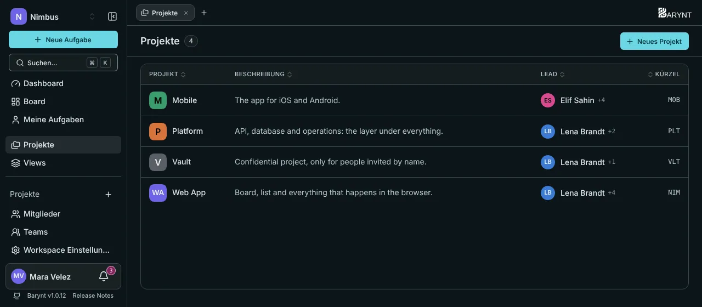

Ein **Projekt** ist ein Behälter für zusammengehörige Arbeit: ein Produkt, der Backlog eines Teams, ein Kunde, eine Kampagne. Es hat eigene Aufgaben, ein eigenes Board und ein eigenes Dashboard und kann einen eigenen Kreis von Menschen haben.

## Die Projektliste

Klicke in der Seitenleiste auf **Projekte**, um alle Projekte zu sehen, die du sehen darfst: Name, eine Zeile Beschreibung, wer es **leitet** und sein Bezeichner. Ein Klick auf eine Zeile bringt dich hinein.

Die **Leitung** ist einfach, wer die Rolle _Project Admin_ hat. Die Liste zeigt die erste Person und ein „+n“ für weitere.

## Ein Projekt anlegen

Drücke `N` oder klicke auf **Neues Projekt** und fülle aus:

- **Name** und eine **Beschreibung**.
- **Bezeichner:** zwei bis vier Buchstaben, die jeder Aufgabennummer vorangestellt werden, wie `WEB` für `WEB-1`, `WEB-2`. Er kann in einem Workspace nicht doppelt vergeben werden.
- **Farbe** (und später ein Bild): woran man das Projekt in der Seitenleiste und auf Tabs erkennt.
- **Sichtbarkeit:** öffentlich oder privat, siehe unten.

Du wirst sofort Admin des Projekts. Das Anlegen steht im Audit-Log.

## Öffentlich oder privat?

| | Öffentlich | Privat |
| --- | --- | --- |
| Wer dabei ist | Jedes Workspace-Mitglied, automatisch. Neue Mitglieder werden beim Beitritt hinzugefügt. | Nur von Hand hinzugefügte Menschen. |
| Wer es sehen kann | Alle Workspace-Mitglieder. | Mitglieder des Projekts, dazu Workspace-Owner, -Admins und -Project-Leads, die jedes Projekt öffnen können. |
| Dafür nutzen | Normale Teamarbeit. | Alles Vertrauliche: Personal, Finanzen, Sicherheit, ein Kunde unter NDA. |

Ein Projekt von öffentlich auf privat umzustellen nimmt **niemandem** den Zugriff. Alle, die schon drin sind, bleiben. Nur **neue** Workspace-Mitglieder werden nicht mehr automatisch hinzugefügt. Um jemanden zu entfernen, tue das ausdrücklich unter _Mitglieder_ des Projekts.

## Im Projekt arbeiten

Jedes Projekt hat eigene Einträge in der Seitenleiste, und dieselben als Tabs oben:

- **Dashboard:** die Zahlen und Diagramme dieses Projekts, siehe [Dashboards](dashboards.md).
- **Board:** die Aufgaben als Spalten nach Status, siehe [Board und Liste](boards.md).
- **Aufgaben:** dieselben Aufgaben als Liste.
- **Mitglieder:** wer dabei ist und mit welcher Rolle, siehe [Projekteinstellungen](../administration/project-settings.md).
- **Einstellungen:** Name, Farbe, Sichtbarkeit, Labels, Felder und mehr.

Daneben stehen deine **gespeicherten Views**, siehe [Views](views.md).

Auf Workspace-Ebene zeigen **Board** und **Aufgaben** in der Seitenleiste die Aufgaben _aller_ deiner Projekte zusammen, mit dem Projekt auf jeder Karte. Praktisch für eine Leitung, die das ganze Bild braucht.

## Zwischen Projekten wechseln

- Klicke das Projekt in der Seitenleiste an. Was dieser Klick öffnet (Board, Liste, Dashboard oder deine eigene Startansicht), bestimmst du unter _Persönliche Einstellungen → Navigation_.
- Mit `[` und `]` springst du zum vorigen oder nächsten Projekt und bleibst in derselben Ansicht.
- Mit `⌘1` bis `⌘9` (`Strg+1` bis `Strg+9`) springst du zum ersten bis neunten Projekt der Seitenleiste.

## Einstellungen, Mitglieder und Entfernen

Name, Beschreibung, Farbe, Bezeichner, Sichtbarkeit, welche Felder Aufgaben haben, projektbezogene Labels und Rollen liegen alle in den Einstellungen des Projekts. Sie stehen unter [Projekteinstellungen](../administration/project-settings.md).

> [!WARNING]
> Ein Projekt zu löschen löscht alle seine Aufgaben. Das lässt sich nicht rückgängig machen, deshalb lässt Barynt dich bestätigen und sagt dir, wie viele Aufgaben darin liegen.
