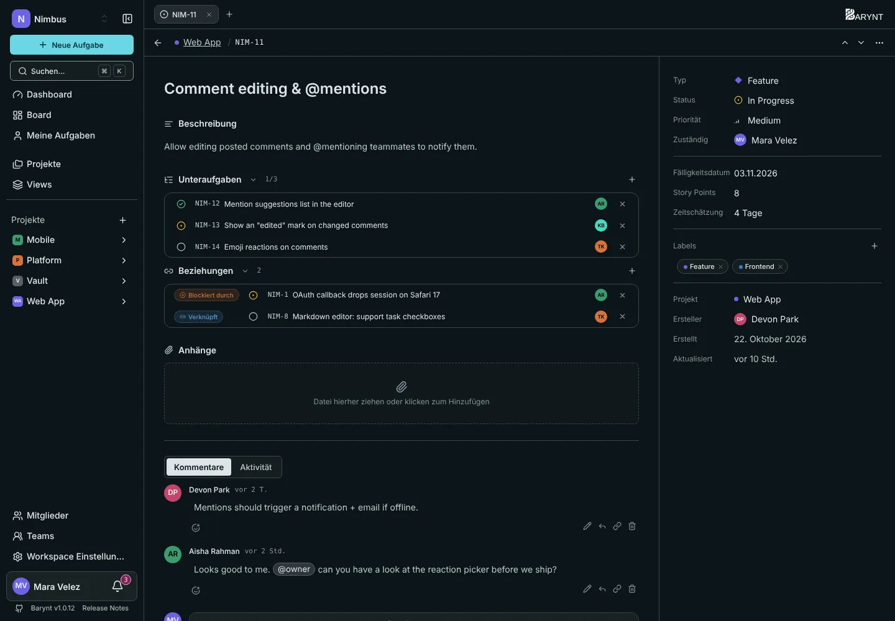

Echte Arbeit ist selten eine saubere einzelne Aufgabe. Diese drei Werkzeuge auf der Aufgabenseite halten die Zusammenhänge sichtbar.

## Unteraufgaben

Eine **Unteraufgabe** ist eine normale Aufgabe, die zu einer größeren gehört, ihrer **übergeordneten Aufgabe**. Nutze sie, wenn eine Aufgabe mehrere Schritte hat und jeder Schritt eigene Zuständigkeit, einen eigenen Status oder eine eigene Diskussion braucht. „Einstellungsseite neu gestalten“ kann Unteraufgaben haben wie „Layout zeichnen“, „Formular bauen“ und „Hilfetext schreiben“.

- Klicke auf **+** neben _Unteraufgaben_ (oder drücke `T`), um eine hinzuzufügen. Du kannst direkt dort eine neue Aufgabe anlegen oder eine bestehende wählen.
- Die Kopfzeile des Abschnitts zeigt den Fortschritt als **erledigt / gesamt**, zum Beispiel `2/5`.
- Jede Unteraufgabe hat eigene Zuständigkeit, eigenen Status und eigene Priorität. Sie kann sogar in einem anderen Projekt liegen, solange du beide sehen kannst.
- Um die Verbindung zu lösen, öffne die Unteraufgabe und wähle _Übergeordnetes Issue entfernen_. Die Aufgabe selbst bleibt.

Standardmäßig sind Unteraufgaben im **Board und in Listen ausgeblendet**, damit eine übergeordnete Aufgabe nicht neben ihren eigenen Kindern erscheint. Möchtest du sie überall sehen, schalte im Menü **Anzeige** _Unteraufgaben anzeigen_ ein, siehe [Board und Liste](boards.md). Auch ein Filter kann sie herausgreifen („Nur Sub-Issues“ oder „Keine Sub-Issues“).

> [!NOTE]
> Löschst du eine übergeordnete Aufgabe, werden ihre Unteraufgaben **nicht** gelöscht. Sie rücken auf die oberste Ebene.

## Beziehungen

Eine **Beziehung** ist eine Verbindung zwischen zwei Aufgaben, die getrennt, aber verwandt sind. Klicke auf **+** neben _Beziehungen_ (oder drücke `R`), wähle die Art und suche die andere Aufgabe.

| Beziehung | Lies sie als | Nutze sie, wenn |
| --- | --- | --- |
| **Blockiert** | „Diese Aufgabe blockiert jene“ | Etwas nicht anfangen kann, bevor das hier fertig ist. |
| **Blockiert durch** | „Diese Aufgabe wartet auf jene“ | Dieselbe Beziehung von der anderen Seite. |
| **Verknüpft** | „Diese beiden gehören zusammen“ | Verwandt, aber keine hängt von der anderen ab. |
| **Duplikat von** | „Das ist dasselbe wie jenes“ | Zwei Leute haben dasselbe gemeldet. Behalte eine, verlinke die andere. |
| **Dupliziert durch** | „Jene ist eine Kopie von dieser“ | Dieselbe Beziehung von der anderen Seite. |

Eine Beziehung legst du nur einmal an. Sie erscheint an beiden Aufgaben, jeweils richtig herum formuliert. Jede hinzugefügte oder entfernte Beziehung steht in der Aktivität der Aufgabe.

## Anhänge

Der Abschnitt **Anhänge** enthält Dateien und Links, die zur Aufgabe gehören: ein Screenshot des Fehlers, ein Vertrag, ein Link zum Entwurf in deinem Designwerkzeug.

- **Eine Datei hinzufügen** geht per Klick auf die Fläche oder indem du eine Datei darauf ziehst. Bilder und Videos zeigen eine Vorschau, andere Dateien eine Download-Schaltfläche.
- **Einen Link hinzufügen**, um auf etwas zu zeigen, das woanders liegt.
- Die Grenze liegt bei **100 MB pro Datei**.
- Wer die Aufgabe sehen kann, kann die Anhänge öffnen. Entfernst du einen, wird auch die gespeicherte Datei gelöscht.

> [!WARNING]
> Dateien brauchen [Objektspeicher](../administration/storage.md). Auf einem Server ohne ihn ist der Anhangsbereich abgeschaltet, und Barynt funktioniert einfach ohne Anhänge.

## Was die Aktivität zeigt

Jede Änderung hier wird in den Tab **Aktivität** der Aufgabe geschrieben: übergeordnete Aufgabe gesetzt oder gelöst, Unteraufgabe hinzugefügt oder entfernt, Beziehung hinzugefügt oder entfernt, Anhang hinzugefügt oder entfernt. So lässt sich leicht beantworten: „Wer hat das verlinkt, und wann?“
