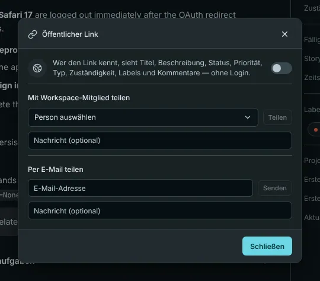
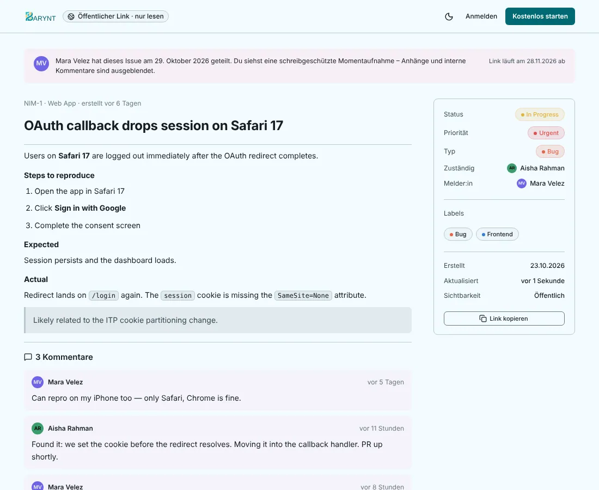

---

title: "Eine Aufgabe teilen"
description: "Zeige eine Aufgabe jemandem ohne Konto oder reiche sie direkt an eine Kollegin weiter: ein schreibgeschützter öffentlicher Link, eine E-Mail oder eine Nachricht in Barynt."
sidebar:
order: 10
---

Manchmal gehört die Person, die eine Aufgabe sehen muss, nicht zu deinem Workspace: ein Kunde, der einen Fehler gemeldet hat, ein Freelancer, eine Führungskraft aus einer anderen Abteilung. Barynt hat drei Wege zu teilen, vom offensten zum privatesten.

## Ein öffentlicher Link

Öffne die Aufgabe, klicke auf das **…**-Menü und wähle **Öffentlichen Link teilen**, dann **Link erstellen**. Barynt gibt dir eine Adresse, die jeder im Browser öffnen kann, **ohne sich anzumelden**.

Die Person sieht eine aufgeräumte, **schreibgeschützte** Seite mit Titel, Beschreibung, Status, Priorität, Typ, Zuständigkeit, Labels und den Kommentaren der Aufgabe. Sie sieht **keine** Anhänge, keine anderen Aufgaben und nichts sonst von deinem Workspace und kann weder kommentieren noch etwas ändern. Ein Hinweis unten lädt sie ein mitzumachen, falls sie teilnehmen möchte.

- Der Link funktioniert **30 Tage**, dann endet er von selbst. Die Seite zeigt das Datum.
- Du kannst das Teilen **jederzeit ausschalten**. Der Link ist ab diesem Moment tot. Ein neuer Link bekommt eine neue Adresse, und die alte bleibt tot.
- Pro Aufgabe gibt es nur einen Link.
- Anlegen und Ausschalten eines Links werden beide im Audit-Log festgehalten, du kannst also immer sehen, wer was geteilt hat.

> [!WARNING]
> Jeder, der den Link hat, kann die Aufgabe lesen. Behandle ihn wie ein Dokument ohne Passwortschutz. Stelle ihn nicht an öffentliche Orte. Enthält eine Aufgabe vertrauliche Details, teile sie lieber mit einer Person.

Den Link zu erstellen braucht die Berechtigung _Öffentlichen Lese-Link für eine Aufgabe erstellen und widerrufen_. Contributors, Project Admins und die Rollen darüber haben sie, Viewer nicht.

## Mit einer Kollegin

Wähle im selben Dialog **Mit Workspace-Mitglied teilen**, such die Person aus und füge optional eine Nachricht an. Sie bekommt eine Benachrichtigung **Aufgabe geteilt** in ihrem Posteingang (und per E-Mail, wenn sie das eingeschaltet hat). Eine sanfte Art zu sagen „schau dir das bitte an“, ohne die Aufgabe zuzuweisen.

## Per E-Mail

Wähle **Per E-Mail teilen**, tippe eine Adresse ein und sende. Die Empfängerin bekommt eine E-Mail mit dem Link auf die öffentliche Seite der Aufgabe. Hat die Aufgabe noch keinen öffentlichen Link, legt Barynt dafür einen an. Alles oben zum öffentlichen Link gilt also auch hier. Das braucht einen Mailserver, siehe [E-Mail](../administration/email.md).

## Welchen Weg nehmen

| Du willst …                                             | Nimm                                                              |
| ------------------------------------------------------- | ----------------------------------------------------------------- |
| Einer Person außerhalb einmal eine Aufgabe zeigen       | **Öffentlicher Link**, danach ausschalten                         |
| Die Aufmerksamkeit eines Teammitglieds, ohne zuzuweisen | **Mit Workspace-Mitglied teilen**                                 |
| Eine externe Person dauerhaft mitmachen lassen          | [Sie als Gast ins Projekt einladen](../administration/members.md) |
