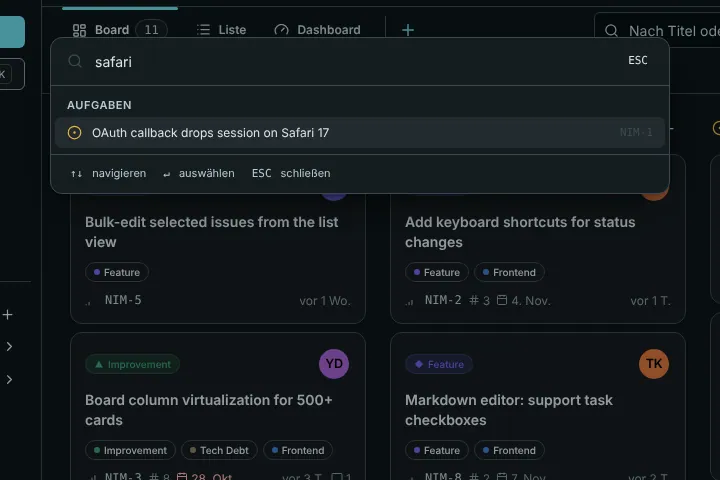
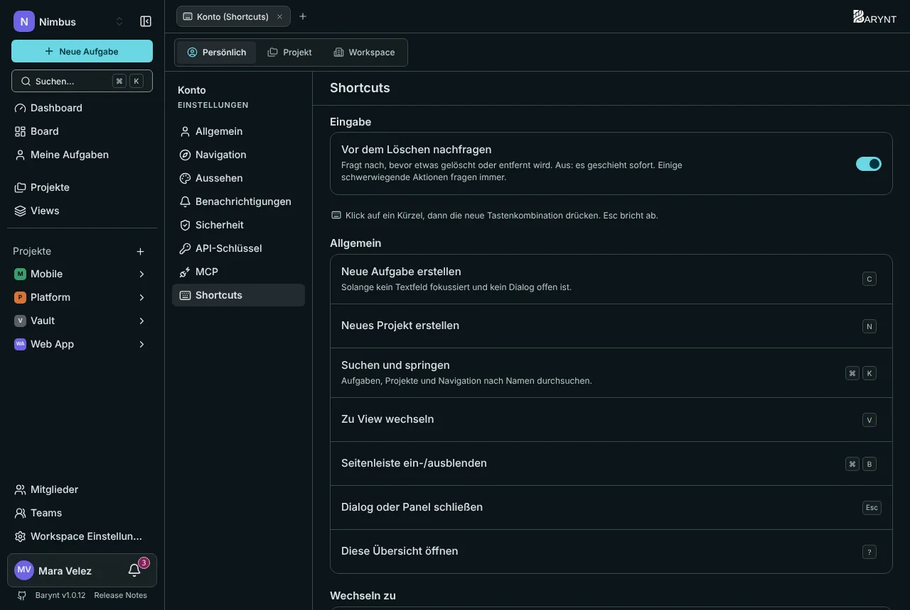

---

title: "Suche und Tastenkombinationen"
description: "Finde alles in einer Sekunde mit ⌘K und erledige das Alltägliche, ohne die Tastatur zu verlassen."
sidebar:
order: 9
---

Barynt ist so gebaut, dass du die Maus selten brauchst. Du musst nichts davon lernen, um die App zu benutzen, aber die wenigen Kombinationen unten sind die, von denen Leute ihren Kolleginnen und Kollegen erzählen.

> [!NOTE]
> Auf dem Mac ist `⌘` die Befehlstaste. Unter Windows und Linux lies es als `Strg`. Barynt zeigt das passende für deinen Rechner an und zeigt auf einem Handy oder Tablet ohne Tastatur gar keine Hinweise auf Tastenkombinationen.

## Die Befehlspalette: `⌘K`

Drücke **`⌘K`** (`Strg+K`) irgendwo und tippe. Ein Feld findet:

- **Aufgaben** nach Titel oder Nummer, auch deine zuletzt geöffneten.
- **Projekte**, um direkt in eines zu springen.
- **Views**, in diesem Projekt oder anderswo.
- **Seiten**, etwa Mitglieder, Teams, Einstellungen oder den Posteingang.
- **Befehle**, etwa _Neue Aufgabe erstellen_ oder _Tastenkombinationen anzeigen_.

Bewege dich mit den Pfeiltasten, öffne mit `Enter`, schließe mit `Esc`.

Die Suche deckt Titel und Beschreibungen ab und findet nur, was du sehen darfst.

## Überall

| Tasten | Was sie tun                                  |
| ------ | -------------------------------------------- |
| `C`    | Neue Aufgabe erstellen                       |
| `N`    | Neues Projekt erstellen                      |
| `⌘K`   | Suchen und springen                          |
| `V`    | Zu einer View gehen                          |
| `⌘B`   | Seitenleiste ein- oder ausblenden            |
| `?`    | Die Übersicht der Tastenkombinationen öffnen |
| `Esc`  | Einen Dialog oder ein Panel schließen        |

Einzeltasten-Kombinationen funktionieren nur, wenn du nicht in einem Feld tippst und kein Dialog offen ist.

## Gehe zu …

Drücke `G`, dann einen Buchstaben. Denk an „Go to“:

| Tasten        | Wohin                                                             |
| ------------- | ----------------------------------------------------------------- |
| `G` `D`       | Dashboard                                                         |
| `G` `I`       | Meine Aufgaben                                                    |
| `G` `P`       | Projekte                                                          |
| `G` `M`       | Mitglieder (des Projekts, in dem du bist, sonst des Workspace)    |
| `G` `T`       | Teams                                                             |
| `G` `S`       | Einstellungen (des Projekts, in dem du bist, sonst des Workspace) |
| `G` `B`       | Board                                                             |
| `G` `L`       | Aufgabenliste                                                     |
| `G` `O`       | Die Übersicht des Projekts                                        |
| `[` und `]`   | Voriges und nächstes Projekt                                      |
| `⌘1` bis `⌘9` | Das erste bis neunte Projekt der Seitenleiste                     |

## An einer Aufgabe

Mit geöffneter Aufgabe oder wenn du in einer Liste darüber fährst:

| Tasten | Was sie tun                                                       |
| ------ | ----------------------------------------------------------------- |
| `S`    | Status ändern                                                     |
| `P`    | Priorität ändern                                                  |
| `A`    | Zuständigkeit ändern                                              |
| `I`    | Dir selbst zuweisen (erneut drücken, um die Zuweisung aufzuheben) |
| `L`    | Labels bearbeiten                                                 |
| `T`    | Eine Unteraufgabe hinzufügen                                      |
| `R`    | Eine Beziehung hinzufügen                                         |
| `M`    | Ins Kommentarfeld springen                                        |
| `⌘.`   | Die Aufgabennummer kopieren                                       |
| `⌘⇧,`  | Einen Link auf die Aufgabe kopieren                               |
| `O`    | Die ganze Seite öffnen                                            |
| `E`    | Zwischen Seitenpanel und Dialog wechseln                          |

## In Board und Liste

| Tasten           | Was sie tun                        |
| ---------------- | ---------------------------------- |
| `J` / `K`        | Nächste oder vorige Aufgabe        |
| `←` / `→`        | Vorige oder nächste Spalte (Board) |
| `Enter` oder `O` | Die fokussierte Aufgabe öffnen     |

## Beim Schreiben

| Tasten      | Was sie tun                                         |
| ----------- | --------------------------------------------------- |
| `⌘↵`        | Speichern oder erstellen, auch direkt im Textfeld   |
| `⌘K`        | Einen Link einfügen oder bearbeiten                 |
| `/`         | Das Befehlsmenü im Editor öffnen                    |
| `@` und `#` | Einen Menschen erwähnen oder eine Aufgabe verlinken |

## Eigene Tastenkombinationen

Kollidiert eine Taste mit einem anderen Programm oder gefällt dir eine andere besser, ändere sie: Öffne _Persönliche Einstellungen → Shortcuts_, klicke eine Tastenkombination an und drücke die neue Kombination. `Esc` bricht ab. Barynt warnt dich, wenn Tasten schon belegt sind. Bei `G`-Folgen lässt sich nur die zweite Taste ändern. Änderungen werden in deinem Konto gespeichert und folgen dir auf jedes Gerät.

Dieselbe Seite hat den Schalter **Vor dem Löschen nachfragen**. Ist er an, fragt Barynt vor dem Löschen nach. Ist er aus, geschieht es sofort, bis auf ein paar schwerwiegende Aktionen, die immer nachfragen.
