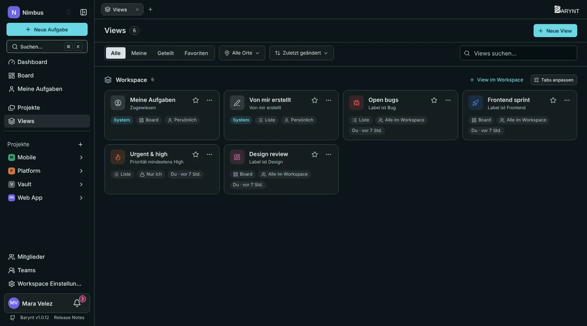
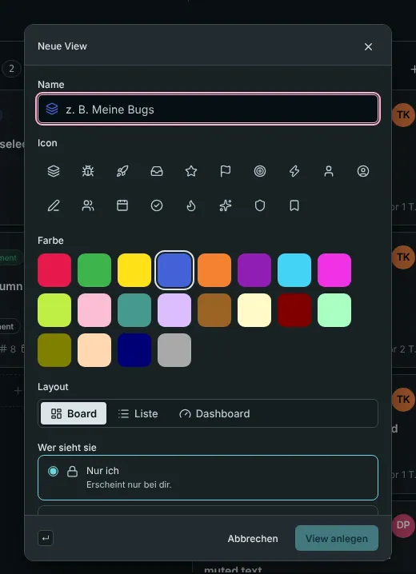

---

title: "Views"
description: "Speichere eine Kombination aus Filtern, Gruppierung und Layout unter einem Namen und öffne sie mit einem Klick wieder: für dich, für ein Projekt oder für den ganzen Workspace."
sidebar:
order: 6
---

Eine **View** ist eine gespeicherte Art, Aufgaben anzusehen. Sie merkt sich Filter, Gruppierung, Sortierung und Layout, sodass „alle offenen Bugs, nach Zuständigkeit gruppiert“ einen Klick entfernt ist statt fünf.

## Ein paar Views, die sich lohnen

- **Offene Bugs:** eine Liste, gefiltert auf den Typ _Bug_ und alles, was nicht erledigt ist.
- **Dieser Sprint:** ein Board, gefiltert auf das Label `Sprint 14`.
- **Dringend und hoch:** eine Liste der Priorität _Hoch_ und darüber, nach Zuständigkeit gruppiert, privat für deinen Montags-Check.
- **Design-Review:** ein Board mit allem, was `Design` heißt, geteilt mit dem ganzen Team.

## Zwei Views sind fertig dabei

Jeder Workspace hat zwei **System-Views**, die niemand ändern oder löschen kann:

- **Meine Aufgaben** (auf den Tabs als _Zugewiesen_): alles, was dir zugewiesen ist, über alle Projekte.
- **Von mir erstellt:** alles, was du geschrieben hast.

Sie sind persönlich, obwohl sie geteilt sind: Jede Person sieht ihre eigenen.

## Eine View anlegen

Es gibt zwei Wege:

1. **Erst einrichten, was du willst.** Filtere, gruppiere und sortiere das Board oder die Liste nach Belieben. Eine kleine Markierung **Ungespeichert** erscheint. Klicke auf **Als neue View** und gib einen Namen ein. Klicke stattdessen auf **Verwerfen**, um die Änderungen wegzuwerfen.
2. **Beginne mit dem Plus** neben den Tabs, wähle **Neue View** und fülle das Formular aus.

| Feld                                                       | Was es bewirkt                                                                                                            |
| ---------------------------------------------------------- | ------------------------------------------------------------------------------------------------------------------------- |
| **Name** und **Symbol**                                    | Woran man sie auf dem Tab und in Listen erkennt.                                                                          |
| **Layout**                                                 | _Board_, _Liste_ oder _Dashboard_. Eine View kann sogar ein Dashboard mit Filter sein, siehe [Dashboards](dashboards.md). |
| **Wo soll sie leben?**                                     | Im **Workspace** (Aufgaben aus jedem Projekt) oder in **einem Projekt**.                                                  |
| **Wer sieht sie**                                          | _Nur ich_, _Alle im Projekt_ oder _Alle im Workspace_.                                                                    |
| **Aktuelle Filter, Gruppierung und Sortierung übernehmen** | Beginnt mit dem, was gerade auf deinem Bildschirm steht.                                                                  |

> [!TIP]
> Eine geteilte View ist ein guter Weg, sich auf Wörter zu einigen. „Bereit für QA“ bedeutet für alle denselben Filter, statt fünf leicht verschiedener.

## Views finden und ordnen

Die Seite **Views** in der Seitenleiste listet jede View, die du sehen kannst, mit Filtern für _Meine_, _Geteilte_ und _Favoriten_, einer Auswahl des Ortes (Workspace oder ein Projekt) und einem Suchfeld. Die Tab-Leiste jedes Projekts zeigt seine Views, und ein Menü **Mehr** enthält die, die nicht mehr passen.

An jeder View bietet das **…**-Menü:

- **In der Sidebar anheften** und **Zu Favoriten** (der Stern): zwei persönliche Schalter, die bestimmen, was in deiner Seitenleiste erscheint. Niemand sonst sieht sie.
- **Als Start-View des Projekts:** was sich öffnet, wenn du auf den Namen des Projekts klickst (sobald du unter _Persönliche Einstellungen → Navigation_ _Start-View_ gewählt hast).
- **Bearbeiten**, **Duplizieren**, **Link kopieren** und **Löschen**.

Unter **Tabs anpassen** bestimmst du, welche Tabs du in einem Projekt siehst und in welcher Reihenfolge. Auch das ist persönlich.

## Wer was darf

- Wer ein Projekt sehen kann, kann dort private Views anlegen.
- Eine View mit einem Projekt oder dem Workspace zu teilen, braucht die Berechtigung _Geteilte Views erstellen_. Members haben sie für den Workspace standardmäßig, Viewer nicht.
- Eine geteilte View zu ändern oder zu löschen, die **jemand anderes** erstellt hat, braucht _Von anderen erstellte geteilte Views bearbeiten und löschen_, was Project Leads, Manager und Admins haben.
- Eine geteilte View, die du nicht ändern kannst, ist als schreibgeschützt markiert und nennt, wer sie geteilt hat.

Eine View zu löschen löscht nie Aufgaben. Es entfernt nur die gespeicherte Art, sie anzusehen.

## Views und die Außenwelt

- Eine neue, geänderte oder gelöschte **geteilte** View kann einen [Webhook](../integrations/webhooks.md) auslösen. Private Views nie.
- Views lassen sich über die [REST-API](../integrations/api.md) und [MCP](../integrations/mcp.md) auflisten, anlegen und ändern, mit denselben Rechten wie in der App.
