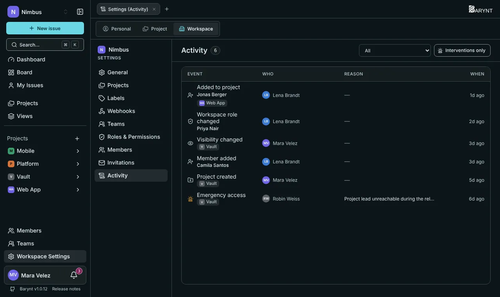

---

title: "Audit log and activity"
description: "A trustworthy record of who did what and when: sign-ins, role changes, deletions and everyday changes to issues."
sidebar:
order: 9
---

When something goes wrong, or someone simply asks "who changed this?", the audit log has the answer. It records **who** did **what**, **when**, and, where it applies, **why**. Entries cannot be edited from within Barynt.

## Where to find it

The same log is shown in four places, each with its own permission:

| Where                             | What it shows                                                        | Who sees it                     |
| --------------------------------- | -------------------------------------------------------------------- | ------------------------------- |
| **Issue → Activity tab**          | The changes on that one issue.                                       | Everyone who can see the issue. |
| **Project settings → Activity**   | Everything that happened in the project.                             | Project admins.                 |
| **Workspace settings → Activity** | Everything in the workspace.                                         | Owners, admins and managers.    |
| **Admin → Audit log**             | Server-wide events: sign-ins, platform roles, workspace suspensions. | Platform administrators.        |

Every list has an **Event** filter and the switch **Interventions only**, which hides the everyday noise and keeps only the entries that matter for security.

## What is recorded

The log is deliberately selective. It does **not** record every page view, because a log nobody reads protects nobody. It records what **shifts permissions or destroys data**, plus the everyday life of issues.

**Interventions** (the security-relevant events):

- Signed in, sign-in failed
- Role changed (platform, workspace, project)
- Account deactivated or reactivated
- Emergency access to a project (with the reason)
- Project deleted, archived or reassigned; workspace deleted or suspended
- Mail templates and system settings changed

**Everyday events** in workspaces and projects:

- Projects created, visibility changed
- Members added or removed
- Issues created, deleted, assigned, unassigned
- Title, description, status, priority, type, labels, due date, story points or time estimate changed
- Sub-issues, relations and attachments added or removed
- Comments added or removed
- Public links created or revoked
- Labels created or deleted, shared views deleted

For issue edits, the log tells you **which aspect** changed ("Status changed"), not the old and new text. That keeps it readable and keeps it from becoming a second copy of your content.

## Reading an entry

Each entry shows the **event**, **who** did it, **when** and the **reason**, if one was given (for emergency access it is mandatory). A person's name is saved with the entry at the time. If someone is renamed or leaves later, the old entries stay as they were written.

## Good to know

- The log answers questions after the fact. For immediate notice of events, use [webhooks](../integrations/webhooks.md).
- Platform administrators can see server-wide events but, by design, no issue content. See [Platform administration](platform.md).
