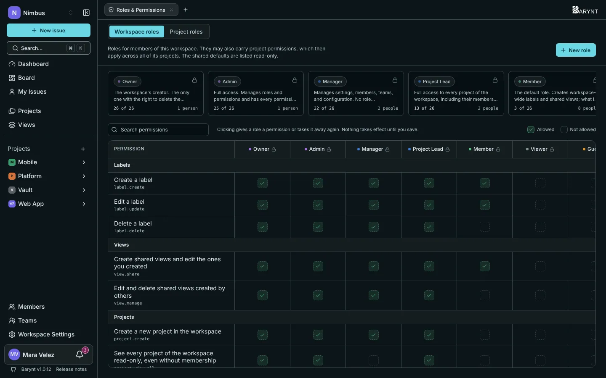
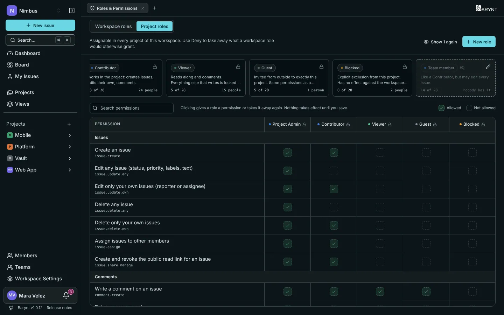

---

title: "Roles and permissions"
description: "Who may see what and who may change what, at three levels. Start with the ready-made roles, build your own when you need to."
sidebar:
order: 4
---

Barynt answers "who may do this?" with **roles**. A role is a named bundle of permissions, such as _Member_ or _Admin_. You give people roles, and the roles decide the rest. This page explains the ideas first, then lists exactly what each ready-made role can do.

## The idea in one picture

Think of an office building:

- Your **workspace role** is the key to the **building**. It says whether you can walk in, and what you may do in the shared parts: invite people, create projects, change settings.
- Your **project role** is the key to a **room**. It says what you may do inside that one project: create issues, edit them, delete them.
- The **platform role** is the key to the **building's machinery**, the server itself. Only a few people have it.

You have at most one role at each level. Inside a project, your **project role decides** what you can do with issues and comments. Everywhere else, your workspace role decides.

> [!NOTE]
> When someone joins a project, Barynt picks a starting project role based on their workspace role (a _Member_ starts as a _Contributor_, a _Viewer_ as a project _Viewer_). From then on, the project role is independent: changing someone in one project never changes their workspace role, and the other way round.

## Workspace roles

These decide what you may do in the workspace itself.

| Role             | In plain words                                                                                                                                                       |
| ---------------- | -------------------------------------------------------------------------------------------------------------------------------------------------------------------- |
| **Owner**        | The workspace's creator. Can do everything, including deleting the workspace. Has full access to every project.                                                      |
| **Admin**        | The same, except deleting the workspace. Manages roles and has full access to every project.                                                                         |
| **Manager**      | Runs the workspace day to day: settings, members, teams, webhooks and the audit log. Cannot manage roles and does not see projects they are not a member of.         |
| **Project Lead** | Looks after the projects: creates them, sees and manages all of them, invites and removes people, manages labels and shared views. Cannot change workspace settings. |
| **Member**       | The usual role. Creates labels and shared views. What they can do in a project depends on their project role.                                                        |
| **Viewer**       | Read access. Joins projects as a reader.                                                                                                                             |
| **Guest**        | Someone from outside, who sees only what they were explicitly invited to.                                                                                            |

## Project roles

These decide what you may do inside one project.

| Role              | In plain words                                                                                                                                                        |
| ----------------- | --------------------------------------------------------------------------------------------------------------------------------------------------------------------- |
| **Project Admin** | Everything in the project: settings, members, roles, labels, views, and every issue and comment.                                                                      |
| **Contributor**   | The working role. Creates issues, edits and deletes **their own** (ones they created or are assigned to), assigns, shares, comments, creates labels and shared views. |
| **Viewer**        | Reads along and comments. Everything that writes is locked.                                                                                                           |
| **Guest**         | The same as Viewer, for people invited from outside straight into this project.                                                                                       |
| **Blocked**       | Locked out of the project. Use it to remove access without removing the person.                                                                                       |

## What exactly can each role do?

### In the workspace

| Permission                                          | Owner | Admin | Manager | Project Lead | Member |
| --------------------------------------------------- | :---: | :---: | :-----: | :----------: | :----: |
| Change name, color and address of the workspace     |   ✓   |   ✓   |    ✓    |              |        |
| Delete the workspace                                |   ✓   |       |         |              |        |
| Manage webhooks                                     |   ✓   |   ✓   |    ✓    |              |        |
| View the audit log                                  |   ✓   |   ✓   |    ✓    |              |        |
| Define roles                                        |   ✓   |   ✓   |         |              |        |
| View, invite, remove members and change their roles |   ✓   |   ✓   |    ✓    |      ✓       |        |
| Create projects                                     |   ✓   |   ✓   |    ✓    |      ✓       |        |
| See and manage every project without being a member |   ✓   |   ✓   |         |      ✓       |        |
| See the dashboard numbers of the whole workspace    |   ✓   |   ✓   |    ✓    |      ✓       |        |
| Set the default dashboard layout                    |   ✓   |   ✓   |    ✓    |              |        |
| Create, edit and delete teams, manage their members |   ✓   |   ✓   |    ✓    |              |        |
| Create and edit labels                              |   ✓   |   ✓   |    ✓    |      ✓       |   ✓    |
| Delete labels                                       |   ✓   |   ✓   |    ✓    |      ✓       |        |
| Create shared views                                 |   ✓   |   ✓   |    ✓    |      ✓       |   ✓    |
| Edit and delete views created by others             |   ✓   |   ✓   |    ✓    |      ✓       |        |

### In a project

| Permission                                     | Project Admin | Contributor | Viewer / Guest |
| ---------------------------------------------- | :-----------: | :---------: | :------------: |
| See the project, read issues                   |       ✓       |      ✓      |       ✓        |
| Create issues                                  |       ✓       |      ✓      |                |
| Edit and delete **own** issues                 |       ✓       |      ✓      |                |
| Edit and delete **any** issue                  |       ✓       |             |                |
| Assign issues to others                        |       ✓       |      ✓      |                |
| Create the public link of an issue             |       ✓       |      ✓      |                |
| Write comments, react                          |       ✓       |      ✓      |       ✓        |
| Edit and delete **own** comments               |       ✓       |      ✓      |       ✓        |
| Edit and delete **any** comment                |       ✓       |             |                |
| Create and edit labels                         |       ✓       |      ✓      |                |
| Delete labels                                  |       ✓       |             |                |
| Create shared views                            |       ✓       |      ✓      |                |
| Edit and delete views created by others        |       ✓       |             |                |
| See the dashboard numbers of the whole project |       ✓       |             |                |
| Set the project's default dashboard layout     |       ✓       |             |                |
| Change project name, color and settings        |       ✓       |             |                |
| Delete the project                             |       ✓       |             |                |
| Invite and remove members, change their roles  |       ✓       |             |                |
| Define project roles                           |       ✓       |             |                |
| View the project's activity                    |       ✓       |             |                |

> [!TIP]
> "Own" means you created the issue or it is assigned to you. If you want your Contributors to be able to edit **every** issue, create a custom role for it, as explained below.

## Who sees what, in short

- A **public project** has every workspace member in it.
- A **private project** only has the people added to it, plus workspace owners, admins and project leads, who can open every project.
- **Nobody sees a project they are not in**, apart from those roles. Search, boards, dashboards and the API all respect it.
- A workspace **Guest** or **Viewer** sees only the projects they belong to.

## Changing someone's role

- **Workspace role:** open **Members** in the sidebar and pick a new role in the _Role_ column.
- **Project role:** open the project's _Members_ page, or _Project settings → Members_, and pick a new role there.

You can only hand out roles **up to your own rank**, and you can only change people **below** you. A Manager cannot make someone an Admin. This is also why the person who set up the workspace should stay Owner.

People are told when their role changes, see [Inbox and notifications](../using-barynt/my-work.md).

## Building your own roles

The ready-made roles cover most teams. When they do not fit, make your own. Typical reasons: "Member, but without creating labels", "Contributor who can edit every issue", "Contractor who can comment but see only one project".

1. Open **Roles and permissions**: under _Workspace settings_ for workspace roles and for project roles you want in every project, or in _Project settings_ for roles that exist only in that project.
2. Click **New role**, give it a name and a short description.
3. In the editor, tick the permissions the role should have. A click on a box allows or removes a permission, and a search box filters the long list. The **rank** field sets where the role stands in the hierarchy.
4. Click **Save**. Nothing takes effect until you do, and Barynt warns you if you leave with unsaved changes.

A few rules keep this safe:

- The ready-made roles are marked **Shared** and cannot be edited. They are the same for everybody. To change one, copy it into your own role.
- You can only grant permissions that **you** have. Boxes you cannot tick are greyed out.
- The **rank** decides who may hand the role out: only people of at least that rank can assign it, and you cannot give a role a higher rank than your own.
- A role can only be deleted when nobody holds it. Move its holders to another role first.

## Teams and roles

A [team](teams.md) can be given a role on a project. All its members then get that role there, in one step. You can still set an individual role for one person, which wins over the team's.

## Platform roles

On top of the two levels above, the server itself has three roles:

| Role                 | What it is for                                                                           |
| -------------------- | ---------------------------------------------------------------------------------------- |
| **Platform Admin**   | Looks after the server: accounts, workspaces, settings. **Cannot read anyone's issues.** |
| **Platform Support** | May look inside any workspace to help with a problem. Cannot manage accounts.            |
| **Platform Member**  | A normal user. Everyone starts here.                                                     |

The first person to register on a fresh server becomes Platform Admin. See [Platform administration](platform.md).

## Common setups

| You want…                                                         | Do this                                                                                                       |
| ----------------------------------------------------------------- | ------------------------------------------------------------------------------------------------------------- |
| A team where everyone edits everything                            | Create a custom project role from Contributor plus _Edit any issue_ and assign it to the team on the project. |
| A confidential project                                            | Make it **private** and add only the people who need it.                                                      |
| A client who can read and comment on one project                  | Invite them to that project as a **Guest**, see [Members and invitations](members.md).                        |
| A stakeholder who follows along and comments, but changes nothing | Give them the project role **Viewer**.                                                                        |
| Taking away access without deleting the account                   | Set their project role to **Blocked**, or remove them from the project.                                       |
