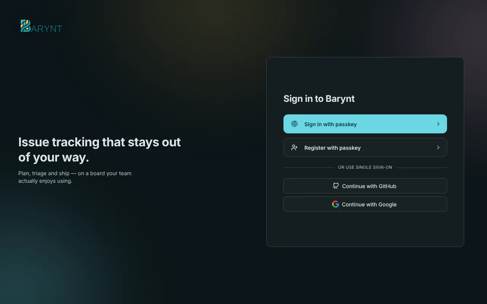

People should sign in the way they already do everywhere else. Barynt supports several ways side by side, and **none of them is a paid extra**. This page is for whoever administers the server: it explains the options and how to switch them on.



## The options at a glance

| Way to sign in | Needs setup? | Good for |
| --- | --- | --- |
| **Passkey** | No, works out of the box | Everyone. The safest and the easiest. |
| **Company login (SSO)** | Yes, a few settings | Companies with Google, Microsoft, Okta, Keycloak and the like. |
| **Magic link by email** | Yes, [email](email.md) | People who have not set up a passkey yet, and recovery. |

Which buttons people see on the sign-in page follows what you have switched on.

## Passkeys

A **passkey** is a login that lives on your device and is unlocked with your fingerprint, your face or your device PIN. There is no password to forget, steal or reuse. It works out of the box. People create theirs on the sign-in page with **Register with passkey**, and add more devices later under _Personal settings → Security_.

Two things to know:

- Passkeys only work on a secure address: `https://…` or `localhost`. A server reached over plain `http://` with an IP address will not offer them.
- A passkey belongs to a domain. If you move Barynt to a different domain, people register new passkeys.

## Company login (SSO)

Barynt speaks to **any provider that Auth.js supports**, which is about a hundred: Google, Microsoft Entra ID (Azure AD), GitHub, GitLab, Apple, Okta, Auth0, Keycloak, authentik, ZITADEL, Cognito, Discord, Slack and many more. And any provider that speaks **OpenID Connect (OIDC)**.

Switching one on never needs a code change. You register Barynt as an application at your provider, then give Barynt the **client ID** and the **client secret** as settings.

### Step 1: register Barynt at your provider

Create a new "application" or "client" there. The provider asks for a **callback address** (also called redirect URI). It is always:

```
https://your-barynt-domain/api/auth/callback/<provider>
```

For example `https://issues.example.com/api/auth/callback/google`. The provider's name is in lower case: `github`, `google`, `gitlab`, `microsoft-entra-id`, `keycloak` and so on.

### Step 2: give Barynt the credentials

The settings are named after the provider, in capitals, with `-` written as `_`:

```bash
AUTH_GOOGLE_ID=…
AUTH_GOOGLE_SECRET=…
```

Set them with `barynt config` (see [Configuration](../getting-started/config.md)), for example:

```bash
barynt config AUTH_GOOGLE_ID=123.apps.googleusercontent.com AUTH_GOOGLE_SECRET=…
```

Barynt restarts and the button appears. Self-hosted or per-company providers (Keycloak, Okta, Auth0, authentik, ZITADEL and others) also need their address, the **issuer**:

```bash
AUTH_KEYCLOAK_ID=barynt
AUTH_KEYCLOAK_SECRET=…
AUTH_KEYCLOAK_ISSUER=https://keycloak.example.com/realms/acme
```

### Microsoft: only your own organization

By default, any Microsoft account can sign in. To limit it to your organization, add the directory (tenant) address as the issuer:

```bash
AUTH_MICROSOFT_ENTRA_ID_ID=…
AUTH_MICROSOFT_ENTRA_ID_SECRET=…
AUTH_MICROSOFT_ENTRA_ID_ISSUER=https://login.microsoftonline.com/<tenant-id>/v2.0
```

### A generic OIDC login with your own button

For an identity provider without its own entry, or if you want a button that says "Sign in with Acme SSO":

```bash
AUTH_OIDC_ISSUER=https://idp.example.com
AUTH_OIDC_CLIENT_ID=…
AUTH_OIDC_CLIENT_SECRET=…
AUTH_OIDC_NAME=Acme SSO
```

### Apple

Needs a paid Apple Developer membership, works only over HTTPS, and the secret is a signed token rather than a fixed string. Follow the steps in `example.env`.

## Who may create an account?

Out of the box, anyone who reaches the sign-in page can create an account, and accounts without a workspace can start one of their own. You can tighten this:

| You want… | Setting |
| --- | --- |
| **Invite-only:** nobody can register by themselves | `AUTH_REGISTRATION_ENABLED=false`. People with an open **email invitation** still get in, because their account already exists. An invite _link_ only helps people who already have an account. On a brand-new, empty server the first account can always register. |
| Passkeys only for existing accounts | `AUTH_PASSKEY_REGISTRATION_ENABLED=false` |
| No passkeys at all | `AUTH_PASSKEY_LOGIN_ENABLED=false`, but make sure another way works first |
| New accounts to land in an existing workspace, not create their own | In the platform [admin settings](platform.md), turn off workspace creation and pick a default workspace. |

A company domain can also be **claimed** by a workspace, so everyone with a matching address joins it, see [Workspace settings](workspace.md).

## Changing identity providers

If you move from one provider to another (say authentik to Keycloak), everyone arrives with a new internal ID, and Barynt cannot be sure they are the same people. Sign-in then fails with "Another account already exists with the same email address". The way through:

1. Set `AUTH_OIDC_ALLOW_EMAIL_LINKING=true`. An unknown login is then linked to the existing account with the **same email address**.
2. Let everyone sign in once. They are linked for good.
3. Switch it off again.

> [!WARNING]
> Only switch this on if your identity provider **verifies email addresses reliably** (administrators manage them, no self-service sign-up). Otherwise anyone who can claim an address there could take over the Barynt account with that address.

## Connected accounts

People who sign in through a company login can see their connected accounts under _Personal settings → Connected accounts_. If they also have a passkey, they can disconnect them. The last remaining way in cannot be removed.
