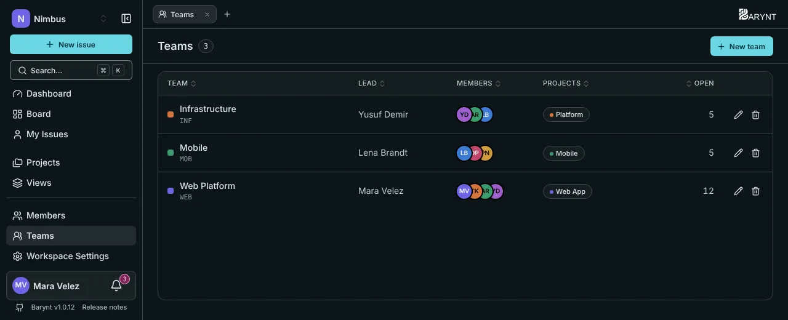
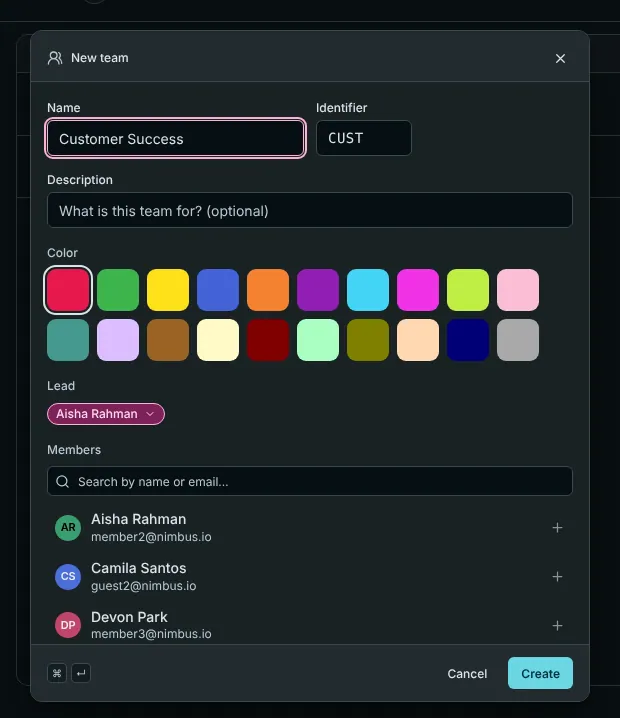

A **team** is a named group of workspace members, for example "Mobile team" or "Customer support". It does two jobs: it shows at a glance **who works on what**, and it lets you **give access to a whole group at once**.

## The team list

Open **Teams** in the sidebar. For each team you see its color, name and identifier, its **lead**, its members, the projects it is linked to, and how many issues are **open** in those projects. The pencil edits a team, the bin deletes it.

## Creating a team

Click **New team** and fill in:

- **Name**, a short **identifier** and a **color**.
- A **description**: what is this team for? (optional)
- A **lead**: the person who looks after the team.
- **Members**: pick them from the workspace.
- **Projects**: link the team to the projects it works on, and choose the **role in this project** that the team's members receive there.

## What linking a team to a project does

When a team is linked to a project with a role, **every member of the team gets that role in that project**. That saves a lot of clicking:

- **A new colleague joins the team?** They are in the project right away.
- **Someone leaves the team?** They lose the access that came only from the team.
- **Need a different role for one person?** Set it individually on the project's _Members_ page. An individual role always wins over the team's. The members list marks roles that come from a team: "Via team 'Mobile'".

This also works for **private** projects: put the people into a team, link the team, and you have set up access for the whole group.

## Who may do what

- Seeing all teams, creating, changing and deleting them, and managing their members and linked projects are separate permissions held by workspace owners, admins and managers, see [Roles and permissions](roles.md).
- Workspace members see the teams they belong to.

## Deleting a team

Deleting a team only removes the **grouping**. Accounts, projects and issues stay as they are. People whose access to a project came **only** from the team lose that access, and Barynt tells you how many people are affected before you confirm.

## When teams pay off

A team is useful as soon as the workspace is bigger than a handful of people, or as soon as you have private projects. In a team of six working on one public project, you probably do not need any.
