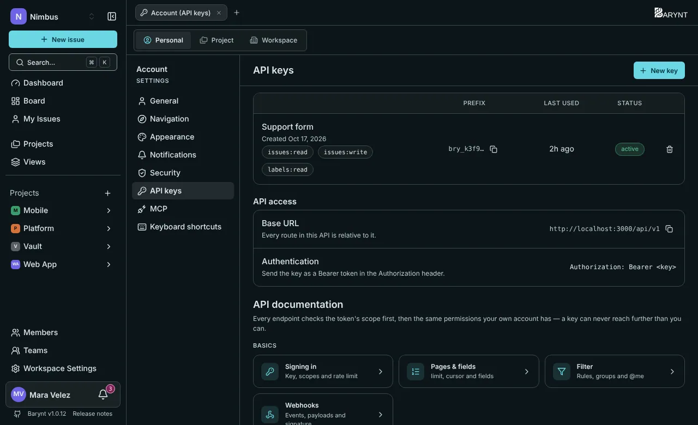
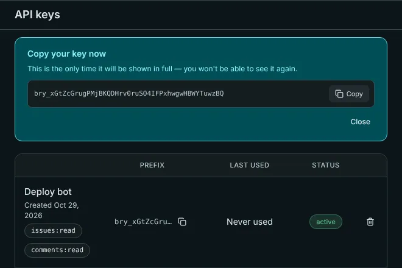

The **REST API** lets other software read and change what is in Barynt: create an issue when a customer submits a form, pull numbers into a report, keep a spreadsheet in sync. It is the same data and the same rules as in the app.

This page explains how it works in general: keys, scopes, what requests and answers look like, errors, limits and paging. Every single call, with all fields and examples, is in the **[API reference](../api-reference/workspaces.md)**. If you are not a developer, read the first two sections and hand the rest to someone who is.



## What it is good for

- **Create issues automatically**, from a support form, a monitoring alert or a chat command.
- **Reports and dashboards** outside Barynt: export open issues, count closed ones per week.
- **Sync** with other systems: CRM, spreadsheets, a company portal.
- **Scripts and CI:** comment on an issue when a deployment finishes.

For AI assistants, use [MCP](mcp.md) instead: it needs no key. To be told when something happens, use [webhooks](webhooks.md).

## API keys

An **API key** is a personal access token. It acts as **you**, so it can never do more than you can, and you can narrow it further with **scopes**.

1. Open your personal settings → **API keys** and click **New key**.
2. Give it a **name** that says what it is for ("Support form"), choose an **expiry** (never, or a number of days) and tick the **scopes** it needs.
3. Click **Create key**. Barynt shows the key **once**. Copy it now, because it cannot be shown again.
4. Give it to whoever needs it, through a safe channel, never in a chat or an email.



A key starts with `bry_`. Barynt stores only a fingerprint of it, so even an administrator cannot read it back. The list shows each key's prefix, when it was created, when it was **last used** (updated at most every five minutes) and whether it is active. **Revoke** a key at any moment: every tool that uses it loses access immediately, and this cannot be undone. A key also stops working when it expires or when its owner's account is deactivated.

> [!WARNING]
> Treat a key like a password. Create **one key per tool**, give it the **fewest scopes** that work, and set an **expiry** where you can. If a key leaks, revoke it.

> [!NOTE]
> **A key is a person.** Its actions show up as that person in the activity of issues. For an integration, create a dedicated account (for example "Support bot"), add it to the workspace with a suitable role, and issue the key there.

### Scopes

A scope is a pair of "what" and "read or write". A call needs the right scope **and** the permission that its owner has in the app: a scope never grants more than you have, it only narrows what the key may do.

| Scope | Allows |
| --- | --- |
| `issues:read` / `issues:write` | Read issues, relations and attachments. Create, change and move issues, add or remove relations and attachments. |
| `comments:read` / `comments:write` | Read and write comments. |
| `labels:read` / `labels:write` | Read, create, change and delete labels. |
| `projects:read` / `projects:write` | Read projects. Create, change and delete them. |
| `workspaces:read` / `workspaces:write` | Read the workspaces, statuses, priorities and types. Create, change and delete workspaces. |
| `members:read` | Read the members of workspaces and projects. There is no write scope: adding people is done in the app. |
| `views:read` / `views:write` | Read and manage saved views. A view's issues also need `issues:read`. |

Each call in the reference names the scope it needs. A few typical sets:

| For | Scopes |
| --- | --- |
| A form that creates issues | `issues:write` (and `projects:read` to look up the project) |
| A read-only report | `issues:read`, `projects:read`, `workspaces:read` |
| A deploy script that comments | `comments:write` |
| A full sync | all read scopes, plus the write scopes of the things you change |

## Quick start

All you need is your server's address and a key. Set them once:

```bash
export BARYNT_URL="https://issues.example.com"
export BARYNT_API_KEY="bry_…"
```

**1. Who am I, where can I work?** List your workspaces. A workspace's id is its short name in the address (`acme` in `/acme/…`):

```bash
curl "$BARYNT_URL/api/v1/workspaces" -H "Authorization: Bearer $BARYNT_API_KEY"
```

```json
{ "data": [{ "id": "acme", "name": "Acme Inc", "color": "#6e63e6", "avatarUrl": null }] }
```

**2. Find the project:**

```bash
curl "$BARYNT_URL/api/v1/workspaces/acme/projects" -H "Authorization: Bearer $BARYNT_API_KEY"
```

Take the `id` of the project you want, for example `proj_9f8e7d`.

**3. Create an issue:**

```bash
curl -X POST "$BARYNT_URL/api/v1/projects/proj_9f8e7d/issues" \
  -H "Authorization: Bearer $BARYNT_API_KEY" \
  -H "Content-Type: application/json" \
  -d '{ "title": "Fix broken checkout", "priority": 2, "type": "bug" }'
```

The answer is the new issue, status `201 Created`. You are its reporter, and it is marked as created through the API.

**4. Comment on it** (use the issue's `id` or its reference such as `WEB-42`):

```bash
curl -X POST "$BARYNT_URL/api/v1/issues/WEB-42/comments" \
  -H "Authorization: Bearer $BARYNT_API_KEY" \
  -H "Content-Type: application/json" \
  -d '{ "body": "Reproduced on Safari 17." }'
```

That is the whole idea; everything else works the same way. The same thing in JavaScript:

```js
const res = await fetch(`${process.env.BARYNT_URL}/api/v1/projects/proj_9f8e7d/issues`, {
  method: "POST",
  headers: {
    Authorization: `Bearer ${process.env.BARYNT_API_KEY}`,
    "Content-Type": "application/json",
  },
  body: JSON.stringify({ title: "Fix broken checkout", priority: 2 }),
});
if (!res.ok) throw new Error(`Barynt answered ${res.status}`);
const { data: issue } = await res.json();
console.log(issue.ref); // "WEB-42"
```

## How requests and answers look

- **Address:** your server, then `/api/v1/…`. Everything is JSON over HTTPS. Send `Content-Type: application/json` with a body.
- **Authentication:** the header `Authorization: Bearer bry_…` on every request. There are no cookies and no sessions.
- **Success:** the answer is always `{ "data": … }`. Creating returns `201`, everything else `200`. Deleting returns the id of what was removed.
- **Ids:** every object has an `id`. A workspace's id is its short name (`acme`). Issues can also be addressed by their reference, such as `WEB-42`, wherever a call takes an issue's id.
- **Dates** are ISO 8601 in UTC, for example `2026-03-04T15:40:00.000Z`. A due date is sent as an ISO 8601 date such as `2026-03-10`.
- **Changing things:** `PATCH` takes only the fields you want to change. Everything you leave out stays as it is.
- **Descriptions and comments** are written in **Markdown**. Barynt converts them on the server and understands the same shortcuts as the editor: `@handle` mentions a workspace member (and notifies them), `#WEB-12` links another issue, `//2026-08-14` becomes a date, `[label|https://…]` a link. Reading gives you the Markdown back.

### Lists, pages and fields

- Lists that can grow long come **newest first** and in **pages**: a project's issues and a view's issues. Ask for up to `limit` items (1 to 100, default 25). If there is more, the answer has a `nextCursor`. Send it back as `cursor` to get the next page; `nextCursor: null` means you have seen everything. The cursor is opaque, pass it on as it is.
- Add `fields=id,title,status` to receive only the fields you need. `id` is always included.
- Issue lists can be filtered with `status`, `assignee`, a text search `q`, or a full **filter** as JSON with the same rules as the filters in the app, including `@me`. See [Filters](../api-reference/filters.md).

```js
// Walk through all issues of a project
let cursor = null;
do {
  const url = new URL(`${BASE}/api/v1/projects/proj_9f8e7d/issues`);
  url.searchParams.set("limit", "100");
  if (cursor) url.searchParams.set("cursor", cursor);
  const res = await fetch(url, { headers: { Authorization: `Bearer ${KEY}` } });
  const { data, nextCursor } = await res.json();
  // … use data …
  cursor = nextCursor;
} while (cursor);
```

## Errors

Errors carry the matching HTTP status and, mostly, a short machine-readable code:

```json
{ "error": { "code": "insufficient_scope" } }
```

| Status | Code | Meaning |
| --- | --- | --- |
| **401** | `unauthorized` | The key is missing, wrong, revoked or expired, or its owner is deactivated. |
| **403** | `insufficient_scope` | The key lacks the scope this call needs. |
| **403** | `forbidden` | You may see the thing, but not change it (for example a shared view someone else made). |
| **403** | `workspace_creation_disabled` | The administrator has turned off creating workspaces. |
| **404** | none (the body is `null`) | It does not exist, **or you may not see it**. Barynt does not say which, on purpose. |
| **422** | `invalid_body` | The request body is missing, not JSON, or a field is wrong. |
| **422** | `invalid_filter` | The `filter` parameter is not a valid filter. |
| **422** | a specific code | Some calls say why, with a `message`: attachments use `invalid_source`, `invalid_url`, `invalid_name`, `invalid_content`, `too_large` and `upload_rejected`. |
| **429** | `rate_limited` | Too many requests, see below. |

A 5xx answer means something went wrong on the server: try again later, and look at the [troubleshooting](../administration/troubleshooting.md) page if it stays.

### Limits

Each key may make **120 requests per minute**. Every answer says where you stand:

| Header | Meaning |
| --- | --- |
| `X-RateLimit-Limit` | The budget per minute: 120. |
| `X-RateLimit-Remaining` | What is left of it. |
| `X-RateLimit-Reset` | When it refills, in milliseconds since 1970. |
| `Retry-After` | Only on `429`: how many seconds to wait. |

The counters live in Redis, see [Configuration](../getting-started/config.md). Requests that are rejected still count, so a client that ignores `429` does not get free retries. A polite client waits for `Retry-After` and fetches pages with `limit=100` instead of many small calls.

## Recipes

### Create an issue from a form

Use a key with `issues:write` of a dedicated "Support bot" account. Look the project's id up once and store it in your configuration. Put the customer's message into `description`. Use a label to mark where it came from, and the issue's `id` in your own system to link back.

### Export open issues every night

```bash
# All issues of a project that are not done, 100 per page
curl -G "$BARYNT_URL/api/v1/projects/$PROJECT_ID/issues" \
  -H "Authorization: Bearer $BARYNT_API_KEY" \
  --data-urlencode 'limit=100' \
  --data-urlencode 'fields=ref,title,status,assignee' \
  --data-urlencode 'filter={"op":"and","rules":[{"field":"statusCategory","is":"none","value":["completed","canceled"]}]}'
```

Repeat with `cursor=` until `nextCursor` is `null`.

### Attach a file

Up to 10 MB, send the file inline as base64. Anything larger (up to 100 MB) is uploaded in two steps: ask for an upload address, `PUT` the file there, then create the attachment with the key you received. See [Attachments](../api-reference/attachments.md).

### Be told instead of asking

Polling for changes wastes your budget. A [webhook](webhooks.md) tells you when an issue or comment changes.

## Good to know

- Nothing the API does skips permissions. A key of a Viewer cannot write, even with a write scope.
- Changes made through the API show up in the activity of the issue and in notifications, just like changes made in the app, and they trigger [webhooks](webhooks.md).
- The in-app reference is in the same place as your keys, on the **API keys** page, and always matches the version you run. This documentation is built from the same data.
- The same keys work for the [MCP server](mcp.md), with the same scopes and the same budget.

## Next

- [The API reference](../api-reference/workspaces.md), one page per area
- [Filters](../api-reference/filters.md)
- [Webhooks](webhooks.md) and [webhook events](../api-reference/webhook-events.md)
