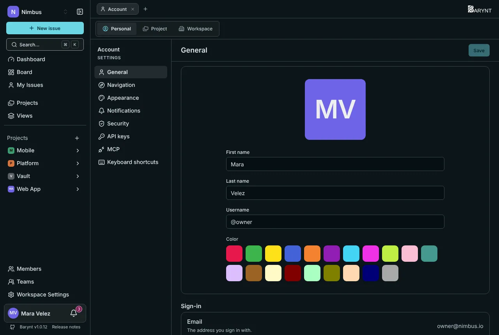
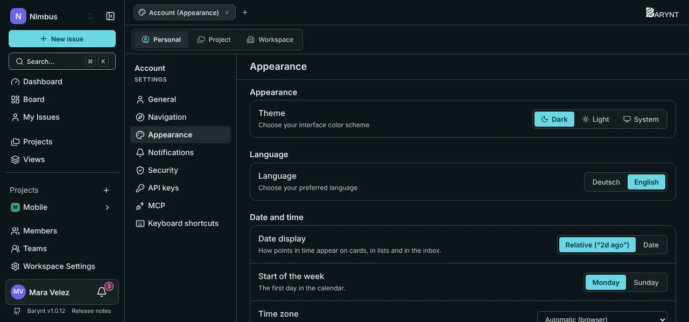
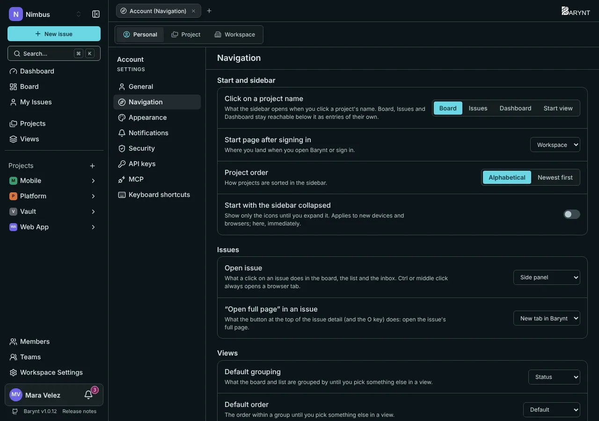
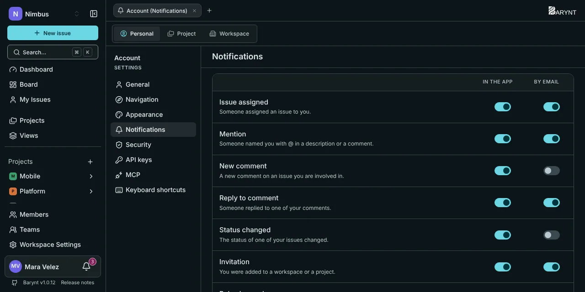
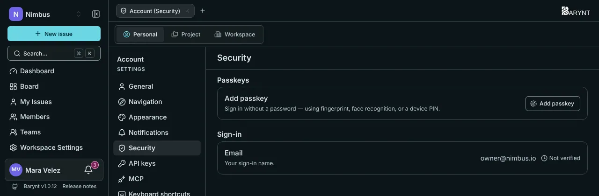

Everything on this page applies to **you only**. It is saved to your account, so it follows you to every device and browser.

To open it, click **your name** at the bottom of the sidebar and choose **Settings**. The _Personal_ tab on top is this area. The other two tabs, _Project_ and _Workspace_, are for [project](../administration/project-settings.md) and [workspace](../administration/workspace.md) settings.

## General

- **Picture, first name, last name** are how colleagues see you. If no picture is set, you get your initials on a color of your choice.
- **Username** is your short handle for `@mentions` and for filter addresses like `?assignee=@mara`. It is unique and may contain lowercase letters, digits and hyphens.
- **Sign-in** shows the email address you sign in with.

## Appearance

- **Theme:** dark, light, or _System_, which follows your computer.
- **Language:** English or German. It applies to the whole interface.
- **Date display:** relative ("2d ago") or the actual date, on cards, in lists and in the inbox.
- **Start of the week:** Monday or Sunday, for calendars.
- **Time zone:** automatic from your browser, or one you choose.

## Navigation

Where clicks take you, where you start, and how issues open.

| Setting | What it decides |
| --- | --- |
| **Click on a project name** | Whether the sidebar opens the _Board_, the _Issues_ list, the _Dashboard_ or your own _Start view_. |
| **Start page after signing in** | Where you land: the _Workspace_ overview, _My issues_, the _Inbox_, the _Dashboard_ or a view of your choice. |
| **Project order** | Alphabetical or newest first. |
| **Start with the sidebar collapsed** | Only icons until you expand it. |
| **Open issue** | What a click on an issue does: open a _side panel_, an _own page_, a _new tab in Barynt_ or a _new browser tab_. |
| **"Open full page" in an issue** | What the button at the top of an issue (and the `O` key) does. |
| **Default grouping, default order** | What boards and lists use until you choose something else in a view. |
| **Show sub-issues on the board** | The default for views where you have not decided yet. |

Holding `Ctrl` (or `⌘`) while clicking, or a middle click, always opens a browser tab.

## Notifications

For each event, choose whether you want it **in the app**, **by email**, both or neither. The details are in [My issues, inbox and notifications](my-work.md).

## Security

- **Passkeys** let you sign in with your fingerprint, your face or a device PIN, no password involved. Click **Add passkey** on each device you use. A passkey that syncs through your password manager or cloud account (iCloud Keychain, Google Password Manager, 1Password) is marked as _synced_.
- **Email** is your sign-in name. A verified address also unlocks sign-in links, invitations and email notifications, and it is your **way back in** if you ever lose your passkey. Add one.
- **Connected accounts** (if your administrator enabled company logins) lists the providers you can sign in with. If you have a passkey, you can disconnect them any time. Without one, the last connected account cannot be removed, because it would lock you out.

> [!TIP]
> Barynt nudges you to set up a passkey once. It takes ten seconds, and it is also the safest way in.

## API keys and MCP

Two sections are for connecting other tools. They are covered in the integrations chapter: [REST API](../integrations/api.md) for personal API keys, and [MCP server](../integrations/mcp.md) for connecting an AI assistant.

## Keyboard shortcuts

See and change them in the _Shortcuts_ section, and switch on or off **Ask before deleting**. See [Search and keyboard shortcuts](shortcuts.md).
