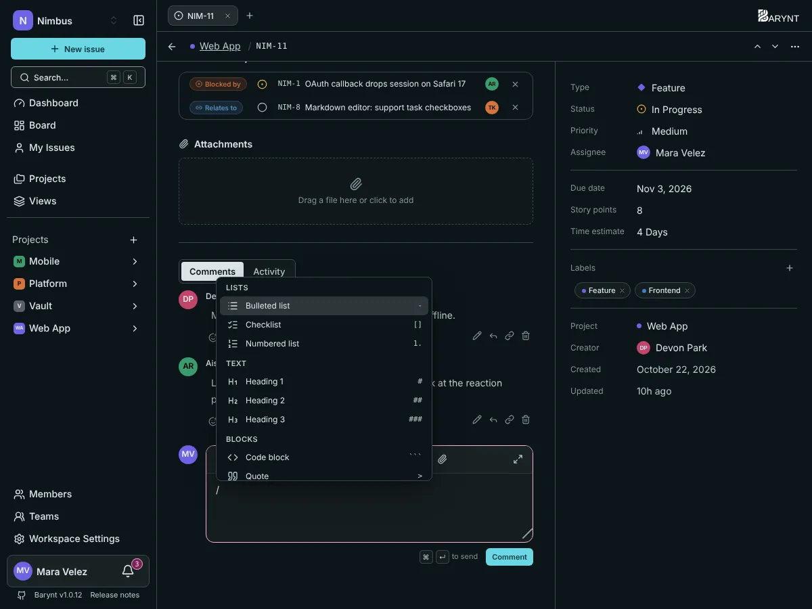

Issue descriptions and comments share the same editor. It is simple on purpose: you can write plain text and never think about it, and the formatting is there when you need it.

## Type `/` for everything

Anywhere in the text, type **`/`** to open the command menu, then keep typing to narrow it down ("/table", "/code"). Use the arrow keys and `Enter`, or click.

| Group | What you can insert |
| --- | --- |
| **Text** | Heading 1, 2 or 3 |
| **Lists** | Bulleted list, numbered list, checklist with tick boxes |
| **Blocks** | Code block, quote, info panel, warning panel, table, divider |
| **Insert** | Link, image, video or file, mention a person, link another issue, date |

Short forms work as you type, too: `#` followed by a space starts a heading, `-` followed by a space a bullet list, `1.` a numbered list, `[ ]` a checklist.

## Formatting text

The toolbar above the text offers bold, italic, strikethrough, inline code, headings, lists, a checklist, a quote, links and attachments. The usual shortcuts work as well: bold (`⌘B`), italic (`⌘I`), and `⌘K` / `Ctrl+K` for a link.

## Mention people with `@`

Type `@` and the first letters of a name. Pick the person from the list and they are mentioned, which sends them a notification (see [Inbox and notifications](my-work.md)). You can mention in the description and in comments.

## Link issues with `#`

Type `#` and a few letters of a title or a number, such as `#NIM-12`. The reference becomes a link that shows the issue's number and title, so everyone can jump straight there. It is the easy way to say "this is related to..." in the middle of a sentence.

## Images, videos and files

Choose _Image, video or file_ from the `/` menu, or use the paperclip in the toolbar. You can upload a file or insert one from an address. Uploads need [object storage](../administration/storage.md) to be set up. The limit is 100 MB per file.

## Checklists

A checklist is the quickest way to track small steps inside one issue. Tick the boxes as you go. If a step deserves its own owner, status and discussion, turn it into a [sub-issue](relations.md) instead.

## Info and warning panels

Panels set a paragraph apart in a colored box. Use an _info panel_ for background and a _warning panel_ for something people must not miss, such as "do not deploy on Fridays".

## Comments

The comment box sits below the description. `⌘↵` / `Ctrl+Enter` sends. The same box handles **replies**: click _Reply_ under a comment and the thread stays together. React with an emoji under any comment, which is often enough of an answer.

Your own comments can be edited (an "(edited)" mark is added) and deleted. Whether you can edit or delete other people's comments depends on your role, see [Roles and permissions](../administration/roles.md).

## Full screen and long texts

Writing a long description? Use the full-screen button in the toolbar for the full height of the screen. On a phone or tablet, the editor opens in place and keeps the issue visible above the keyboard.

> [!TIP]
> If you cancel a comment, its text is kept as a draft, so you can come back to it.
