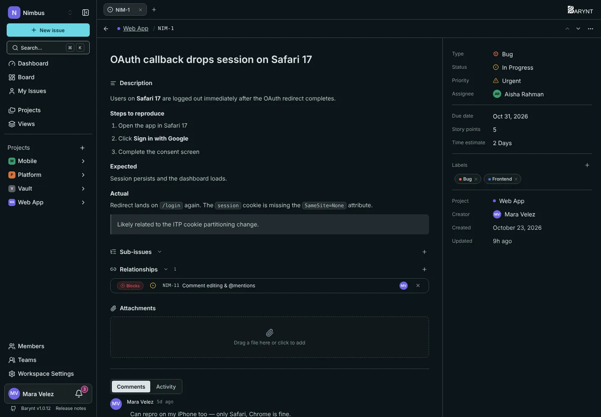

---

title: "Issues in detail"
description: "Create an issue, describe it, assign it, move it along and talk about it: everything you do with one piece of work."
sidebar:
order: 1
---

An **issue** is one piece of work: a task, a bug, an idea. Everything else in Barynt, from boards to dashboards, is just a way of looking at issues. This page is about the issue itself.

## Creating an issue

There are several ways, all leading to the same small dialog:

- Press **`C`** anywhere in the app (as long as you are not typing in a field).
- Click **New issue** at the top of the sidebar.
- Click the **+** at the top of a column on the board, which pre-selects that status.
- Press `⌘K` / `Ctrl+K` and choose _Create new issue_.

Only the **title** is required. Everything else can be filled in now or later. `⌘↵` / `Ctrl+Enter` creates the issue.

> [!TIP]
> Issues also arrive from the outside: through the [REST API](../integrations/api.md) or from an AI assistant through [MCP](../integrations/mcp.md). The issue then shows where it came from ("Created via MCP").

## The issue page

Click an issue anywhere (board, list, inbox, search) and it opens. By default it opens in a **side panel** next to your list, so you do not lose your place. Press `E` to switch between side panel and dialog, `O` to open it as a full page. You can choose what a click does under _Personal settings → Navigation_, see [Account and personal settings](account.md).

The page has two parts:

- **On the left**, the story: title, description, sub-issues, relationships, attachments, and below them the **Comments** and **Activity** tabs.
- **On the right**, the properties.

### Properties

| Property                    | What it is for                                                            |
| --------------------------- | ------------------------------------------------------------------------- |
| **Type**                    | The kind of work: Feature, Bug, Improvement, Task or Chore.               |
| **Status**                  | Where it stands: Backlog, Todo, In Progress, In Review, Done or Canceled. |
| **Priority**                | How urgent: No priority, Low, Medium, High or Urgent.                     |
| **Assignee**                | The one person responsible.                                               |
| **Labels**                  | Any number of tags, from the project or the workspace.                    |
| **Project, creator, dates** | Where it lives, who wrote it, when it was created and last changed.       |

Click a property to change it, or hover the issue and use the single-key shortcuts: `S` status, `P` priority, `A` assignee, `I` assign to me, `L` labels.

### Planning fields

Three optional fields help with planning. They are off by default and can be switched on per project under _Project settings → Fields_, see [Project settings](../administration/project-settings.md).

- **Due date** is a calendar day. It powers the _overdue_ numbers on the dashboard and the due-date filters.
- **Story points** is a whole number, typically 1, 2, 3, 5, 8 or 13, for teams that estimate in points.
- **Time estimate** is a duration. You can type it in hours, days, weeks, months or years, and Barynt remembers the unit you used.

You can use one, both or neither. There is no conversion between them.

## Moving an issue along

Change the status in the properties, with `S`, or by dragging the card on the [board](boards.md). When an issue becomes **Done** or **Canceled**, Barynt remembers when. That is what the dashboard uses to measure how much your team finishes and how long things take. Moving it back into work clears that moment again.

## Talking about it

Below the description is the discussion. Write a comment, mention a colleague with `@`, or refer to another issue with `#`. Replies and emoji reactions keep long threads readable. The assignee and the creator are told about new comments, anyone you mention gets a notification, and so does the author of a comment you reply to. See [Inbox and notifications](my-work.md).

The **Activity** tab is the other half of the story. It lists every change on this issue: who changed the status, the assignee, the labels, and when. Nothing here can be edited, so you can rely on it.

More about writing well in [Writing and formatting](editor.md).

## Breaking down and linking

- **Sub-issues** split a big issue into smaller steps, each with its own assignee and status.
- **Relationships** say how issues depend on each other: _blocks_, _is blocked by_, _relates to_, _is a duplicate of_.
- **Attachments** hold files and links.

All three are covered in [Sub-issues, relations and attachments](relations.md).

## Sharing and deleting

The **…** menu at the top of the issue offers:

- **Share**, which creates a read-only public link for people without an account, see [Sharing an issue](sharing.md).
- **Delete issue**, which removes it for good. Sub-issues are not deleted with it: they move up one level.

Copy the issue number with `⌘.` / `Ctrl+.`, or a link to it with `⌘⇧,` / `Ctrl+Shift+,`.

## Who may do what

What you can change depends on your role in the project:

- A **Contributor** (the usual role) can create issues, edit and delete **their own** (created by them or assigned to them), assign issues, and comment on everything they can see.
- A **Project admin** can edit and delete any issue.
- A **Viewer** can read and comment.

Details are in [Roles and permissions](../administration/roles.md).
