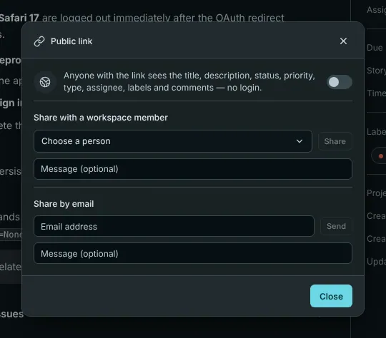
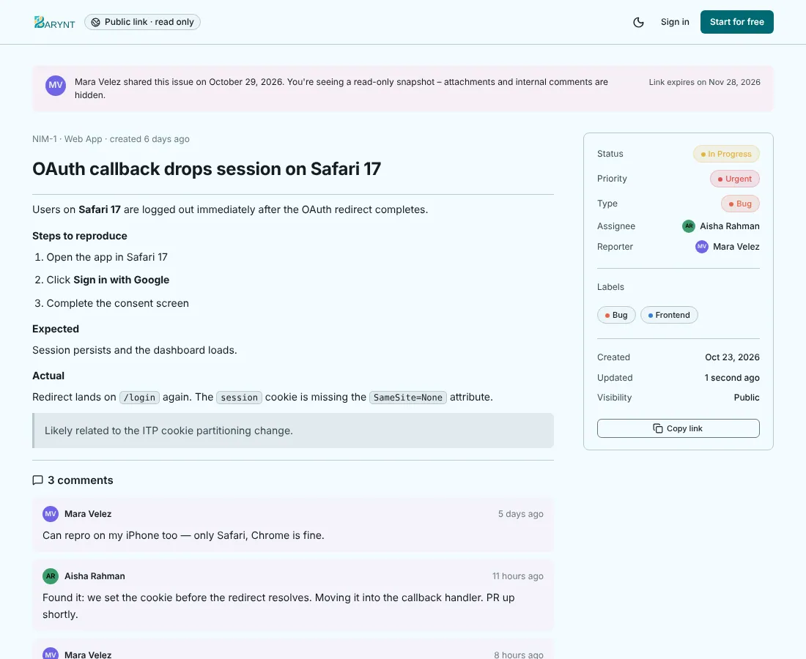

---

title: "Sharing an issue"
description: "Show an issue to someone without an account, or hand it directly to a colleague: a read-only public link, an email, or a message inside Barynt."
sidebar:
order: 10
---

Sometimes the person who needs to see an issue is not in your workspace: a client who reported a bug, a freelancer, a manager from another department. Barynt has three ways to share, from open to private.

## A public link

Open the issue, click the **…** menu and choose **Share public link**, then **Create link**. Barynt gives you an address that anyone can open in a browser, **without signing in**.

What the person sees is a clean, **read-only** page with the issue's title, description, status, priority, type, assignee, labels and the comments. They do **not** see attachments, other issues or the rest of your workspace, and they cannot comment or change anything. A note at the bottom invites them to join if they would like to take part.

- The link works for **30 days**, then it stops by itself. The page shows the date.
- You can **turn sharing off** at any time. The link is dead from that moment. Creating a new link gives a new address, and the old one stays dead.
- Only one link exists per issue.
- Creating and turning off a link are both written to the audit log, so you can always see who shared what.

> [!WARNING]
> Anyone who has the link can read the issue, so treat it like a password-protected document without the password. Do not put it in a public place. If an issue contains confidential details, share it with a person instead.

Creating the link needs the permission _Create and revoke the public read link for an issue_. Contributors, project admins and the roles above them have it, viewers do not.

## With a colleague

In the same dialog, choose **Share with a workspace member**, pick the person and add an optional message. They get an **Issue shared** notification in their inbox (and by email, if they have turned that on). It is a gentle way of saying "please have a look at this", without assigning it.

## By email

Choose **Share by email**, type an address and send. The recipient gets an email with the link to the issue's public page. If the issue has no public link yet, Barynt creates one for this. So everything above about the public link applies here too. This needs a mail server, see [Email](../administration/email.md).

## Which one to use

| You want to…                                 | Use                                                                   |
| -------------------------------------------- | --------------------------------------------------------------------- |
| Show an issue to someone outside, once       | **Public link**, then turn it off                                     |
| Get a teammate's attention without assigning | **Share with a workspace member**                                     |
| Let an external person take part over time   | [Invite them to the project as a guest](../administration/members.md) |
