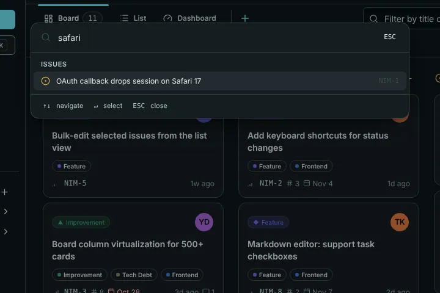
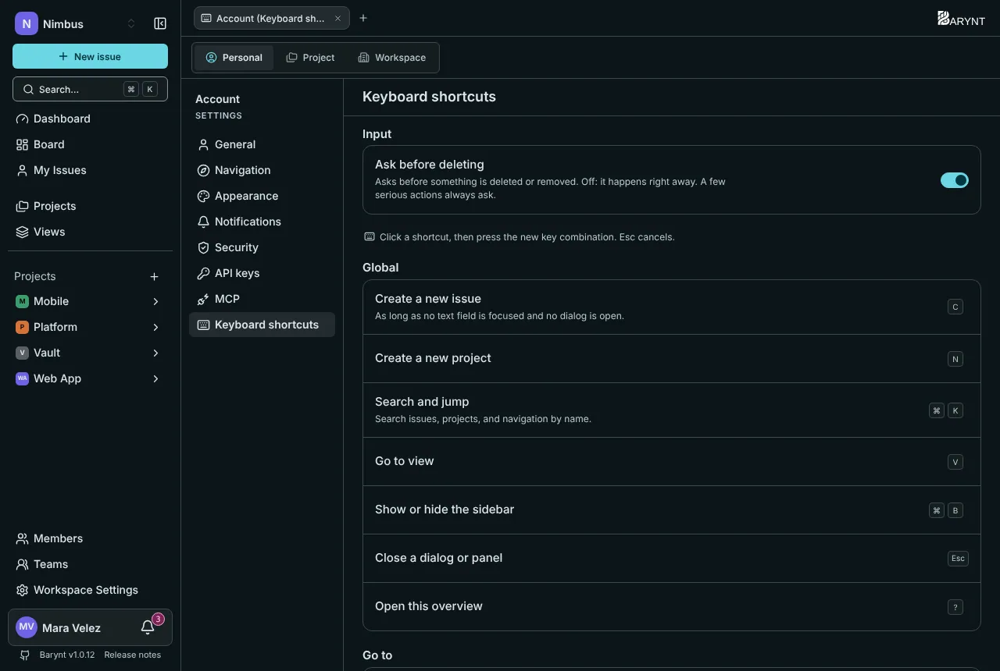

Barynt is built so that you rarely need the mouse. You do not have to learn any of this to use the app, but the few shortcuts below are the ones people tell their colleagues about.

> [!NOTE]
> On a Mac, `⌘` is the Command key. On Windows and Linux, read it as `Ctrl`. Barynt shows the right one for your computer, and shows no shortcut hints at all on a phone or tablet without a keyboard.

## The command palette: `⌘K`

Press **`⌘K`** (`Ctrl+K`) anywhere and type. One box finds:

- **Issues** by title or number, including your recently opened ones.
- **Projects**, to jump straight into one.
- **Views**, in this project or elsewhere.
- **Pages**, such as Members, Teams, Settings or the Inbox.
- **Commands**, such as _Create new issue_ or _Show keyboard shortcuts_.

Move with the arrow keys, press `Enter` to open, `Esc` to close.

Search covers titles and descriptions, and it only finds what you are allowed to see.

## Everywhere

| Keys | What it does |
| --- | --- |
| `C` | Create a new issue |
| `N` | Create a new project |
| `⌘K` | Search and jump |
| `V` | Go to a view |
| `⌘B` | Show or hide the sidebar |
| `?` | Open the shortcut overview |
| `Esc` | Close a dialog or panel |

Single-key shortcuts only work when you are not typing in a field and no dialog is open.

## Go to…

Press `G`, then a letter. Think "Go to":

| Keys | Where |
| --- | --- |
| `G` `D` | Dashboard |
| `G` `I` | My issues |
| `G` `P` | Projects |
| `G` `M` | Members (of the project you are in, otherwise of the workspace) |
| `G` `T` | Teams |
| `G` `S` | Settings (of the project you are in, otherwise of the workspace) |
| `G` `B` | Board |
| `G` `L` | Issue list |
| `G` `O` | The project's overview |
| `[` and `]` | Previous and next project |
| `⌘1` to `⌘9` | The first to ninth project in the sidebar |

## On an issue

With an issue open, or hovered in a list:

| Keys | What it does |
| --- | --- |
| `S` | Change status |
| `P` | Change priority |
| `A` | Change assignee |
| `I` | Assign to yourself (press again to unassign) |
| `L` | Edit labels |
| `T` | Add a sub-issue |
| `R` | Add a relation |
| `M` | Jump to the comment box |
| `⌘.` | Copy the issue number |
| `⌘⇧,` | Copy a link to the issue |
| `O` | Open the full page |
| `E` | Switch between side panel and dialog |

## In board and list

| Keys | What it does |
| --- | --- |
| `J` / `K` | Next or previous issue |
| `←` / `→` | Previous or next column (board) |
| `Enter` or `O` | Open the focused issue |

## While writing

| Keys | What it does |
| --- | --- |
| `⌘↵` | Save or create, also right inside a text field |
| `⌘K` | Insert or edit a link |
| `/` | Open the command menu in the editor |
| `@` and `#` | Mention a person, or link an issue |

## Your own shortcuts

If a key collides with another program, or you simply prefer another, change it: open _Personal settings → Keyboard shortcuts_, click a shortcut, and press the new combination. `Esc` cancels. Barynt warns you when keys are already in use. For `G`-sequences, only the second key can be changed. Changes are saved to your account, so they follow you to every device.

The same page has the switch **Ask before deleting**. With it on, deleting something asks first. With it off, it happens right away, except for a few serious actions, which always ask.
