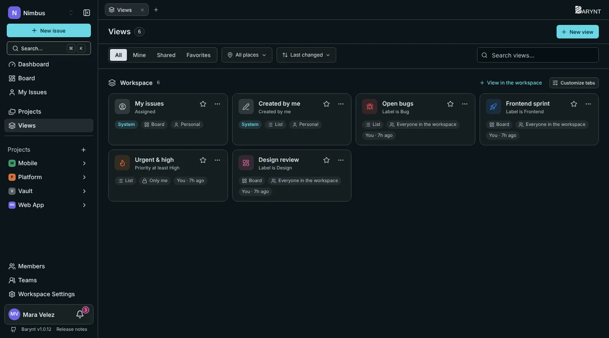
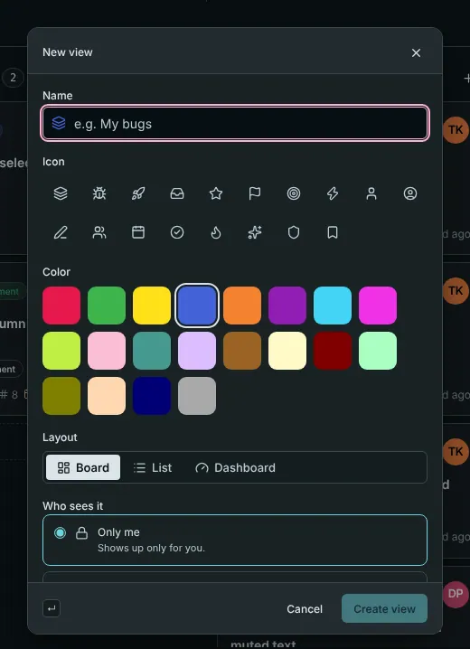

A **view** is a saved way of looking at issues. It remembers the filter, the grouping, the order and the layout, so "all open bugs, grouped by assignee" is one click away instead of five.

## Some views worth having

- **Open bugs:** a list filtered to type _Bug_ and everything not done.
- **This sprint:** a board filtered to the label `Sprint 14`.
- **Urgent and high:** a list of priority _High_ and above, grouped by assignee, kept private for your Monday check.
- **Design review:** a board of everything labelled `Design`, shared with the whole team.

## Two views come ready-made

Every workspace has two **system views** that nobody can change or delete:

- **My issues** (shown as _Assigned_ on the tabs): everything assigned to you, across all projects.
- **Created by me:** everything you wrote.

They are personal even though they are shared: each person sees their own.

## Creating a view

There are two ways:

1. **Set up what you want first.** Filter, group and sort the board or list as you like. A small **Unsaved** marker appears. Click **Save as new view** and give it a name. Click **Discard** instead to throw your changes away.
2. **Start from the plus** next to the tabs, choose **New view** and fill in the form.

| Field | What it does |
| --- | --- |
| **Name** and **icon** | How it is recognised on the tab and in lists. |
| **Layout** | _Board_, _List_ or _Dashboard_. A view can even be a dashboard with a filter, see [Dashboards](dashboards.md). |
| **Where does it live?** | In the **workspace** (issues from every project) or in **one project**. |
| **Who sees it** | _Only me_, _Everyone in the project_, or _Everyone in the workspace_. |
| **Take over the current filters, grouping and order** | Starts from what is on your screen right now. |

> [!TIP]
> A shared view is a good way to agree on words. "Ready for QA" means the same filter for everyone, instead of five slightly different ones.

## Finding and organising views

The **Views** page in the sidebar lists every view you can see, with filters for _Mine_, _Shared_ and _Favorites_, a choice of place (workspace or a project) and a search box. The tab bar of each project shows its views, and a **More** menu holds the ones that do not fit.

On every view, the **…** menu offers:

- **Pin to sidebar** and **Add to favorites** (the star): two personal switches that decide what shows up in your sidebar. Nobody else sees them.
- **Make project start view:** what opens when you click the project's name (once you have chosen _Start view_ under _Personal settings → Navigation_).
- **Edit**, **Duplicate**, **Copy link** and **Delete**.

Under **Customize tabs** you decide which tabs you see in a project and in which order. That is personal, too.

## Who may do what

- Anyone who can see a project can create private views there.
- Sharing a view with a project or workspace needs the permission _Create shared views_. Members have it for the workspace by default; viewers do not.
- Changing or deleting a shared view that **someone else** created needs _Edit and delete shared views created by others_, which project leads, managers and admins have.
- A shared view you cannot change is marked read-only and says who shared it.

Deleting a view never deletes issues. It only removes the saved way of looking at them.

## Views and the outside world

- A new, changed or deleted **shared** view can trigger a [webhook](../integrations/webhooks.md). Private views never do.
- Views can be listed, created and changed through the [REST API](../integrations/api.md) and [MCP](../integrations/mcp.md), with the same rights as in the app.
