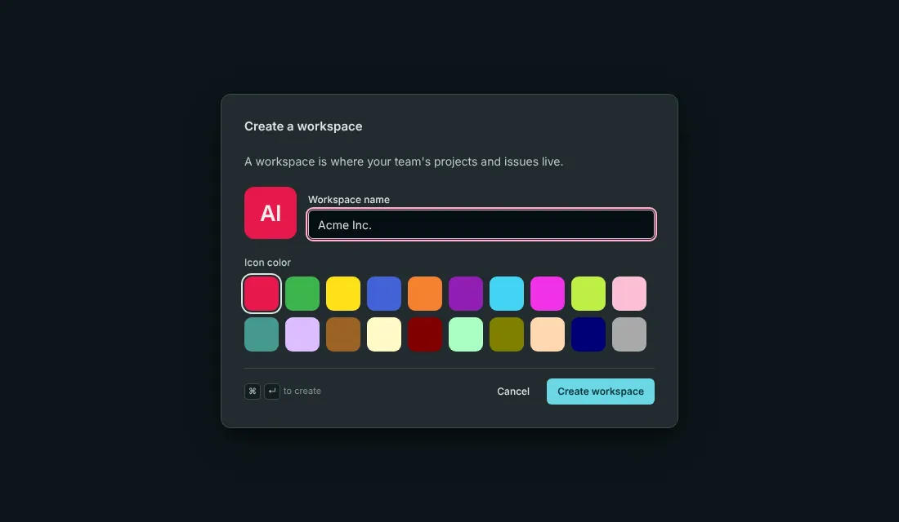
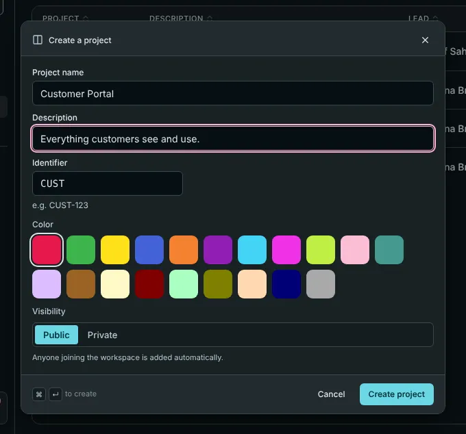

This walk-through takes you from the sign-in screen to a first issue and a first teammate. If someone has already set up your workspace, skip ahead to [step 4](#4-write-your-first-issue).

## 1. Sign in

Open the address your administrator gave you. Which buttons you see depends on how the server was set up:

- **Sign in with passkey.** A passkey replaces the password. You confirm with your fingerprint, your face or your device PIN, and nothing secret ever travels over the network. New here? Choose **Register with passkey** once.
- **Continue with your company login.** If your company has single sign-on (Google, Microsoft, Okta, Keycloak and others), use that button, as you do everywhere else.
- **A magic link by email.** You type your address, and Barynt sends a link or a short code.

> [!NOTE]
> The very first account on a new server becomes the **platform administrator**, the person who looks after the server itself. Everyone after that is a normal user.

After your first sign-in Barynt asks you to confirm your name and a short username. That username is what others type to mention you (`@mara`).

## 2. Join or create a workspace

A **workspace** is the home of your team: its projects, issues and people. You get into one in one of three ways:

- Someone **invites** you, by email or with a link.
- Your email domain is **claimed** by a workspace (for example everyone with `@nimbus.io`), and you join automatically.
- You **create your own**: give it a name and a color. The short address (the _slug_) is made from the name and becomes part of every link.

If your administrator has switched off workspace creation, you do not see this step: you are taken straight into the default workspace.

## 3. Create a project

A **project** groups related work, for instance "Web App" or "Mobile". Press `N` anywhere, or click **+** next to _Projects_ in the sidebar.

- **Name and description** are shown in the sidebar and on the project overview.
- **Identifier** is a short prefix of two to four letters. It becomes part of every issue number: with `WEB`, your issues are called `WEB-1`, `WEB-2` and so on.
- **Visibility** decides who is in. _Public_ projects add every workspace member automatically. _Private_ projects only include the people you add yourself. Use private for anything confidential.

## 4. Write your first issue

Press `C` (or click **New issue** at the top of the sidebar). Give it a title, and add as much or as little as you like: a description, a type, a status, a priority, someone to do it, labels. Press `⌘↵` (`Ctrl+Enter` on Windows and Linux) to create it.

The issue is now in your project, on the **Board** and in the **List**. Its number (like `WEB-1`) is what you use to refer to it in chat, in commits and in other issues.

## 5. Move it along

Open the project's **Board**. Every column is a status. Drag a card from _Todo_ to _In Progress_ and the status changes for everybody, right away. Click a card to open its details: write a comment, assign it, add a due date, attach a file.

## 6. Invite your team

Open **Members** in the sidebar and click **Invite member**. Enter one or more email addresses, choose a role (_Member_ is the usual one) and send.

> [!TIP]
> No email set up on your server? Barynt then shows you an **invitation link** to copy and send yourself. You can also create a **link for everyone** under _Workspace settings → Invitations_, which is handy for a team chat.

More about this in [Members and invitations](../administration/members.md).

## 7. Make Barynt yours

Click your name at the bottom of the sidebar to open your personal settings. Three things are worth a minute:

- **Appearance:** dark or light, English or German.
- **Notifications:** what lands in your inbox and what is also sent by email. See [Account and personal settings](../using-barynt/account.md).
- **Shortcuts:** press `?` to see all keyboard shortcuts. After a day you will not want to go back.

## Where to go from here

- [The building blocks](concepts.md): the words Barynt uses, in one page.
- [Issues in detail](../using-barynt/issues.md): everything you can do with one.
- [Roles and permissions](../administration/roles.md): who may see and do what.
