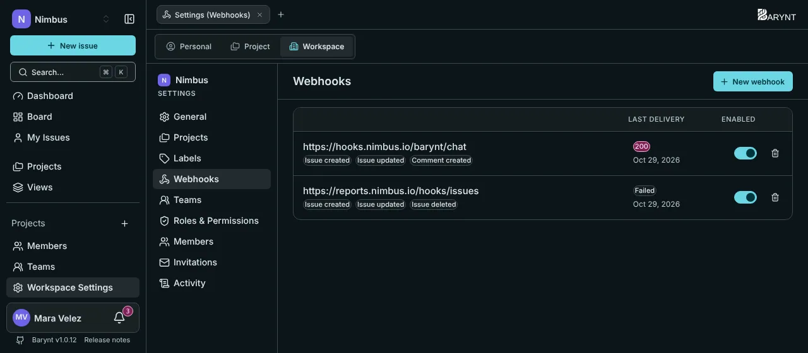
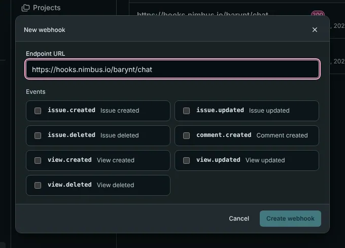

With a **webhook**, Barynt calls **you**. Whenever something you care about happens in the workspace, it sends a message to an address you choose. That is how you post new bugs into a chat channel, start a build when an issue moves to _In Review_, or keep another system up to date without checking again and again.



## Examples of what teams do with it

- **Chat notifications:** a message in your team channel for every new _Urgent_ bug.
- **Automation:** when an issue is created with the label `Customer`, open a ticket in the support system.
- **Reporting:** copy every change into a data warehouse.
- **Syncing** a spreadsheet, a status page or a customer portal.

Some of these need a developer, or a tool like Zapier, Make or n8n that can receive a webhook. The settings page itself needs no code.

## Setting one up

Open **Workspace settings → Webhooks** (you need the permission to manage webhooks, which owners, admins and managers have) and click **New webhook**.



1. **Endpoint URL:** the address that should receive the messages, for example `https://example.com/webhooks/barynt`.
2. **Events:** choose what you want to hear about.
3. Click **Create webhook**. Barynt shows the **secret** once: copy it now. The receiver needs it to check that a message really came from your Barynt.

The list shows each webhook with its **last delivery** (the HTTP status, or the error) and a switch to turn it **on or off**. A webhook that has never been triggered says so. Deleting one stops it immediately.

## Events

| Event | When |
| --- | --- |
| `issue.created` | An issue is created, in the app, through the API or by an AI assistant. |
| `issue.updated` | An issue changes. The message carries the **whole current issue**, not just the difference. |
| `issue.deleted` | An issue is deleted. |
| `comment.created` | A comment is written. |
| `view.created`, `view.updated`, `view.deleted` | A **shared** view changes. Private views never trigger anything. |

Webhooks belong to one workspace and only report events of that workspace.

## What a message looks like

Barynt sends an HTTP `POST` with a JSON body:

```json
{
  "event": "issue.created",
  "timestamp": 1772870400000,
  "data": {
    "id": "i_4k2n1x",
    "ref": "WEB-42",
    "title": "Fix broken checkout flow",
    "status": "backlog",
    "priority": 2,
    "type": "feature",
    "labels": [{ "id": "l_9f2a1b", "name": "frontend" }],
    "assignee": null,
    "reporter": { "id": "u_1a2b3c", "name": "Alex Kim" },
    "project": { "id": "proj_9f8e7d", "name": "Website Relaunch" }
  }
}
```

`data` is the same issue (or comment, or view) shape as in the [REST API](api.md).

## Checking that a message is genuine

Anybody who knows the receiving address could send fake messages to it. That is why every delivery is **signed**. Two headers come with it:

- `X-Barynt-Timestamp`: when the message was sent.
- `X-Barynt-Signature`: a signature of the message, made with your secret.

The receiver computes the same signature and compares. The recipe, for the developer:

```js
import { createHmac, timingSafeEqual } from "node:crypto";

function isGenuine(secret, timestamp, rawBody, signature) {
  const expected = createHmac("sha256", secret)
    .update(`${timestamp}.${rawBody}`) // timestamp, a dot, the raw body
    .digest("hex");
  return timingSafeEqual(Buffer.from(expected), Buffer.from(signature));
}
```

Also reject messages whose timestamp is older than a few minutes. That stops someone replaying an old message.

## Good to know

- **One attempt only.** Barynt sends each message once, waits ten seconds for an answer, and does not retry. If your receiver is down, it misses that message. The status of the last delivery is shown in the list, so you can spot it. Receivers should answer quickly and do slow work afterwards.
- **No order guarantee.** Two quick changes can arrive in either order. Use the `updated` time in the data to tell which is newer.
- A message carries the content of the issue, such as its title and description. Treat the receiving address with care and use **HTTPS**.

If a webhook does not seem to arrive, see [Troubleshooting](../administration/troubleshooting.md).
