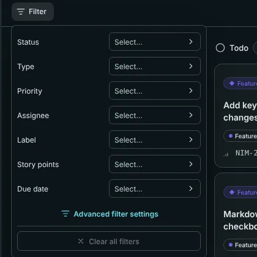

Barynt has two basic layouts for issues. They show the same data, so use whichever suits the moment: the **board** to move work along, the **list** to scan, sort and work through many issues.

## The board

Each **column** is a status: _Backlog_, _Todo_, _In Progress_, _In Review_ and _Done_. Every issue is a card. What a card shows: its project (on the workspace board), type, title, labels, number, priority, assignee's picture, when it last changed and how many comments it has.

- **Drag a card** to another column and its status changes for everybody, at once.
- **Drag a card up or down** inside a column to rank it. The order you set is the order everyone sees (the default _manual_ ordering).
- **Click a card** to open it, or move with the arrow keys and press `Enter`.
- The **+** at the top of a column creates an issue in that status.
- **Canceled** issues are not shown as a column, but you can bring them back with _Shown groups_ (see below).

No mouse at hand? Open the card and change its status with `S`, or press `⌘K` and use the commands.

> [!NOTE]
> When a colleague changes something while you have the board open, a small note says "There are changes" with a **Refresh** button. Your own changes never trigger it.

## The list

The list shows the same issues as rows: number, title, status, priority, assignee, labels and the date. Rows are grouped (by default by status) and each group can be folded away. Click a row to open the issue.

Use `J` and `K` to move down and up, `Enter` to open, like in many mail clients.

## Display: choose what you see

The **Display** button on the right opens a small menu. Your choices are remembered for you, per project.

| Setting | What it does |
| --- | --- |
| **Board / List** | Switches the layout. |
| **Columns / Grouping** | Group by _Status_ (the default), _Priority_, _Type_, _Assignee_ or _Story points_. On the workspace board you can also group by _Project_. |
| **Swimlanes** | A second grouping as horizontal rows, for instance columns by status and one lane per person. |
| **Ordering** | _Default_ (your manual ranking), or sort by priority, type, status, story points, due date, time estimate, last update, creation date, title or assignee, ascending or descending. |
| **Shown groups** | Hide columns you do not need, such as Backlog, and re-order the others. |
| **Hide empty groups** | Collapses columns without issues. |
| **Show sub-issues** | Shows sub-issues next to their parents. Off by default. |
| **Display properties** | Which details cards show: priority, labels, story points, due date. |
| **Reset** | Back to the defaults. |

If you want one of these setups again tomorrow, or want to share it with your team, save it as a [view](views.md).

## Filter: show only what matters

Click **Filter** above the board. The quick filters are _Status_, _Type_, _Priority_, _Assignee_ and _Label_. Pick one or several values in each. **Clear all filters** starts over.

For anything more precise, open **Advanced filter settings**. There you build conditions yourself:

- Fields include status, type, priority, assignee, creator, labels, due date, story points and whether it is a sub-issue.
- Comparisons include _is_, _is not_, _is empty_, _at least_, _at most_, _before_, _after_ and _within_.
- Special values save typing: **Me** stands for whoever is looking, and dates can be relative, like _overdue_, _today_, _next 7 days_ or _last 30 days_.
- Conditions can be combined with **AND** or **OR**, and grouped into boxes.

To find an issue by name or number, use the **Filter by title or ID** box next to the tabs. For a search across everything, press `⌘K`, see [Search and keyboard shortcuts](shortcuts.md).

## Workspace-wide board and list

**Board** and **Issues** in the top part of the sidebar do the same across all your projects. Cards then carry the project name, and you can group by project.
