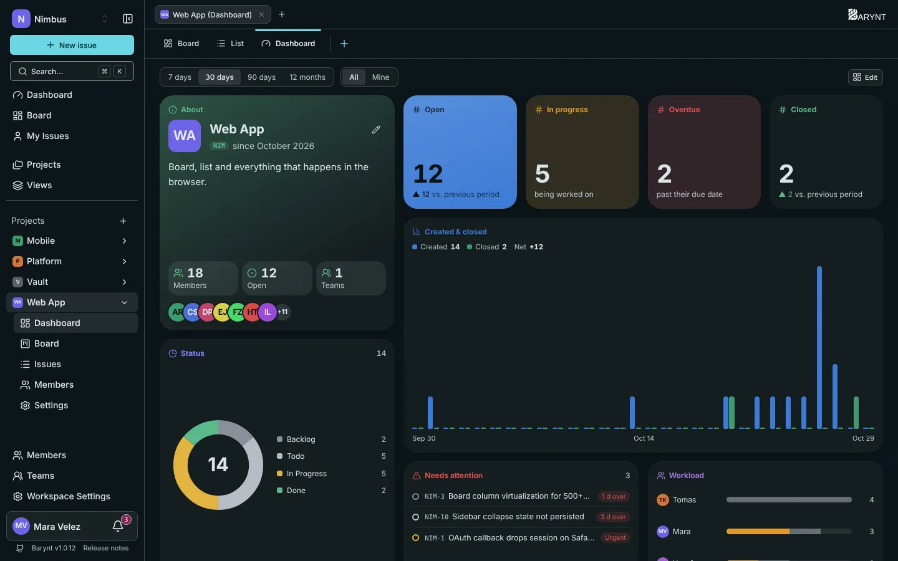
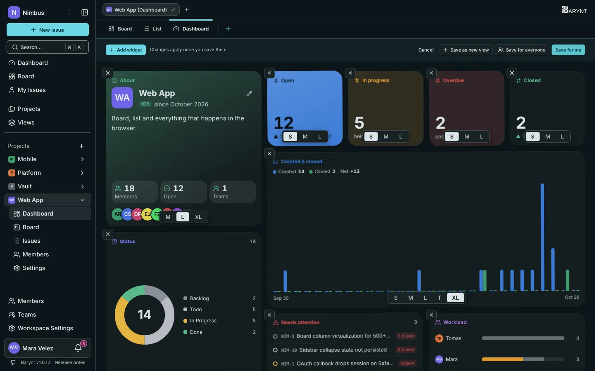
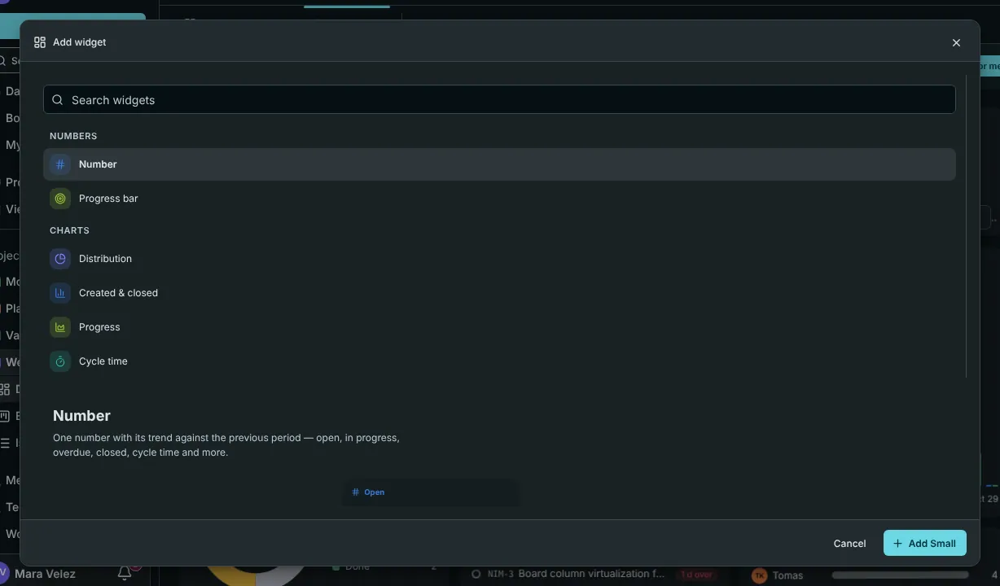

A **dashboard** turns the issues of a project, or of the whole workspace, into a picture. It is made of **widgets**: small tiles with a number, a chart or a list. You decide which ones you want and where they sit.

## Where to find it

- **Workspace dashboard:** _Dashboard_ at the top of the sidebar. It covers all projects you can see.
- **Project dashboard:** the _Dashboard_ tab (or sidebar entry) inside a project.

## Reading a dashboard

Two switches at the top control everything on the page:

- **Time range:** 7 days, 30 days, 90 days or 12 months. The trend arrows always compare with the period before.
- **Scope:** **All** shows the whole project or workspace, **Mine** only your own issues. Seeing _All_ needs a permission (_See the dashboard numbers of the whole project_). Without it (the usual situation for team members), you see your own numbers, and the page says so.

### What the standard widgets tell you

| Widget | The question it answers |
| --- | --- |
| **About** | What is this project, who is in, how many issues are open? |
| **Open, In progress, Overdue, Closed** | The four numbers a lead checks first, each with its trend against the previous period. |
| **Status** | How is the work spread across Backlog, Todo, In Progress, Done? |
| **Created and closed** | What came in and what got done, per day, week or month. Where the blue bars outrun the green, the backlog is growing. |
| **Needs attention** | What is at risk: overdue, urgent and unassigned, urgent, or in progress but untouched for two weeks. |
| **Workload** | Who has how much open, split into in progress and not yet started. |
| **Progress bar** | How much of a chosen set is done, for example everything labelled `Release 2.4`. |
| **Projects** | Every project with its open issues, one click away (workspace dashboard). |

## More widgets

Click **Edit**, then **Add widget** to open the gallery. You can search it, and every entry shows a live preview with your own numbers.

| Group | Widgets |
| --- | --- |
| **Numbers** | Number (open, in progress, overdue, closed, cycle time and more), Progress bar |
| **Charts** | Distribution (ring or bars by status, priority, type, assignee, label or project), Created and closed, Progress (burn-up), Cycle time, Cumulative flow, Time in status, Workload, Matrix (two properties against each other, as a heat map), Age of open issues |
| **Lists** | Needs attention, Issue list (any filter), Activity |
| **Overview** | About, Members, Teams, Labels, Projects, Links, Shortcuts |
| **Free-form** | Note (goals, text, links), Embed (a website or an image), Custom widget |

Most widgets can have their **own filter** on top of the dashboard's, so one tile can show "bugs only" while another shows everything.

## Making it yours

Click **Edit** at the top right. You can now:

- **Drag** a widget to a new place.
- Change its **size** with the small buttons beneath it: **S**, **M**, **L**, **T** (tall), **XL** or **W** (full width).
- **Remove** it with the **×** in its corner.
- **Add** more with _Add widget_.

When you are done, you choose how to save:

| Button | What it does |
| --- | --- |
| **Save for me** | Your own arrangement. Everyone else keeps the default. |
| **Save for everyone** | Makes this the default for everyone who has not changed their own. Needs the permission _Set the default dashboard layout_, which workspace owners, admins, managers and project admins have. |
| **Save as new view** | Keeps this dashboard, with its filter, as a [view](views.md) of its own, for example "Mobile team dashboard". |
| **Cancel** | Goes back to the last saved state. |

## Your own widgets

Cannot find what you need? Build a **custom widget** from building blocks: numbers, progress bars, distributions, time series, matrices and issue lists, each with its own filter. Start from a template (_Sprint status_ is a popular one), name it, and tick **Share in the workspace** if everyone should find it in their gallery. Only you can change a widget you shared. Widgets already placed on dashboards stay when the custom one is deleted.

## Good to know

- **Cycle time** is the time from creating an issue to closing it, shown as median, P75 and P95. Only closed issues count.
- A _closed_ issue is one whose status became _Done_ or _Canceled_. Reopening it takes it out of the closed numbers again.
- Everything on a dashboard respects permissions: you only ever see issues from projects you can see.
