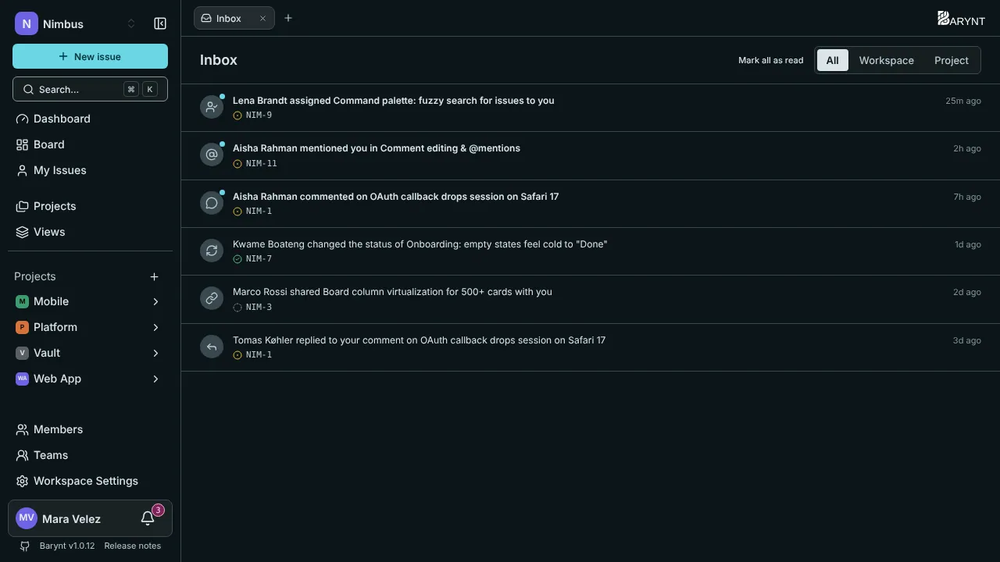

Teams drown in noise when everything pings everyone. Barynt keeps two things apart: **My issues** is the list of your work, and the **Inbox** is the short list of things that need your attention right now.

## My issues

Click **My Issues** in the sidebar. You see everything assigned to you, across **all projects**, as a board by default. It is one of the two system views every workspace has (see [Views](views.md)), so you can filter, group and sort it like any other board or list. With the keyboard: `G`, then `I`.

It is a good place to start the day: what is mine, what is in progress, what is waiting for review.

## The inbox

The **Inbox** collects notifications about things that concern you. The **bell** next to your name at the bottom of the sidebar opens it and shows how many notifications are unread.

Notifications come in when:

| Event | You are told when… |
| --- | --- |
| **Issue assigned** | Someone assigns an issue to you. |
| **Mention** | Someone names you with `@` in a description or a comment. |
| **New comment** | Someone comments on an issue you created or are assigned to. |
| **Reply to comment** | Someone replies to one of your comments. |
| **Status changed** | The status of an issue you created or are assigned to changes. |
| **Invitation** | You are added to a workspace or a project. |
| **Role changed** | Your role in a workspace or a project changes. |
| **Issue shared** | Someone shares an issue directly with you. |

Nobody is notified about their own actions. If you are mentioned in a comment, you get the mention, not an extra "new comment" on top.

### Working through the inbox

- **Filter by place** with the tabs _All_, _Workspace_ and _Project_.
- **Click a notification** to open the issue. It is marked as read.
- **Mark all as read** clears the list in one go.
- Make the inbox your **start page** under _Personal settings → Navigation_ if you live in it, see [Account and personal settings](account.md).

## Notifications by email

Every event can be sent **in the app**, **by email**, both or neither. You decide under _Personal settings → Notifications_:

| Event | In the app | By email |
| --- | :---: | :---: |
| Issue assigned, mention, reply, invitation, role changed, issue shared | on | on |
| New comment, status changed | on | **off** |

Comments and status changes are off by default because they can be frequent. Turn them on if you prefer email over the inbox.

> [!NOTE]
> Email only works if your administrator has set up a mail server, see [Email](../administration/email.md). Without it, everything stays in the inbox.

## Making it less noisy

- Switch off email for comments and status changes (the default).
- Use `@mentions` deliberately: they always reach the person.
- Keep your issues assigned correctly. Assignment is what ties notifications to the right person.
