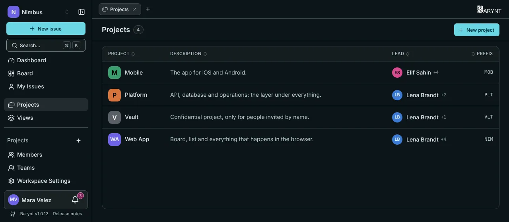

A **project** is a bucket of related work: a product, a team's backlog, a client, a campaign. It has its own issues, its own board and its own dashboard, and it can have its own circle of people.

## The project list

Click **Projects** in the sidebar for the list of every project you can see: name, a one-line description, who **leads** it and its identifier. A click on a row takes you in.

The **lead** is simply whoever holds the _Project Admin_ role. The list shows the first one and a "+n" for the others.

## Creating a project

Press `N`, or click **New project**, and fill in:

- **Name** and a **description**.
- **Identifier:** two to four letters that prefix every issue number, like `WEB` for `WEB-1`, `WEB-2`. It cannot be used twice in a workspace.
- **Color** (and later a picture): how the project is recognised in the sidebar and on tabs.
- **Visibility:** public or private, see below.

You become the project's admin right away. The creation is recorded in the audit log.

## Public or private?

| | Public | Private |
| --- | --- | --- |
| Who is in | Every workspace member, automatically. New members are added when they join. | Only people added by hand. |
| Who can see it | All workspace members. | Members of the project, plus workspace owners, admins and project leads, who can open every project. |
| Use it for | Normal team work. | Anything confidential: HR, finance, security, a client under NDA. |

Changing a project from public to private takes access from **nobody**. Everyone already inside stays. Only **new** workspace members stop being added automatically. To remove somebody, do it explicitly under the project's _Members_.

## Working inside a project

Every project has its own entries in the sidebar, and the same set as tabs at the top:

- **Dashboard:** the numbers and charts of this project, see [Dashboards](dashboards.md).
- **Board:** the issues as columns by status, see [Board and list](boards.md).
- **Issues:** the same issues as a list.
- **Members:** who is in and with which role, see [Project settings](../administration/project-settings.md).
- **Settings:** name, color, visibility, labels, fields and more.

Next to them sit your **saved views**, see [Views](views.md).

At the workspace level, **Board** and **Issues** in the sidebar show the issues of _all_ your projects together, with the project named on each card. Handy for a lead who needs the whole picture.

## Moving between projects

- Click the project in the sidebar. What that click opens (board, list, dashboard or your own start view) is your choice under _Personal settings → Navigation_.
- Press `[` and `]` to go to the previous or next project, staying on the same view.
- Press `⌘1` to `⌘9` (`Ctrl+1` to `Ctrl+9`) to jump to the first to ninth project in the sidebar.

## Settings, members and removal

Name, description, color, identifier, visibility, which fields issues have, project-only labels and roles all live in the project's settings. They are covered in [Project settings](../administration/project-settings.md).

> [!WARNING]
> Deleting a project deletes all its issues. It cannot be undone, so Barynt asks you to confirm and tells you how many issues are in it.
