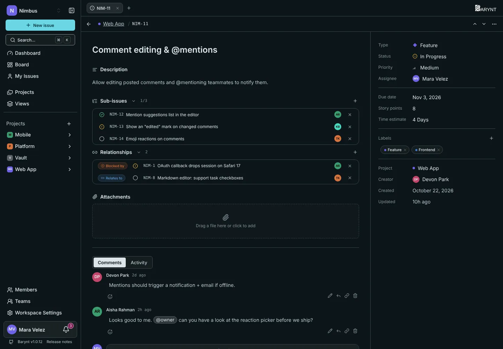

Real work is rarely one clean task. These three tools, all on the issue page, keep the connections visible.

## Sub-issues

A **sub-issue** is a normal issue that belongs to a bigger one, its **parent**. Use it when a task has several steps and each step needs its own owner, status or discussion. "Redesign the settings page" can have sub-issues for "Draw the layout", "Build the form" and "Write the help text".

- Click **+** next to _Sub-issues_ (or press `T`) to add one. You can create a new issue right there or pick an existing one.
- The section header shows progress as **done / total**, for example `2/5`.
- Each sub-issue has its own assignee, status and priority. It can even live in another project, as long as you can see both.
- To remove the link, open the sub-issue and choose _Remove parent_. The issue itself stays.

By default, sub-issues are **hidden on the board and in lists**, so a parent does not appear next to its own children. If you would rather see them everywhere, switch on _Show sub-issues_ in the **Display** menu, see [Board and list](boards.md). A filter can also single them out ("Only sub-issues" or "No sub-issues").

> [!NOTE]
> If you delete a parent issue, its sub-issues are **not** deleted. They move up to the top level.

## Relationships

A **relation** is a link between two issues that are separate but connected. Click **+** next to _Relationships_ (or press `R`), choose the type and search for the other issue.

| Relation | Read it as | Use it when |
| --- | --- | --- |
| **Blocks** | "This issue blocks that one" | Something cannot start before this is done. |
| **Blocked by** | "This issue waits for that one" | The same relation, seen from the other side. |
| **Relates to** | "These two belong together" | Related, but neither depends on the other. |
| **Duplicate of** | "This is the same as that one" | Two people reported the same thing. Keep one, link the other. |
| **Duplicated by** | "That one is a copy of this" | The same relation, seen from the other side. |

You only set a relation once. It shows up on both issues, worded the right way round for each. Every added or removed relation is recorded in the issue's activity.

## Attachments

The **Attachments** section holds files and links that belong to the issue: a screenshot of the bug, a contract, a link to the design in your design tool.

- **Add a file** by clicking the area or dragging a file onto it. Images and videos show a preview, other files a download button.
- **Add a link** to point at something that lives elsewhere.
- The limit is **100 MB per file**.
- Anyone who can see the issue can open the attachments. Removing one deletes the stored file as well.

> [!WARNING]
> Files need [object storage](../administration/storage.md). On a server without it, the attachment area is switched off and Barynt simply works without attachments.

## What the activity shows

Every change here is written to the issue's **Activity** tab: parent set or cleared, sub-issue added or removed, relation added or removed, attachment added or removed. That makes it easy to answer "who linked this, and when?".
