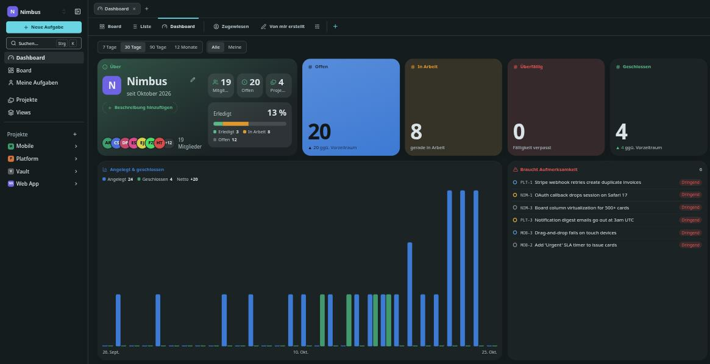
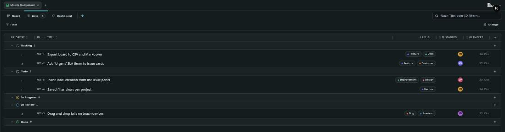

# Barynt 1.0.10

**Views, deeper filters, swimlanes, a table-style list and widget dashboards.** This release turns Barynt's boards and lists into things you can shape, save and share, and gives every workspace and project a dashboard that is actually yours.

## ✨ Highlights

- **Saved views** — save any board or list setup, pin it, favorite it, share it, make it your start page.
- **Advanced filters** — nested AND/OR groups, "is / is not" and relative values, all stored in the link.
- **Swimlanes** — group the board a second time and drag cards between lanes.
- **The list as a table** — columns, sorting, resizable widths and sums.
- **Dashboards made of widgets** — fixed-size widgets, a gallery, a widget builder and flow metrics.
- **API & MCP** — saved views, statuses, priorities and issue types; Markdown in, Markdown out.

## 🗂️ Views and navigation

- **Saved views** for boards and lists: change filters, grouping, sort order or columns, then **Save** or **Save as new view**. Unsaved changes show up as "Unsaved" with _Discard_ and _New view_.
- **One tab row** for _Board · List · Dashboard_ and your own views, with a "More" menu for what doesn't fit. Choose which tabs show and in which order under **Customize tabs**.
- **Pin, favorite and start views.** Pin views you need every day, star favorites, and set the view Barynt opens first.
- **Workspace-wide views** across all projects, plus **My issues** (_Assigned_ and _Created by me_) as built-in views.
- **A new Views page** that lists every view you can see as cards, filterable by _Mine_, _Shared_ and _Favorites_, with every action and creation in any place.
- **Quick switching:** the command palette finds views by name and project, and the board/list switch sits at the top of _Display_ everywhere.
- **Board columns per view:** reorder and hide the board's columns for each view, by drag and drop or with the arrow buttons.
- **On phones and tablets** the tab row scrolls as one, the views page has its own layout, and the board gives way to the list on small screens.

## 🔍 Advanced filters

- **Filter by anything, as deep as you need.** Build conditions in nested boxes joined by _and_ / _or_, to any depth, with _is_ and _is not_ for every field.
- **Relative values** such as `@me` keep a view current without editing it.
- **The whole filter lives in the address.** Copy the link and the person who opens it sees exactly your result.
- **Readable at a glance.** Active filters sit in a row of their own with their values spelled out, colored per field, and _is not_ crosses the value out. A single × removes one condition.
- **Made for touch.** The same editor works in a bottom sheet on phones.

## 🏊 Board swimlanes

- **Group the board a second time.** Pick a second grouping in _Display_ and every value becomes a lane across your columns.
- **Drag cards between lanes** and columns in one move, including onto a **folded lane**, which opens as soon as a card hovers over it.
- **Empty lanes start folded** and take less room.
- **Create in place.** Add a card in a lane cell and both the lane's and the column's value are already set.

## 📋 The list as a table

- **Real columns:** priority, ID, status, title, labels, assignee and updated come by default; choose which columns show and resize them.
- **Sort by clicking a header**, and see **sums** for numeric columns.
- **The _Display_ panel** controls the list's columns too, and the list starts out like the board's cards, without fields the project hides.
- Phones keep their familiar card rows.

## 📊 Dashboards

- **Widgets in fixed sizes** (S, M, L, XL), in the style you know from your phone. Edit **for me** or **for everyone**, with Cancel, _Save as new view_ and Save, and a gallery with live previews: one click adds a widget.
- **Everything you need on one page:** numbers and progress, created/closed trends, distribution by field, workload per person, an _About_ card, and clickable lists of members, teams, labels and projects.
- **Click through.** Numbers, bars and distribution parts open the board already filtered to what they count.
- **Shortcuts and links.** Choose and order shortcut tiles, add external links with a name and an icon.
- **Notes** you write right in the dashboard: pages as tabs, light Markdown, formatting as you type, saved with ⌘/Ctrl+S, always private.
- **Embed** a website, an image or a YouTube video.
- **Build your own widgets** from blocks (measures, free time series, tables), save them, share them and add them from the gallery.
- **Flow metrics:** cumulative flow, burndown, cycle time and time in status, fed by a record of every status change.
- **Made for every screen:** a phone edit mode with its own bottom bar, up/down arrows on touch screens, and 12 columns on large monitors.

## 🔌 API and MCP

- **Saved views and statuses** are available in REST and MCP, with a `statusCategory` on every issue.
- **List the choices:** `GET /workspaces/{id}/priorities` and `/issue-types`, plus the MCP tools `list_priorities` and `list_issue_types`, so an agent knows which values `priority`, `type` and `status` take.
- **Markdown both ways.** Descriptions and comments come back in the Markdown you write (`@handle`, `#PREFIX-123`, dates, links), so they can be read, edited and written back.
- **`commentCount` on every issue**, and MCP's `get_issue` tells the agent to read the comments when there are any.
- **Issue references like `BARY-185` work everywhere** you can write: updates, relations, comments and parent issues.
- **Docs in English and German**, with a new _Options_ tab, guides for signing in, paging, filters and webhooks, and a setup guide per AI app with OAuth as the recommended way.

<!-- changes:start -->
<!-- changes:end -->
