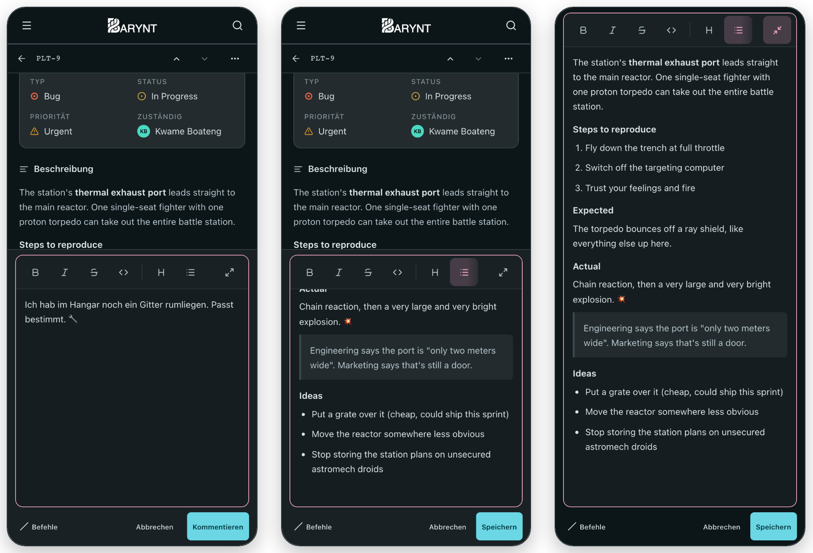
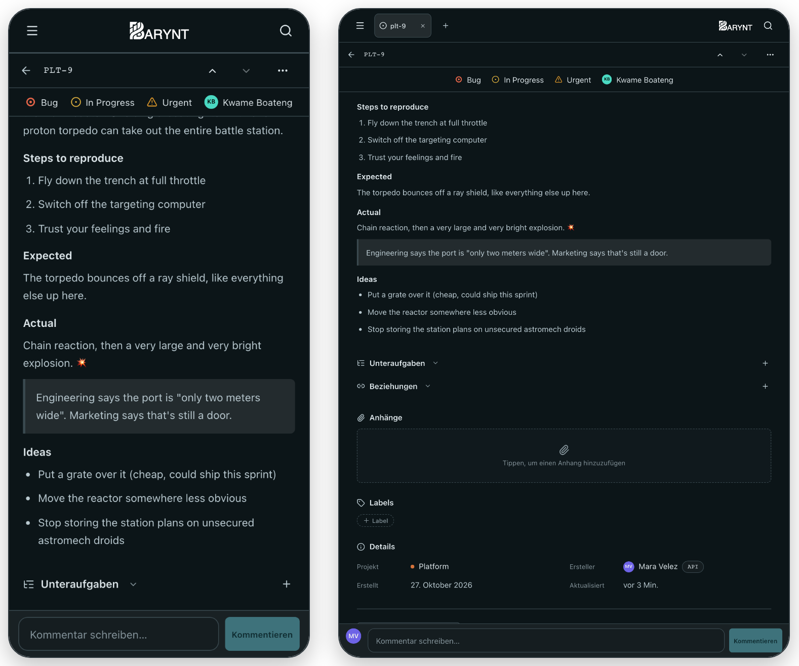

# Barynt 1.0.12

**Besser schreiben auf Handy und Tablet, Anhänge in API und MCP und Anmeldung mit jedem Anbieter.** Beschreibungen und Kommentare zu bearbeiten nimmt auf kleinen Bildschirmen nicht mehr den ganzen Bildschirm ein, die wichtigsten Felder eines Issues bleiben beim Scrollen sichtbar, und Integrationen können Anhänge endlich sehen, hinzufügen und entfernen.

## ✨ Highlights

- **Schreiben, ohne das Issue aus den Augen zu verlieren** – auf Handy und Tablet öffnet sich der Editor an Ort und Stelle, das Issue drumherum bleibt lesbar und scrollbar.
- **Vollbild, wenn du es willst** – ein Button ganz rechts in der Werkzeugleiste des Editors, auf jedem Gerät.
- **Die wichtigsten Felder immer zur Hand** – Typ, Status, Priorität und Zuständig begleiten dich beim Scrollen als schmale Leiste.
- **Anhänge in API und MCP** – mit Link zum Öffnen ansehen, Dateien und Links hinzufügen, entfernen.
- **Anmeldung mit jedem Anbieter** – jeder Anmelde-Anbieter, den Auth.js unterstützt, lässt sich über die Umgebung einschalten.

## ✍️ Schreiben auf Handy und Tablet

- **Der Editor bleibt in der Seite.** Beschreibung oder Kommentar zu bearbeiten füllt nicht mehr den ganzen Bildschirm. Das Feld wird etwas größer und hört bei der Hälfte des sichtbaren Platzes über der Tastatur auf – der Rest des Issues bleibt im Blick.
- **Neue Kommentare und Beschreibungen sitzen unten.** Tippst du auf die Kommentarzeile oder die Beschreibung, öffnet sich der Editor an einem festen Platz unter dem Issue, während du darüber weiterscrollst. Die Beschreibung, die du bearbeitest, bleibt an ihrer Stelle und zeigt schon beim Tippen, was du schreibst.
- **Immer nur ein Editor.** Während du einen Kommentar schreibst, lässt sich die Beschreibung nicht öffnen, und die Kommentarzeile macht Platz, solange die Beschreibung bearbeitet wird. Ein abgebrochener Kommentar behält seinen Entwurf.
- **Vollbild auf Knopfdruck.** Der letzte Button der Werkzeugleiste bringt den Editor auf die volle Bildschirmhöhe, zusammen mit Speichern, Abbrechen oder Kommentieren. Text, Cursor und Rückgängig-Verlauf bleiben dabei erhalten, in beide Richtungen.
- **Eine Werkzeugleiste, die ihre Größe behält.** Ein langer Text drückt die Werkzeugleiste nicht mehr zu einem schmalen Streifen zusammen.

## 📌 Wichtige Felder beim Scrollen

- **Eine zweite Leiste unter dem Header.** Im Seitenpanel und auf der Issue-Seite auf Handy und Tablet fahren Typ, Status, Priorität und Zuständig als schmale Leiste herein, sobald ihr Block aus dem Bild scrollt – und wieder heraus, wenn du zurückscrollst.
- **Weiter bearbeitbar.** Alle vier Werte lassen sich direkt in der Leiste ändern.
- **Passend zum Bildschirm.** Auf dem Tablet etwas größer, und mit „Bewegung reduzieren“ wird sie einfach eingeblendet.
- **Bündige Header.** Der Header des Seitenpanels schließt jetzt genau mit der Leiste daneben ab.

## 📎 Anhänge in API und MCP

- **Anhänge eines Issues sehen.** Ein einzelnes Issue listet jetzt seine Dateien und Links, jeweils mit einem Link zum Öffnen. Der Link einer Datei funktioniert eine Stunde lang ohne Token; für einen neuen ruf das Issue oder den Anhang erneut ab. Jedes Issue sagt außerdem, wie viele Anhänge es hat.
- **Dateien und Links hinzufügen.** Häng einen Link an, eine Datei bis 10 MB direkt oder eine Datei bis 100 MB über einen eigenen Upload-Schritt.
- **Entfernen** – eine Datei wird dabei auch aus dem Speicher gelöscht.
- **KI-Agenten können hineinschauen.** Über MCP kann ein Agent ein Bild oder eine Textdatei wie ein Log direkt öffnen, ohne Browser.
- **Dieselben Rechte wie in der App.** Anhänge sehen braucht Zugriff auf das Issue, hinzufügen oder entfernen das Recht, es zu bearbeiten. Bestehende API-Keys funktionieren unverändert, und jede Änderung erscheint im Verlauf des Issues.
- **Klare Fehler.** Eine abgelehnte Anfrage sagt jetzt, warum – etwa eine zu große Datei oder ein Link, der nicht http(s) ist.

## 🔐 Anmeldung und Self-Hosting

- **Jeder Anmelde-Anbieter.** Jeder OAuth-/OIDC-Anbieter, den Auth.js mitbringt (Discord, Slack, Keycloak, Okta, Auth0, ZITADEL und viele mehr), schaltet sich ein, sobald `AUTH_<ID>_ID` und `AUTH_<ID>_SECRET` gesetzt sind – bei selbst gehosteten zusätzlich `AUTH_<ID>_ISSUER`. Siehe `example.env`.
- **Identity Provider wechseln.** Ein Wechsel des IdP (z. B. authentik → Keycloak) hat bisher alle mit „Another account already exists with the same e-mail address“ ausgesperrt. Das neue, optionale `AUTH_OIDC_ALLOW_EMAIL_LINKING=true` (Helm: `auth.oidc.allowEmailLinking`) verknüpft den neuen Login mit dem bestehenden Konto derselben E-Mail. Schalte es nur ein, wenn dein IdP E-Mail-Adressen verlässlich prüft; es kann auch nur für die Umstellung an bleiben.

<!-- changes:start -->
### Neue Funktionen

- **api,mcp:** view, add and remove issue attachments ([`9464b86`](https://github.com/Jafoson/Barynt/commit/9464b86b791dc6a0d14ec5f3d517b7a6539678fe))
- **editor:** edit markdown in place on phone/tablet, with an optional full screen ([`1d01079`](https://github.com/Jafoson/Barynt/commit/1d010793fca489f3eae582a40efc869dfa026bfc))
- **issues:** pin type/status/priority/assignee under the header while scrolling ([`4a9e9c3`](https://github.com/Jafoson/Barynt/commit/4a9e9c3c1172b615b15345d09a39e66a17033560))
- **auth:** enable any Auth.js OAuth/OIDC provider through the env ([`77ec88e`](https://github.com/Jafoson/Barynt/commit/77ec88e6cb337e64da7df0a1b4250182aaf9e3fc))
- **auth:** opt-in email linking for the OIDC provider ([`47b79c8`](https://github.com/Jafoson/Barynt/commit/47b79c8057fa87bb5ce48f6b44430c6ec9f21470))

Wartung (2)

- **helm:** chart 1.0.12 ([`da7fd25`](https://github.com/Jafoson/Barynt/commit/da7fd2586e6dbfefdd8437f9ed3c6bbbde9b9043))
- **release:** notes and screenshots for 1.0.12 ([`cd61f4c`](https://github.com/Jafoson/Barynt/commit/cd61f4c6afc146ac7ad96537d43e05eb5b0f29ec))

**Vorherige Version:** [v1.0.11](https://github.com/Jafoson/Barynt/releases/tag/v1.0.11) · **Alle Änderungen:** [v1.0.11…v1.0.12](https://github.com/Jafoson/Barynt/compare/v1.0.11...v1.0.12)
<!-- changes:end -->
