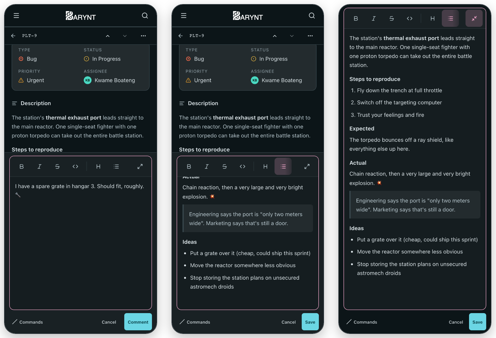
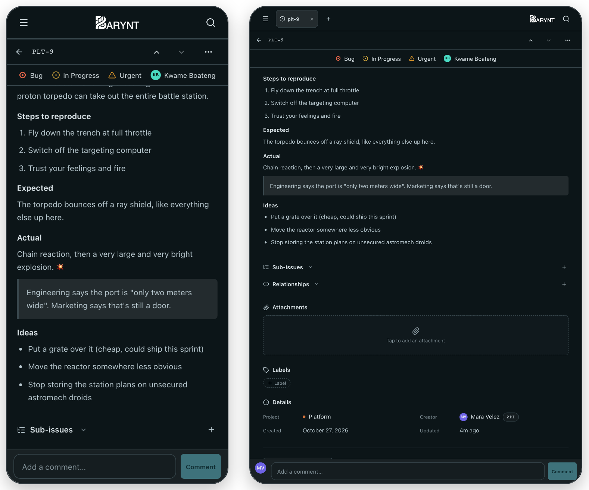

# Barynt 1.0.12

**Better writing on phones and tablets, attachments in the API and MCP, and sign-in with any provider.** Editing a description or a comment on a small screen no longer takes over the whole screen, an issue's key fields stay in view while you scroll, and integrations can finally see, add and remove attachments.

## ✨ Highlights

- **Write without losing the issue** — on phones and tablets the editor opens in place, and the issue stays readable and scrollable around it.
- **Full screen when you want it** — a button at the right end of the editor's toolbar, on every device.
- **Key fields always at hand** — type, status, priority and assignee follow you as a slim bar while you scroll.
- **Attachments in the API and MCP** — see them with a link to open each one, add files and links, remove them.
- **Sign in with any provider** — every sign-in provider Auth.js supports can be switched on from the environment.

## ✍️ Writing on phones and tablets

- **The editor stays in the page.** Editing a description or a comment no longer fills the whole screen. The field grows a little and stops at half of what's visible above the keyboard, so the rest of the issue stays in view.
- **New comments and descriptions sit at the bottom.** Tap the comment line or the description and the editor opens in a fixed spot below the issue, while you keep scrolling through it above. The description you're editing stays where it was and shows what you type as you type it.
- **One editor at a time.** While a comment is being written, the description can't be opened for editing, and the comment line steps aside while the description is being edited. A cancelled comment keeps its draft.
- **Full screen at the tap of a button.** The last button in the toolbar takes the editor to the full height of the screen, together with its Save, Cancel or Comment buttons. Text, cursor and undo history stay as they were, both ways.
- **A toolbar that keeps its size.** A long text no longer squeezes the toolbar down to a sliver.

## 📌 Key fields while you scroll

- **A second bar under the header.** In the side panel and on the issue page on phones and tablets, type, status, priority and assignee slide in as a slim bar as soon as their block scrolls out of view, and slide back out when you return.
- **Still editable.** Change any of the four right from the bar.
- **Sized for the screen.** A little larger on tablets, and with reduced motion it simply fades in.
- **Aligned headers.** The side panel's header now lines up exactly with the bar beside it.

## 📎 Attachments in the API and MCP

- **See an issue's attachments.** A single issue now lists its files and links, each with a link to open it. A file's link works without a token for an hour; fetch the issue or the attachment again for a fresh one. Every issue also says how many attachments it has.
- **Add files and links.** Attach a link, a file of up to 10 MB directly, or a file of up to 100 MB through a separate upload step.
- **Remove them** — a file is deleted from storage as well.
- **AI agents can look inside.** Over MCP, an agent can open an image or a text file such as a log directly, without a browser.
- **Same rights as in the app.** Seeing attachments needs access to the issue, adding or removing them needs the right to edit it. Existing API keys work as they are, and every change shows up in the issue's activity.
- **Clear errors.** A rejected request now says why, for example a file that's too large or a link that isn't http(s).

## 🔐 Sign-in and self-hosting

- **Any sign-in provider.** Every OAuth/OIDC provider Auth.js ships (Discord, Slack, Keycloak, Okta, Auth0, ZITADEL and many more) turns on as soon as its `AUTH_<ID>_ID` and `AUTH_<ID>_SECRET` are set, plus `AUTH_<ID>_ISSUER` for self-hosted ones. See `example.env`.
- **Switching identity providers.** Moving from one IdP to another (e.g. authentik → Keycloak) used to lock everyone out with "Another account already exists with the same e-mail address". The new, opt-in `AUTH_OIDC_ALLOW_EMAIL_LINKING=true` (Helm: `auth.oidc.allowEmailLinking`) links the new login to the existing account with the same email. Only turn it on if your IdP verifies email addresses reliably; it can stay on just for the move.
